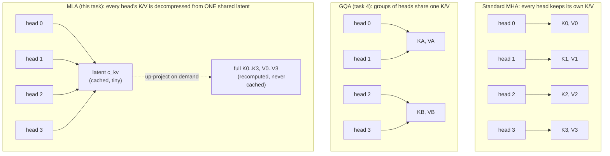
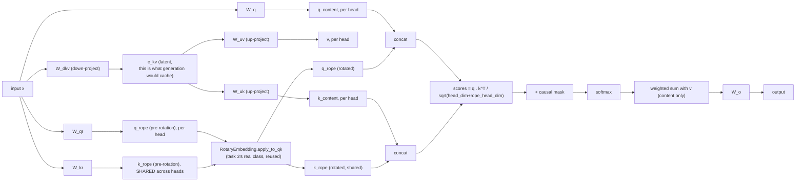

# 016 — Multi-Head Latent Attention (Task 16, stretch)

**Type:** task · **Date:** 2026-08-31 · **Related:** Requirement 12.4;
design.md `model/attention.py` component (`MLAAttention`)

> **Full by-hand derivation:** [`docs/math/016-mla-attention.md`](../docs/math/016-mla-attention.md)
> carries one concrete 3-token, 2-head, `head_dim=4`, `latent_dim=2`
> example through *every* line of `MLAAttention.forward_with_trace` — the
> `x → c_kv` compression, the per-head up-projection of K/V from that one
> shared latent, the full derivation of *why* the decoupled-RoPE split is
> forced (rotating the reconstructed key would entangle the position with
> the up-projection matrix), the `[content ; rope]` concat, and the
> mask/softmax/weighted-sum solved digit by digit — all checked against
> the real module by [`docs/math/verify_016_mla_attention.py`](../docs/math/verify_016_mla_attention.py).

## What was implemented
- **`qwenmoe/model/attention.py::MLAAttention`** — a simplified
  Multi-Head Latent Attention module (DeepSeek-V2/V3), selected via
  `ModelConfig(attention_variant="mla", mla_latent_dim=...)`. Exposes the
  exact same `forward(x, positions) -> Tensor` signature as `Attention`
  (task 4), so `TransformerBlock` and `build_attention` needed only a
  one-line change (constructing `MLAAttention` instead of raising the
  `NotImplementedError` placeholder task 4 left behind).
- A `kv_cache_elements_per_token` property reporting what generation would
  actually need to cache per token per layer — the compressed latent plus
  the shared decoupled-RoPE key — used directly by the test verifying
  Requirement 12.4's cache-size claim.
- **19 tests** in `tests/test_mla.py`: output-shape parity with `Attention`,
  causal masking (mirrors task 4's test), gradient flow through every
  projection, behavior across several `mla_latent_dim` values, a
  fail-clearly test for an incompatible `head_dim`, and — the two the task
  explicitly asked for — shape parity and a real KV-cache-size comparison
  against equivalent GQA. One task-15-style placeholder test in
  `tests/test_model.py` (`test_transformer_block_mla_not_yet_implemented`)
  was replaced with a real assertion that `TransformerBlock` now works
  end-to-end with `attention_variant="mla"`.

## Why this exists: the KV cache problem, briefly recapped

Task 4's journal entry already explained Grouped-Query Attention (GQA) as
one answer to an inference-time memory problem: during autoregressive
generation, a transformer must remember every previous token's **key** and
**value** vectors (the "KV cache") to avoid recomputing them at every new
step. GQA shrinks this cache by having several query heads share one
key/value head. MLA (DeepSeek-V2, Liu et al. 2024) attacks the *same*
problem from a different angle, and — per the paper's own ablations — does
it while matching or *beating* standard multi-head attention's quality,
not just trading quality for a smaller cache like GQA/MQA do.

## Concepts explained for a complete beginner

### Low-rank compression / a latent vector
- **What it means:** instead of storing a large vector directly, store a
  much smaller vector that can be expanded back into something
  *approximately* as useful via a fixed transformation. The small vector is
  the "latent" (hidden/compressed) representation.
- **Why it exists:** many real vectors don't actually need every one of
  their dimensions to carry independent information — a lot of the
  "shape" of a big vector can be reconstructed from far fewer numbers, the
  same reason a JPEG can compress a photo without keeping every raw pixel.
- **Analogy:** a zip-compressed file — you don't keep the original
  uncompressed bytes around; you keep a smaller compressed file and
  *decompress* it back to full size only when you actually need to read it.
- **Simple technical explanation:** a "down-projection" matrix
  $W^{DKV}\in\mathbb{R}^{d_c\times d}$ maps a full-size vector
  $h_t\in\mathbb{R}^{d}$ down to a latent $c_t^{KV}=W^{DKV}h_t\in\mathbb{R}^{d_c}$
  with $d_c\ll d$; separate "up-projection" matrices $W^{UK},W^{UV}$ map
  that same small latent back up to full-size keys/values whenever they're
  needed for an attention computation.
- **How it relates here:** `MLAAttention.w_dkv` compresses the block's
  input into `c_kv` (dim `mla_latent_dim`); `w_uk`/`w_uv` separately
  up-project that *one shared* `c_kv` into a full-size key and value **for
  every head** — only `c_kv` itself would need to be cached during real
  generation, not the up-projected per-head K/V.

### Decoupled Rotary Position Embedding (why RoPE needed a fix for this)
- **What it means:** rather than rotating the *entire* key/query vector to
  encode position (as plain RoPE does, task 3), carve out one small *extra*
  slice of the vector whose only job is carrying rotated positional
  information, and leave the rest of the vector ("content") unrotated.
- **Why it exists:** RoPE's rotation angle depends on a token's *absolute
  position*, which changes every time a new token is generated. If the
  up-projected key $k_t^C=W^{UK}c_t^{KV}$ were rotated directly, the
  up-projection matrix $W^{UK}$ would become entangled with a
  position-dependent rotation matrix, and — because matrix multiplication
  order matters — that entanglement would force recomputing every past
  token's key from scratch at every generation step, defeating the entire
  point of caching a small latent. Keeping a small *separate*
  never-compressed slice for position information sidesteps this entirely.
- **Analogy:** like keeping a book's content (chapters, unchanging once
  written) separate from a removable sticky-note bookmark (says "you are
  here", updates constantly) — mixing the bookmark's information *into*
  the permanent text would mean re-printing the whole book every time you
  moved the bookmark.
- **Simple technical explanation:** an extra small linear layer produces a
  per-head query slice $q_{t,i}^R\in\mathbb{R}^{d_h^R}$ (`w_qr`, this
  project) and *one* slice shared by every head for the key,
  $k_t^R\in\mathbb{R}^{d_h^R}$ (`w_kr`) — both get the *same* RoPE rotation
  task 3 already implements, then each head's final query/key is the
  concatenation of its content half and its rotated positional half:
  $q_{t,i}=[q_{t,i}^C;\,q_{t,i}^R]$, $k_{t,i}=[k_{t,i}^C;\,k_t^R]$.
- **How it relates here:** `MLAAttention` reuses task 3's real, tested
  `RotaryEmbedding` class directly for this small slice — no new RoPE math
  was written, only a smaller `head_dim` (`rope_head_dim = head_dim // 2`,
  matching DeepSeek-V2's own choice of $d_h^R=d_h/2$) was passed into it.
  Because only *one* copy of $k_t^R$ (not one per head) ever needs
  remembering, this project's `kv_cache_elements_per_token` counts
  `mla_latent_dim + rope_head_dim`, not `mla_latent_dim + n_heads *
  rope_head_dim`.
- **Paper:** [DeepSeek-V2: A Strong, Economical, and Efficient
  Mixture-of-Experts Language Model (DeepSeek-AI, 2024)](https://arxiv.org/abs/2405.04434)
  — §2.1.2 (low-rank KV compression, Eq. 9-11) and §2.1.3 (decoupled RoPE,
  Eq. 14-17); reused unchanged in [DeepSeek-V3 (DeepSeek-AI,
  2024)](https://arxiv.org/abs/2412.19437), matching design.md's "per
  DeepSeek-V2/V3" phrasing.
- **Blog:** [On MLA — planetbanatt.net](https://planetbanatt.net/articles/mla.html)

## What this project's "simplified" MLA leaves out
The real DeepSeek-V2 also low-rank-compresses the **query** side
($c_t^Q=W^{DQ}h_t$, then $q_t^C=W^{UQ}c_t^Q$) — but that compression only
reduces *training activation memory*, not the inference-time KV cache this
task is actually demonstrating, so `MLAAttention.w_q` here projects
queries directly from the block's input instead, matching Requirement
12.4's own "simplified" wording. Also out of scope, and not needed for a
CPU-only toy project: the paper's "matrix absorption" trick (folding
$W^{UK}$ into $W^Q$ and $W^{UV}$ into $W^O$ so the up-projected K/V are
*never materialized* at all during real generation) and YaRN long-context
extension for the decoupled key. This project also has no KV-cache code
at all anywhere (`generate()`, task 11, re-runs the full forward every
step) — `kv_cache_elements_per_token` is a *reporting* property only, the
same "visualization/analysis-only" spirit as task 14's imbalance-ratio
metric, not a claim that this project actually caches anything smaller at
runtime.

## Full derivation and a worked numeric example

**Setup:** 1 head (so `head_dim` = `d_model` = 4), `rope_head_dim = 2`,
`mla_latent_dim = 2`, 2 tokens. Hand-picked weights (chosen simple enough
to multiply by hand, then verified by actually running them through the
real `MLAAttention` module):

$$W^{DKV}=\begin{pmatrix}1&0&0&0\\0&1&0&0\end{pmatrix},\quad
W^{UK}=\begin{pmatrix}1&0\\0&1\\1&1\\1&-1\end{pmatrix},\quad
W^{UV}=\begin{pmatrix}1&1\\1&-1\\0&1\\1&0\end{pmatrix},\quad
W_Q=I_4$$
$$W^{QR}=\begin{pmatrix}1&0&0&0\\0&1&0&0\end{pmatrix},\quad
W^{KR}=\begin{pmatrix}1&1&0&0\\1&-1&0&0\end{pmatrix},\quad
W_O=I_4$$

Input tokens $x_0=[1,0,0,0]$, $x_1=[0,1,0,0]$.

**Step 1 — compress once, up-project per head/token.**
$c_0^{KV}=W^{DKV}x_0=[1,0]$, $c_1^{KV}=W^{DKV}x_1=[0,1]$.
$k_0^C=W^{UK}c_0^{KV}=[1,0,1,1]$, $k_1^C=W^{UK}c_1^{KV}=[0,1,1,-1]$.
$v_0=W^{UV}c_0^{KV}=[1,1,0,1]$, $v_1=W^{UV}c_1^{KV}=[1,-1,1,0]$.

**Step 2 — plain query content.** $q_0^C=W_Q x_0=[1,0,0,0]$,
$q_1^C=W_Q x_1=[0,1,0,0]$ (identity $W_Q$, so this just copies $x$).

**Step 3 — decoupled RoPE slice, pre-rotation.**
$q_0^{R,\text{pre}}=W^{QR}x_0=[1,0]$, $q_1^{R,\text{pre}}=W^{QR}x_1=[0,1]$.
$k_0^{R,\text{pre}}=W^{KR}x_0=[1,1]$, $k_1^{R,\text{pre}}=W^{KR}x_1=[1,-1]$.

**Step 4 — rotate.** `rope_head_dim=2` means exactly one frequency:
$\theta_0=\text{rope\_theta}^{-0/2}=1$ exactly (task 13's entry already
noted `inv_freq[0]==1.0` always) — so position $p$'s angle is just $p$
radians. Position 0's angle is 0 (cos=1, sin=0): rotation is the identity,
so $q_0^R=q_0^{R,\text{pre}}=[1,0]$ and $k_0^R=k_0^{R,\text{pre}}=[1,1]$
unchanged. Position 1's angle is $1$ rad ($\cos 1=0.540302$,
$\sin 1=0.841471$); using the rotate-half formula
$\text{rot}([a,b])=[-b,a]$:
$$q_1^R=[0,1]\cdot 0.540302+[-1,0]\cdot 0.841471=[-0.841471,\ 0.540302]$$
$$k_1^R=[1,-1]\cdot 0.540302+[1,1]\cdot 0.841471=[1.381773,\ 0.301169]$$

**Step 5 — concatenate content + rope, per token.**
$q_0=[1,0,0,0,1,0]$, $q_1=[0,1,0,0,-0.841471,0.540302]$,
$k_0=[1,0,1,1,1,1]$, $k_1=[0,1,1,-1,1.381773,0.301169]$ (dim
$4+2=6=$ `head_dim + rope_head_dim`).

**Step 6 — scores, scaled by $\sqrt{6}=2.449490$.**
$q_0\cdot k_0=2.0$ (token 0 is only ever compared to itself, since it's
the first token — causally masked from seeing token 1 regardless).
$q_1\cdot k_0=-0.301169$ (only the rope part contributes:
$-0.841471{\times}1+0.540302{\times}1=-0.301169$; the content part is 0
since $q_1^C\cdot k_0^C=[0,1,0,0]\cdot[1,0,1,1]=0$).
$q_1\cdot k_1=0.0$ **exactly** — worth pausing on why: $q_1$ and $k_1$'s
rope parts are rotated by the *same* angle (both are position 1), and
rotating two vectors by the same angle is an orthogonal transform that
exactly preserves their dot product, so $q_1^R\cdot k_1^R=q_1^{R,\text{pre}}\cdot
k_1^{R,\text{pre}}=[0,1]\cdot[1,-1]=-1$ regardless of the actual rotation
angle — and the content part is $q_1^C\cdot k_1^C=[0,1,0,0]\cdot[0,1,1,-1]=1$,
so the two terms cancel to exactly $0$. Scaled: $q_0\cdot
k_0/\sqrt6=0.816497$, $q_1\cdot k_0/\sqrt6=-0.122952$, $q_1\cdot
k_1/\sqrt6=0.0$.

**Step 7 — causal mask + softmax + weighted sum of V.** Token 0 can only
see itself, so its softmax is trivially $[1]$ and its output is exactly
$v_0=[1,1,0,1]$ (note: **the output only ever uses the content $v$, never
the rope slice** — confirming the rope dimensions exist purely to shape
the *attention weights*, not the values being combined). Token 1's
unmasked scores are $[-0.122952,\ 0.0]$; softmax gives
$[0.469301,\ 0.530699]$; its output is
$0.469301{\times}[1,1,0,1]+0.530699{\times}[1,-1,1,0]=[1.0,\ -0.061398,\
0.530699,\ 0.469301]$.

**Verification:** every one of these hand-computed numbers was cross-checked
by setting these exact weight matrices on a real `MLAAttention` instance
and reading off its actual intermediate tensors and final output — they
matched to full floating-point precision.

## Real measured numbers from this project's actual presets

|            | `head_dim` | `n_kv_heads` | GQA cache/token/layer | MLA cache/token/layer (latent=head_dim) | MLA attn params | GQA attn params |
|------------|-----------:|-------------:|-----------------------:|------------------------------------------:|-----------------:|------------------:|
| SMOKE_TEST |         16 |            2 |               64 elements |              24 elements (**37.5%** of GQA) |           13,824 |             12,288 |
| BASELINE   |         32 |            4 |              256 elements |              48 elements (**18.8%** of GQA) |          192,512 |            196,608 |

Both measured directly (not fabricated) by constructing real `Attention`/
`MLAAttention` modules from `configs/presets.py`'s real `SMOKE_TEST`/
`BASELINE` configs. Two things worth noting: (1) MLA's cache advantage
*grows* as `n_kv_heads` grows (BASELINE's 4 kv-heads make GQA's cache 4x
bigger, while MLA's latent stays the same size) — matching the paper's
own point that MLA's relative advantage compounds at larger scale; (2)
whether MLA has *more* or *fewer* raw parameters than GQA isn't fixed
either way — it depends on the specific `mla_latent_dim`/`n_kv_heads`
chosen (slightly more for SMOKE_TEST, slightly fewer for BASELINE here) —
parameter count was never the point; cache size is.

A real forward+backward pass through a full `QwenMoEModel(attention_variant=
"mla")` (both SMOKE_TEST- and BASELINE-shaped) confirms gradients reach
every MLA projection correctly. One initial surprise while checking this
— a handful of `moe.routed_experts.*` parameters showed no gradient on the
first BASELINE run — turned out to be the *exact same* pre-existing MoE
zero-token-expert behavior (Requirement 2.5, task 5) reproduced identically
when swapping back to `attention_variant="gqa"` on the same seed/batch, not
an MLA bug: with only 24 tokens spread over 8 routed experts at top-2, some
expert in some layer occasionally receives zero tokens by chance and is
simply skipped for that step.

## Diagrams

`MLAAttention.forward`'s full data flow:

## Questions that might come to mind
- **Why does only the key get ONE shared decoupled slice, while queries get
  their own per-head slice?** Because the key only needs to be *compared
  against* by every query head — one shared positional "signature" per
  token is enough information for all of them to use identically — while
  each query head separately decides *how much* to weight that
  information, which does need to vary per head.
- **Does this project's `MLAAttention` actually make generation faster on
  this machine?** No — `qwenmoe/model/generate.py` (task 11) has no KV
  cache at all for either attention variant, so `kv_cache_elements_per_token`
  is a reporting/comparison number only, not a measured wall-clock speedup.
  It reflects what a real inference server *would* need to store, per
  Requirement 12.4's own framing.
- **Why require `head_dim` divisible by 4 instead of just 2 (RoPE's own
  requirement)?** `rope_head_dim = head_dim // 2` itself has to be even
  for task 3's `RotaryEmbedding` to rotate it at all (it pairs up
  dimensions) — `head_dim` divisible by 4 is exactly the condition that
  guarantees `head_dim // 2` comes out even.
- **Could `MLAAttention` be visualized with the existing task 12-14 Manim
  pipeline?** Not without changes: `LayerTrace.k`/`v` are typed and shaped
  for GQA's `n_kv_heads`, and `MLAAttention` has no `forward_with_trace`
  method at all — `TransformerBlock.forward_with_trace` would raise
  `AttributeError` if ever called on an MLA-configured block. This is a
  deliberate, documented scope limit (task 16's checklist asks only for
  the module and `tests/test_mla.py`, not tracing), not an oversight — no
  formal Manim scene ever loads an MLA checkpoint, since every one of them
  sources real numbers from the SMOKE_TEST checkpoint (GQA + RoPE).
- **Was a new ablation preset (like task 15's `POS_NOPE`/`MOE_LOSSFREE`)
  added so `scripts/run_comparison.py` could compare attention variants
  too?** Considered and deliberately not done — task 15 added presets
  because *that task's own deliverable* (the comparison CLI) had nothing
  real to compare without them; task 16 has no CLI deliverable of its own,
  so adding one here would be unrequested scope creep rather than
  something the task actually needs to be complete.

## Outcome
`uv run pytest -q` — 211 passed (192 from tasks 1-15 plus 19 new in
`tests/test_mla.py`; `tests/test_model.py`'s task-4-era placeholder test
was replaced in place with a real assertion, same count). Task 16 checked
off.
