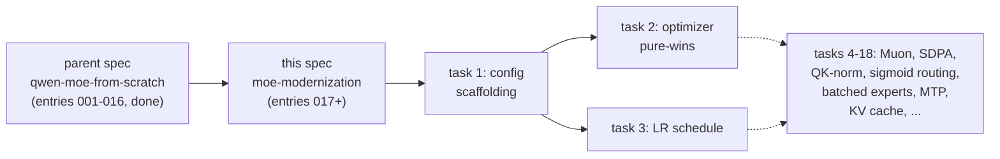

# 017 — MoE Modernization spec approved, starting implementation

**Type:** decision · **Date:** 2026-09-01 · **Related:** new spec
`.kiro/specs/moe-modernization/` (`requirements.md`, `design.md`,
`tasks.md`); parent spec `.kiro/specs/qwen-moe-from-scratch/`

## What this entry covers
The `qwen-moe-from-scratch` spec (entries 001–016) is feature-complete
through its stretch goal (MLA). This entry starts a **second spec**,
`moe-modernization`, that doesn't add new architecture axes so much as
bring the existing ones up to 2024–2026 published practice — Muon,
DeepSeek-V3-style routing, QK-norm, a KV cache, multi-token prediction, and
a more defensible ablation methodology. It was written the same way the
parent spec was: a `requirements.md` (EARS-style acceptance criteria) →
`design.md` (components/interfaces) → `tasks.md` (numbered implementation
plan) sequence, on a dedicated branch (`moe-modernization`) so `main`/
`model-development` stay untouched.

## Idea considered: rewrite vs. incremental modernization
**Considered:** starting a fresh package for the "modern" architecture,
keeping the parent spec's implementation as a frozen reference.
**Rejected:** the parent codebase is correct, well-tested (213 passing
tests going in), and dependency-minimal — there's no defect driving a
rewrite, only a gap against newer published techniques. A rewrite would
also orphan every `journey_of_a_model` entry's worked examples and the
`forward_with_trace` visualization pipeline (Manim scenes at the time, later removed), which is the project's
actual pedagogical core. **Decision:** incremental modernization, staged so
every change is one of three kinds (see `requirements.md`'s Introduction):
a **pure win** (changes the default path directly — e.g. fused attention,
tuned AdamW constants), a **new axis** (opt-in, defaults to today's
behavior, becomes a `run_comparison` variant), or a **methodology upgrade**
(how the study itself is run). This mirrors the parent spec's own "config
value, not a code fork" philosophy (design.md, Overview) rather than
abandoning it.

## Idea considered: which techniques make the cut
Not every technique surveyed made it into `requirements.md`. Kept: Muon,
tuned AdamW, gradient clipping, WSD scheduling, bf16 + output z-loss,
sigmoid MoE routing + router z-loss + the loss-free complementary balance
loss, batched expert computation, multi-token prediction, fused SDPA
attention + QK-norm, a real KV cache, principled init, document-boundary
masking, min-p sampling, and multi-seed/param-matched ablation reporting.
Deliberately deferred (noted in `design.md`'s Key decisions, not forgotten):
self-speculative decoding via the MTP head (needs the KV cache landed
first), µP-style hyperparameter transfer, and hybrid local/global
attention — each is a bigger lift than this spec's other items and doesn't
block anything else in the list.

## Journal convention carries over unchanged
Per the parent journal's own index (`journey_of_a_model/README.md`) and
`design.md`'s "Development Journal Convention" section: **every completed
task gets a dated entry before it counts as done** — beginner-friendly
(every term defined before use: plain-English meaning, why it exists, an
analogy, the technical explanation, how it connects to this project), at
least one Mermaid diagram, a "Questions that might come to mind" section,
the full derivation of any formula (exact math clearly separated from any
empirically-fitted constant) plus a worked numeric example by hand, and a
link to the source paper found via web search. `moe-modernization/
requirements.md` Requirement 13 restates this verbatim as its own
acceptance criterion rather than assuming it carries over implicitly.
Numbering continues this journal's sequence (017 = this entry; entries 018+
cover the tasks below).

## What's implemented so far (tasks 1–3 of `moe-modernization/tasks.md`)
- **Task 1 — config scaffolding**: every new `ModelConfig`/`TrainConfig`/
  `DataConfig` field this spec will use, all defaulting to today's exact
  behavior, with `__post_init__` validation. See `018-optimizer-
  hardening.md` and `019-lr-schedule-wsd.md` for the fields actually wired
  up to behavior so far.
- **Task 2 — optimizer pure-wins**: weight-decay/no-decay parameter groups,
  tuned AdamW constants, gradient-norm clipping. Own entry: `018-optimizer-
  hardening.md`.
- **Task 3 — LR schedule**: a configurable decay floor and an opt-in WSD
  (Warmup-Stable-Decay) schedule alongside the existing cosine one. Own
  entry: `019-lr-schedule-wsd.md`.

## Outcome
Branch `moe-modernization` created off `model-development`. Spec approved
and written (`requirements.md`, `design.md`, `tasks.md`). `uv run pytest -q`
— 213 passing tests going in; see the per-task entries below for the count
after each.
