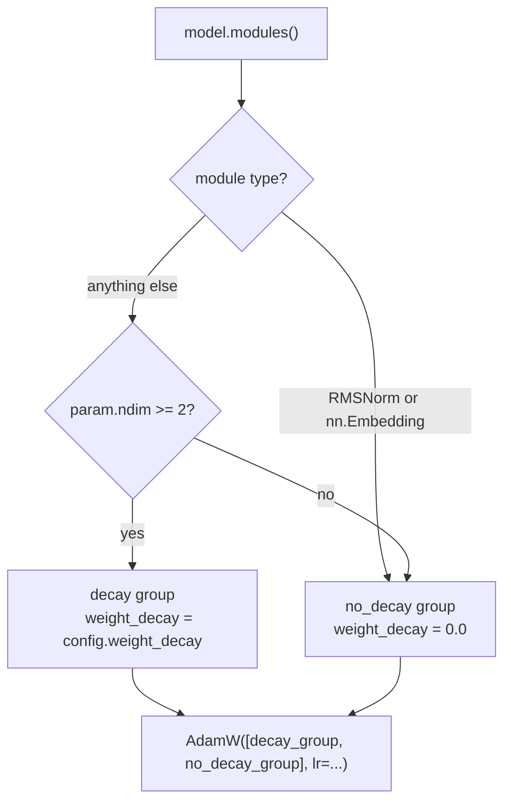
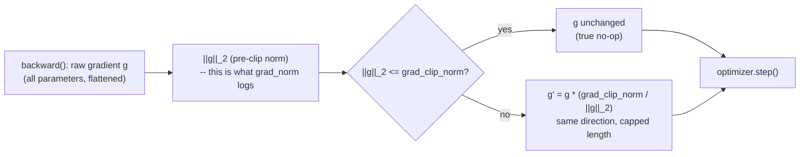

# 018 — Optimizer hardening: param groups, tuned AdamW, gradient clipping (Task 2)

**Type:** task · **Date:** 2026-09-01 · **Related:** `moe-modernization`
Requirement 1.1-1.3; `design.md` `train/optim.py` component; builds on
entry 010's AdamW/cosine-schedule introduction

> **Full by-hand derivation:** [`docs/math/018-optimizer-hardening.md`](../docs/math/018-optimizer-hardening.md)
> walks `split_param_groups` over `model.modules()` parameter by parameter
> (the `recurse=False` fetch, the `id()` dedup, the "no_decay if
> `RMSNorm`/`nn.Embedding` module **or** `ndim < 2`, else decay" rule),
> gives the 22 / 256 vs 6 / 44 counts and the tied-vs-untied `lm_head`
> cases, then the global gradient 2-norm as the quadrature sum
> `√(Σ‖g_p‖²) = √10.383615 = 3.222362` (the six zero-token expert matrices
> contributing 0), the exact clipping algebra, the decoupled `θ(1−γλ)`
> term, and — from first principles — `β₂`'s effective averaging window
> (`(1−β₂)β₂ᵏ` weights → mean lag `β₂/(1−β₂)` = 19 vs 999, `1/e` length
> `−1/ln β₂` and its Taylor `1/(1−β₂)` = 20 vs 1000, a regime-change
> experiment) and `weight_decay`'s compounding pull `(1−γλ)^S` (26% vs 3%
> over 10k steps) — every number checked against the real code by
> [`docs/math/verify_018_optimizer_hardening.py`](../docs/math/verify_018_optimizer_hardening.py).

## What was implemented
- **`qwenmoe/train/optim.py`** (new): `split_param_groups(model) ->
  (decay, no_decay)` and `build_optimizer(model, config) -> Optimizer`.
- **`qwenmoe/config.py`**: `TrainConfig` gained `optimizer` (`"adamw"` for
  now), `betas` (default `(0.9, 0.95)`, was PyTorch's `(0.9, 0.999)`),
  `adam_eps` (`1e-8`), `weight_decay` (default `0.1`, was `0.01`),
  `grad_clip_norm` (`1.0`), plus two fields task 4 will use
  (`muon_lr`, `muon_momentum`), all validated in `__post_init__`.
- **`qwenmoe/train/trainer.py`**: `Trainer.fit` now calls `build_optimizer`
  instead of constructing `AdamW` directly; `_forward_backward_step` clips
  the global gradient norm (`torch.nn.utils.clip_grad_norm_`) between
  `backward()` and `optimizer.step()` and returns the **pre-clip** norm;
  the JSON-lines step-log record gained a `grad_norm` key.
- **Tests**: `tests/test_optim.py` (new, 8 tests) + 1 new trainer-
  integration test (`test_trainer_logs_grad_norm`) + modernization-default
  cases in `tests/test_config.py` (folded into task 1's additions).
- `uv run pytest -q` — **249 passed** (was 236 after task 1's config
  scaffolding, 213 before this spec started).

This entry documents two independent ideas — **which parameters get weight
decay**, and **why the AdamW/clipping constants changed** — since both are
real technical content, not just plumbing.

## Concepts explained for a complete beginner

### Weight decay, and why *which* parameters get it matters
- **What it means:** weight decay is a small, constant pull on every
  parameter toward zero, applied every optimizer step regardless of what
  the gradient says. Entry 010 already introduced AdamW's *decoupled*
  version of this (the $\lambda\theta$ term added directly to the update,
  not mixed into the gradient's own running averages) — this entry is
  about a different question: decoupled or not, should **every** parameter
  get it?
- **Why it exists:** pulling weights toward zero discourages a model from
  relying on any single large weight too heavily, which tends to improve
  generalization (the model doesn't overfit to memorizing training-set
  quirks via a few oversized weights).
- **Why *not* every parameter, though:** a weight *matrix* (e.g. an
  attention projection) has many redundant paths — shrinking any one entry
  slightly barely changes what the layer computes overall, so decay's
  regularizing pressure lands harmlessly. A `RMSNorm` **gain** is different:
  it's a single learned multiplier that rescales an entire normalized
  activation, and it started training already properly scaled (`RMSNorm`
  initializes it to exactly `1.0`, task 3). Pulling it toward `0` doesn't
  regularize anything — it directly fights the norm's whole job (undoing
  the `variance -> 1` rescaling task 3 built). A **token embedding row** is
  even more direct: it *is* the model's entire learned representation of
  that token; decaying it toward zero doesn't discourage over-reliance on
  redundant paths, it erodes the token's meaning.
- **Analogy:** decaying an attention weight matrix is like slightly
  reducing the volume on one of a hundred backup singers — barely
  noticeable, and it discourages any one voice from dominating. Decaying an
  RMSNorm gain is like slightly turning down the venue's *master* volume
  knob for no reason related to any singer's performance; decaying an
  embedding row is like slightly erasing a word's dictionary definition
  every single day.
- **Simple technical explanation:** `split_param_groups` classifies every
  parameter by *which module it belongs to*, not just its shape — an
  `RMSNorm`'s or `nn.Embedding`'s parameters always land in `no_decay`,
  everything else with `ndim >= 2` (a weight matrix: attention/expert/
  router projections) lands in `decay`, and any remaining 1-D tensor also
  lands in `no_decay`. Module-type, not just `ndim`, matters here because
  an embedding table *is* 2-D (`vocab_size x d_model`) — indistinguishable
  from a weight matrix by shape alone.
- **How it relates here:** `build_optimizer` passes these as two AdamW
  parameter groups, `weight_decay=config.weight_decay` (decay group) and
  `weight_decay=0.0` (no-decay group). A tied embedding
  (`tie_word_embeddings=True`, the default) is deduplicated by object
  identity and always lands in `no_decay`, since `QwenMoEModel.__init__`
  registers `embedding` (an `nn.Embedding`) before `lm_head` (an
  `nn.Linear` that merely *points at* the same tensor) — see the "why
  identity, not module type, breaks the tie" question below.
- **Papers:** [Decoupled Weight Decay Regularization (Loshchilov & Hutter,
  2019)](https://arxiv.org/abs/1711.05101) for decoupled decay itself
  (already cited in entry 010); the "exclude norms and embeddings"
  convention is standard practice across GPT-3 (Brown et al., 2020),
  PaLM (Chowdhery et al., 2022), and nanoGPT's own `configure_optimizers`
  (Karpathy) rather than tracing to one originating paper.

**Real measured numbers** (this project's actual `SMOKE_TEST` preset,
`split_param_groups` run on a real constructed model, not fabricated):

| group | tensors | parameters | example shapes |
|---|---:|---:|---|
| `decay` | 40 | 270,848 | attention/expert/router weight matrices |
| `no_decay` | 6 | 4,480 | one `(65, 64)` embedding + five `(64,)` RMSNorm gains |
| **total** | 46 | **275,328** | matches `model.parameters()` exactly |



### Adam's β₂: why 0.999 → 0.95 for language models
- **What it means:** AdamW's $v_t$ (entry 010's "running average of recent
  *squared* gradients") is an exponential moving average with decay rate
  $\beta_2$: $v_t = \beta_2 v_{t-1} + (1-\beta_2)g_t^2$. Larger $\beta_2$
  means the average remembers gradients from further in the past.
- **Why it exists / why change it:** the *effective window* this average
  covers is $N_{\text{eff}} \approx \dfrac{1}{1-\beta_2}$ steps (exact for
  the geometric-series weight; see derivation below). Language-model
  gradients are highly non-stationary — a batch of dialogue looks
  statistically different from a batch of code, and MoE routing changes
  which experts even *receive* a gradient from step to step (task 5's
  "zero tokens this batch" skip). A window that's too long lets $v_t$ chase
  gradient statistics from hundreds of steps ago that no longer describe
  the current batch, understating the *true* current variance and letting
  AdamW take an overconfident, too-large step — a common contributor to
  mid-training loss spikes.
- **Analogy:** judging today's weather from a 1000-day running average
  (β₂=0.999) versus a 20-day one (β₂=0.95) — the short average reacts to
  an actual regime change (a new season, or here a shift in what kind of
  data/routing pattern recent batches show); the long one keeps insisting
  it's still summer weeks into autumn.
- **Simple technical explanation / derivation:** the weight on the
  gradient from $k$ steps ago is $(1-\beta_2)\beta_2^{k}$ — a geometric
  sequence. Its "characteristic decay length" (steps until the weight
  drops to $1/e$ of its peak) solves $\beta_2^{N} = 1/e \Rightarrow N =
  \dfrac{-1}{\ln \beta_2}$, and for $\beta_2$ close to 1, a first-order
  Taylor expansion of $\ln\beta_2 \approx -(1-\beta_2)$ gives the standard
  approximation $N_{\text{eff}} \approx \dfrac{1}{1-\beta_2}$ (exact in the
  $\beta_2 \to 1$ limit; the Taylor step is the approximation, not the
  geometric-series algebra before it).
- **How it relates here:** `TrainConfig.betas` defaults to `(0.9, 0.95)`
  (was `(0.9, 0.999)`); `betas[0]` (momentum) is unchanged.
- **Papers:** [Adam (Kingma & Ba, 2015)](https://arxiv.org/abs/1412.6980)
  for $\beta_2$ itself; $\beta_2=0.95$ specifically matches the recipe used
  by GPT-3 (Brown et al., 2020, Appendix B) and carried forward by most
  open LLM-pretraining configs since (e.g. OLMo, Groeneveld et al. 2024).

**Worked numeric example** — effective averaging window for both settings:
$$N_{\text{eff}}(\beta_2=0.999) \approx \frac{1}{1-0.999} = 1000 \text{ steps}, \qquad N_{\text{eff}}(\beta_2=0.95) \approx \frac{1}{1-0.95} = 20 \text{ steps}$$
A 50x shorter memory — at this project's batch size, the difference
between "remembers roughly the last ~1000 batches" and "remembers roughly
the last ~20 batches" of squared-gradient statistics.

### Gradient-norm clipping
- **What it means:** before the optimizer uses the gradient, rescale the
  *entire* gradient vector (concatenated across every parameter) so its
  overall length (L2 norm) never exceeds a fixed ceiling `grad_clip_norm`,
  while preserving its *direction* exactly.
- **Why it exists:** an occasional unusually "surprising" batch (e.g. MoE
  routing dumping far more tokens than usual onto one expert) can produce a
  gradient far larger than typical, and AdamW's adaptive step size doesn't
  fully protect against that — a single huge update can knock the model
  into a much worse region of parameter space, sometimes catastrophically
  (a visible loss spike, occasionally one it never recovers from).
  Clipping caps the worst case without touching the vast majority of
  perfectly normal steps.
- **Analogy:** a car's speed limiter — it doesn't change *which direction*
  you're driving, it just prevents any single moment of extra throttle from
  exceeding a safe top speed.
- **Simple technical explanation / exact derivation:** let $g$ be the
  gradient (all parameters flattened into one vector) and $c$ =
  `grad_clip_norm`. The clipped gradient is
  $$g' = g \cdot \min\!\left(1, \frac{c}{\lVert g \rVert_2}\right)$$
  If $\lVert g\rVert_2 \le c$ already, the scale factor is exactly $1$ (a
  true no-op, not an approximation) — clipping only ever *shrinks*, never
  grows, a gradient, and always along the same direction (a positive
  scalar multiple). This is exact algebra given that definition; nothing
  here is an empirically-fitted constant except $c$ itself, which is a
  hyperparameter (this project's default `1.0`, the common LLM-pretraining
  default).
- **How it relates here:** `torch.nn.utils.clip_grad_norm_(model.
  parameters(), grad_clip_norm)` runs between `backward()` and `optimizer.
  step()`; it returns $\lVert g\rVert_2$ **before** rescaling (the
  *pre-clip* norm — PyTorch's own documented return value), which is
  exactly the training-health signal Requirement 1.3 asks to log: a
  logged norm consistently near or above `grad_clip_norm` means clipping
  is actively engaging that run, not just standing by as insurance.
- **Paper:** [On the difficulty of training Recurrent Neural Networks
  (Pascanu, Mikolov & Bengio, 2013)](https://arxiv.org/abs/1211.5063) —
  the paper that introduced norm-based gradient clipping (originally for
  RNN exploding gradients; the same failure mode shows up in deep
  transformers under noisy per-step statistics).

**Worked numeric example** (hand-computed, $c=1.0$, a toy 2-parameter
gradient $g=(3, 4)$, so $\lVert g\rVert_2 = \sqrt{3^2+4^2}=5$):
$$g' = (3,4)\cdot\min\!\left(1,\ \frac{1.0}{5}\right) = (3,4)\cdot 0.2 = (0.6,\ 0.8), \qquad \lVert g'\rVert_2 = \sqrt{0.6^2+0.8^2}=1.0\ \checkmark$$
Direction preserved exactly ($g'$ is a positive scalar multiple of $g$);
magnitude capped exactly at $c$.



**Real measured numbers** — 20 real steps on the trainer-integration
suite's periodic synthetic sequence, `grad_clip_norm=1.0`, `lr=1e-2`:

```
step  1 | loss 2.4944 | grad_norm 1.0508 | lr 2.00e-03
step  2 | loss 2.4629 | grad_norm 1.2331 | lr 4.00e-03
step  5 | loss 2.3004 | grad_norm 1.3505 | lr 1.00e-02
step  6 | loss 2.2413 | grad_norm 2.2482 | lr 1.00e-02
step 10 | loss 1.8485 | grad_norm 1.1741 | lr 8.51e-03
step 15 | loss 1.4760 | grad_norm 1.0568 | lr 4.11e-03
step 20 | loss 1.3602 | grad_norm 1.0345 | lr 1.10e-03
```
Nearly every logged norm is `>= 1.0` — the ceiling — confirming clipping is
actively engaging on this small, aggressively-warmed-up (`lr=1e-2`) toy
run, not merely a dormant safety net; loss still decreases cleanly
throughout (2.49 → 1.36 over 20 steps), meaning the cap is catching the
worst-case step size without preventing real learning.

## Questions that might come to mind
- **Why does a *tied* embedding correctly land in `no_decay` when
  `nn.Linear` (the `lm_head`'s module type) isn't in the no-decay list?**
  `split_param_groups` walks every module and, for each of *its own*
  (non-recursive) parameters, checks that specific module's type — it
  never re-classifies a parameter it's already seen. `QwenMoEModel.
  __init__` constructs `embedding` (an `nn.Embedding`) before `lm_head` (an
  `nn.Linear` whose `.weight` is *reassigned* to point at the same tensor,
  task 6), so the walk reaches `embedding` first, classifies that shared
  tensor as `no_decay`, and `lm_head`'s later, identical-`id()` parameter
  is skipped as already-seen. `tests/test_optim.py::
  test_split_param_groups_tied_embedding_counted_once` pins this. With
  `tie_word_embeddings=False` the two are genuinely different tensors, and
  the now-independent `lm_head.weight` (a real `nn.Linear`, `ndim=2`,
  no special-cased module type) lands in `decay` like any other projection
  — also pinned by its own test.
- **Doesn't a lower β₂ make training noisier?** Yes, deliberately — a
  shorter memory means $v_t$ tracks the *current* gradient variance more
  faithfully rather than smoothing over regime changes, which is the whole
  point. The tradeoff is well-established at LLM pretraining scale
  (GPT-3's own choice); this project's tiny scale doesn't invalidate the
  reasoning, and the loss-still-decreases integration test protects
  against a regression either way.
- **Could clipping mask a real bug (e.g. exploding logits from a bad
  init) instead of just handling normal noise?** Yes — clipping treats the
  *symptom* (an oversized gradient), not the cause. This project also logs
  the norm precisely so a *persistently* huge value (not just an
  occasional spike) is visible and diagnosable rather than silently capped
  forever; task 9 (principled initialization) addresses one concrete cause
  directly rather than relying on clipping to paper over it.
- **Why keep AdamW as the only working `optimizer` value this task, when
  `TrainConfig.optimizer` already accepts `"muon"`?** The field and its
  validation exist now (task 1) so `configs`/tests referencing it don't
  need editing again in task 4; `build_optimizer` deliberately raises a
  clear `ValueError` naming task 4 rather than silently falling back to
  AdamW, so a config typo or a too-early Muon experiment fails loud instead
  of quietly training with the wrong optimizer.

## Outcome
`uv run pytest -q` — **249 passed** (236 going in, +13: 8 in the new
`tests/test_optim.py`, 5 covering `grad_norm` logging and the modernization
config defaults). A real end-to-end `Trainer.fit` run (shown above) trains
correctly with the new param groups, tuned betas, and clipping active.
Task 2 checked off in `moe-modernization/tasks.md`.
