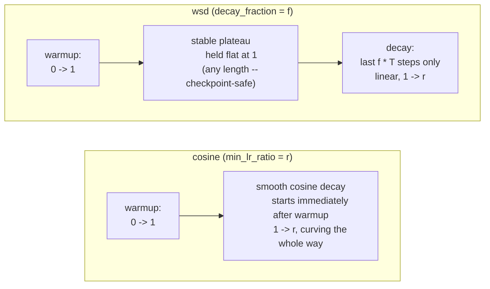

# 019 — Learning-rate schedule: a decay floor + Warmup-Stable-Decay (Task 3)

**Type:** task · **Date:** 2026-09-01 · **Related:** `moe-modernization`
Requirement 2.1-2.4; `design.md` `train/trainer.py` component; builds on
entry 010's warmup+cosine introduction

> **Full by-hand derivation:** [`docs/math/019-lr-schedule-wsd.md`](../docs/math/019-lr-schedule-wsd.md)
> sweeps one parameter set (`warmup_steps=4`, `total_steps=20`,
> `min_lr_ratio=0.25`, `decay_fraction=0.28`, peak `lr=0.01`) through
> *every* branch of `lr_multiplier` and `_set_lr` — the `(step+1)/W`
> warmup ramp, the cosine curve `½(1+cos(π·progress))` derived from the
> unit circle, the `min_lr_ratio` interpolation blend, WSD's
> `decay_steps = max(1, round(f·T))` / `decay_start = max(W, T−decay_steps)`
> / flat plateau / linear decay to the floor, the unknown-schedule error,
> and `_set_lr` scaling one shape onto AdamW and Muon param groups at two
> peak magnitudes — all checked against the real module (and a real
> `Trainer.fit` log) by [`docs/math/verify_019_lr_schedule_wsd.py`](../docs/math/verify_019_lr_schedule_wsd.py).

## What was implemented
- **`qwenmoe/train/trainer.py::lr_multiplier`** gained three new parameters
  — `schedule` (`"cosine"` default, or `"wsd"`), `min_lr_ratio` (default
  `0.0`, i.e. today's exact decay-to-zero), `decay_fraction` (`0.2`, WSD
  only) — while staying the same **pure function** of `(step, ...)` entry
  010 relied on for exact resumability. `_set_lr` now reads
  `config.lr_schedule`/`min_lr_ratio`/`decay_fraction` instead of always
  running plain cosine.
- **`qwenmoe/config.py`**: `TrainConfig` gained `lr_schedule`
  (`"cosine"`/`"wsd"`), `min_lr_ratio` (default `0.1` — a deliberate
  pure-win default change, see below), `decay_fraction` (default `0.2`).
- **Tests**: 5 new cases in `tests/test_trainer_integration.py` — the decay
  floor, WSD's flat stable phase, WSD's linear decay to the floor, and an
  unknown-schedule error.
- `uv run pytest -q` — **249 passed** (same count as entry 018 — this task
  landed alongside task 2 in one session; see that entry's Outcome for the
  full before/after breakdown).

## Concepts explained for a complete beginner

### Why decay to a floor instead of exactly zero
- **What it means:** entry 010's cosine curve ends at multiplier `0` —
  the very last training steps use a learning rate so close to zero they
  barely update anything. `min_lr_ratio` changes the curve's floor from
  `0` to `min_lr_ratio x peak_lr` instead.
- **Why it exists:** the final stretch of a decay-to-zero schedule is
  mostly wasted compute — those steps process real tokens but the model
  barely moves. Stopping the decay at a small but non-zero floor (10% of
  peak is this project's new default, matching common practice) keeps
  every step doing *some* useful learning.
- **How it relates here:** exact algebra, not fitted — see the unified
  formula below, which reduces to the original decay-to-zero behavior
  exactly when `min_lr_ratio=0.0` (the function's own default, so every
  entry-010-era caller — including the task-10 Manim preview scene (since
  removed), which still called `lr_multiplier(step, warmup_steps, total_steps)` with
  no new arguments — is numerically unaffected).

### Warmup-Stable-Decay (WSD): decoupling the schedule from the token budget
- **What it means:** instead of starting to decay the learning rate the
  moment warmup ends (cosine's shape), hold it flat at its peak for a long
  "stable" plateau, and only decay — linearly, quickly — over a short
  window at the very end of training.
- **Why it exists:** cosine's shape *requires* knowing `total_steps` in
  advance, because the whole curve is shaped around hitting the floor
  exactly at the last step — training 20% longer than planned means either
  re-deriving the whole curve (and every prior step's rate was, in
  hindsight, "wrong" for the schedule that actually happened) or accepting
  a lopsided curve. WSD sidesteps this: every checkpoint saved during the
  flat plateau is in the *same* optimization regime (constant peak LR), so
  it's a valid starting point for a short, fresh decay phase whenever
  training actually needs to stop — extend the plateau for a while longer,
  or decay right now, without touching anything already trained.
- **Analogy:** cruise control on a road trip where you don't yet know your
  exact exit (the stable phase — travel at a comfortable constant speed for
  as long as needed) versus committing at the very start of the trip to a
  precise deceleration curve timed to stop the car exactly at mile 200,
  which only works out gracefully if the trip is *exactly* 200 miles.
- **Simple technical explanation / unified derivation:** let $t$ = current
  step (0-indexed), $W$ = `warmup_steps`, $T$ = `total_steps`, $r$ =
  `min_lr_ratio`, $f$ = `decay_fraction`. Warmup (unchanged from entry
  010): $\text{mult}(t) = (t+1)/W$ for $t<W$. Past warmup:
  $$
  \text{cosine: } \text{mult}(t) = r + (1-r)\cdot\tfrac12\bigl(1+\cos(\pi\cdot p)\bigr), \quad p=\min\!\left(\frac{t-W}{T-W},\,1\right)
  $$
  $$
  \text{wsd: } \text{mult}(t) = \begin{cases} 1 & t < D_s \\ 1-(1-r)\cdot p' & t \ge D_s \end{cases}, \quad D_s = \max(W,\ T - D_n),\ \ D_n=\max(1,\ \mathrm{round}(f\cdot T)),\ \ p'=\min\!\left(\frac{t-D_s}{T-D_s},\,1\right)
  $$
  Both are exact algebra given their definitions; nothing here is an
  empirically-fitted constant except the *choices* of $r$ and $f$
  themselves (hyperparameters, not derived quantities). Setting $r=0$
  recovers entry 010's original formulas exactly in both branches.
- **How it relates here:** `lr_multiplier`'s `schedule` parameter selects
  between the two branches above; `Trainer.fit` is otherwise unchanged —
  the schedule is purely a per-step multiplier, so checkpoint/resume
  (entry 010) keeps working unmodified for either choice.
- **Paper:** [MiniCPM: Unveiling the Potential of Small Language Models
  with Scalable Training Strategies (Hu et al.,
  2024)](https://arxiv.org/abs/2404.06395), §3 — the paper that introduced
  and named the Warmup-Stable-Decay schedule specifically to support
  exactly this "don't commit to a token budget upfront" workflow.

**Real measured numbers** (an actual `Trainer.fit` run, both schedules,
identical model/data/seed, `total_steps=30`, `warmup_steps=5`,
`min_lr_ratio=0.1`, `decay_fraction=0.3`, peak `lr=0.01` — every value below
is a real logged `lr` from `train.jsonl`, not recomputed by hand):

| step | cosine `lr` | wsd `lr` |
|---:|---:|---:|
| 5 (peak) | 0.01000 | 0.01000 |
| 10 | 0.00944 | 0.01000 |
| 15 | 0.00742 | 0.01000 |
| 20 | 0.00466 | 0.01000 |
| 22 (wsd decay starts) | 0.00358 | 0.01000 |
| 25 | 0.00222 | 0.00700 |
| 30 (final) | 0.00104 | 0.00200 |

Cosine is already down to 47% of peak by step 20; WSD is still at exactly
peak through step 22, then decays over its last `round(0.3*30) = 9` steps
(the "decay window" spans internal steps 21–29, i.e. logged steps 22–30) —
any checkpoint saved at, say, step 15 sits at the *identical* optimization
state (flat peak LR) whichever final step count the run eventually settles
on, which is exactly the property cosine can't offer.

## Questions that might come to mind
- **Does WSD ever reach `min_lr_ratio` exactly?** Only if `step` actually
  reaches `total_steps` — `_run_step` always calls with `step in [0,
  total_steps)` (0-indexed, the step *about to run*), so a real training
  run's *last executed* step lands one step short of the mathematical
  floor, same asymptotic-but-not-quite-exact behavior cosine already had
  (entry 010 noted the same thing: "essentially zero," not exactly). A
  direct call `lr_multiplier(total_steps, ...)` (past what `Trainer` itself
  ever passes) does hit the floor exactly — `tests/
  test_lr_multiplier_wsd_decays_linearly_to_min_lr_ratio_at_the_end` checks
  this directly.
- **Why is the decay window rounded (`round(f * T)`) instead of computed
  exactly?** `f * T` isn't guaranteed to be a whole number of steps (e.g.
  `f=0.2, T=33`); rounding to the nearest integer step count is the only
  sensible choice for something that has to index real, whole training
  steps, and `max(1, ...)` guards the degenerate case where rounding would
  produce a zero-length decay window.
- **What happens if `decay_fraction` is large enough that the decay window
  would start before warmup even ends?** `decay_start = max(warmup_steps,
  total_steps - decay_steps)` clamps it — the stable phase can shrink to
  zero length (decay starts the instant warmup ends), but never overlaps
  warmup itself or starts before it.
- **Is WSD strictly better than cosine?** Not unconditionally — published
  results (including MiniCPM's own) show WSD matching or slightly trailing
  cosine's *final* loss at a *single, fully-committed* token budget, in
  exchange for the flexibility described above. This project keeps both
  behind `TrainConfig.lr_schedule` specifically so it's a measurable
  `run_comparison` axis (moe-modernization task 17) rather than a
  one-sided replacement.

## Outcome
`uv run pytest -q` — **249 passed** (see entry 018's Outcome for the
task-2-and-3-combined before/after count; both tasks landed together in
this session's implementation pass). Task 3 checked off in
`moe-modernization/tasks.md`.
