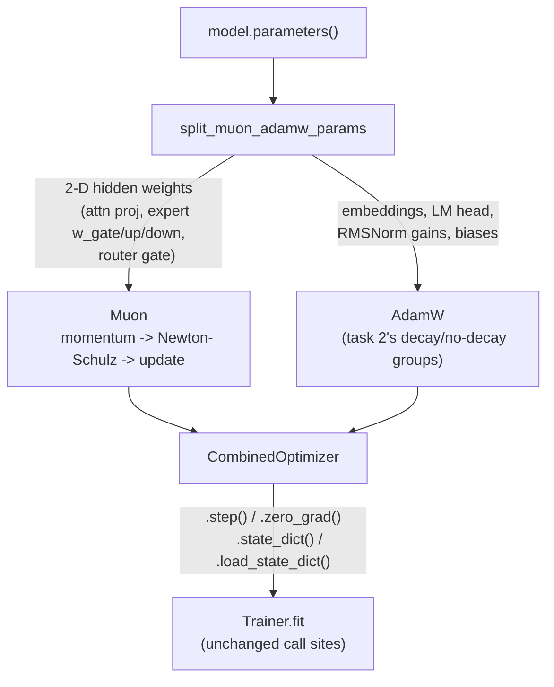

# 020 — The Muon optimizer: orthogonalized momentum for weight matrices (Task 4)

**Type:** task · **Date:** 2026-09-02 · **Related:** `moe-modernization`
Requirement 1.4-1.6; `design.md` `train/optim.py` component; builds on
entry 018's AdamW/param-group work

## What was implemented
- **`qwenmoe/train/optim.py`** gained four new pieces:
  - `zeropower_via_newtonschulz5(G, steps=5)` — the from-scratch
    Newton-Schulz orthogonalization core.
  - `Muon(torch.optim.Optimizer)` — momentum + orthogonalization, one
    parameter-update rule.
  - `CombinedOptimizer` — fans `step`/`zero_grad`/`state_dict`/
    `load_state_dict` out over a list of sub-optimizers and concatenates
    their `param_groups`.
  - `split_muon_adamw_params(model)` — decides *which* parameters go
    through Muon at all (a different split than task 2's decay/no-decay
    split — see below).
- **`build_optimizer`** grew a `config.optimizer == "muon"` branch: 2-D
  hidden weight matrices go to `Muon`; everything else (embeddings, the LM
  head, RMSNorm gains, any bias) goes to a second, ordinary `AdamW`; both
  are wrapped in one `CombinedOptimizer`.
- **`qwenmoe/train/trainer.py::_set_lr`** changed: every param group now
  carries its own `"base_lr"` (stamped on at construction time — `lr` for
  AdamW groups, `muon_lr or lr` for the Muon group), and `_set_lr` scales
  each group from *its own* base rate rather than one shared rate, so one
  warmup/decay curve can drive two different peak learning rates.
- **Tests**: 20 new cases in `tests/test_optim.py` (the muon/adamw
  parameter split, orthogonalization behavior, `Muon.step` convergence on
  a toy problem, `CombinedOptimizer` coverage/state-dict round-trip) plus
  3 in `tests/test_trainer_integration.py` (`_set_lr`'s per-group scaling,
  an end-to-end Muon training run, a Muon checkpoint save/resume
  round-trip).
- `uv run pytest -q` — **264 passed** (was 249 after entry 019; net +15
  after also retiring the old "Muon isn't implemented yet" placeholder
  test from entry 002/task-1's scaffolding).

## Concepts explained for a complete beginner

### Why give matrices a *different* optimizer than everything else
- **What it means:** AdamW (and SGD, and most optimizers most people
  learn first) treats every number in every parameter tensor as an
  independent scalar — it doesn't know or care that 512 of those numbers
  happen to form one row of a weight *matrix*. Muon treats a 2-D weight
  tensor as a genuine matrix and updates it with an operation
  (orthogonalization) that only makes sense for matrices, not for a
  vector of unrelated numbers.
- **Why it exists:** a linear layer's weight matrix $W$ doesn't just hold
  numbers — its *singular values* control how much it stretches different
  input directions, and gradient descent on a matrix can easily update it
  in a way that's dominated by whichever single direction currently has
  the largest gradient, leaving the matrix's other directions
  under-trained. Recent optimization theory (Bernstein & Newhouse, 2024,
  "Old Optimizer, New Norm") reframes several optimizers as *steepest
  descent under a chosen norm* — plain SGD is steepest descent under the
  Euclidean (entrywise) norm; Muon's orthogonalized update is
  (approximately) steepest descent under the **spectral norm**, which
  treats every direction in the matrix's row/column space as equally
  important rather than letting the largest-gradient direction dominate.
- **Analogy:** AdamW tuning a weight matrix is like adjusting 512
  independent thermostats in a building, one knob at a time, each reacting
  only to its own room's temperature reading. Muon is like a building-wide
  control system that first asks "which *directions* of adjustment affect
  the whole building coherently" and moves in *those* directions by a
  balanced amount — it doesn't ignore individual rooms, but it stops one
  unusually drafty room's thermostat from dominating every adjustment.
- **How it relates here:** only *hidden* weight matrices (attention
  `w_q`/`w_k`/`w_v`/`w_o`, expert `w_gate`/`w_up`/`w_down`, the router
  gate) are genuinely "this matrix's rows/columns are interchangeable
  directions in a learned representation space" — an embedding table's
  rows are *specific tokens*, not interchangeable directions, and the same
  is true of the LM head's rows (each row scores one specific vocabulary
  token). That's why `split_muon_adamw_params` routes embeddings and the
  LM head to AdamW even though they're 2-D too (see the worked split
  below) — this is the standard convention from Jordan's own writeup and
  the NanoGPT speedrun community that built on it, not something derived
  from first principles in this project.

### The Newton-Schulz iteration: orthogonalizing without an SVD
- **What it means:** "orthogonalizing" a matrix $G$ means replacing it
  with the nearest matrix whose singular values are all pushed toward $1$
  — same row/column *directions* as $G$, but with the stretching factor
  along every direction roughly equalized. The exact way to do this is a
  Singular Value Decomposition (SVD), which is too slow to run every
  optimizer step for every weight matrix in a large model. Newton-Schulz
  iteration gets *close* to the same result using only a handful of matrix
  multiplications — operations GPUs already do very fast.
- **Why it exists:** classical Newton-Schulz iteration (a numerical
  analysis technique older than deep learning) computes a matrix inverse
  or pseudo-inverse using only multiplications, by repeatedly applying a
  polynomial map to a matrix's singular values. Muon (Keller Jordan, 2024)
  adapts this idea, picking a specific quintic (degree-5) polynomial whose
  coefficients are chosen not to reach exact convergence, but to converge
  *fast enough in very few steps* to be worth using inside a training
  loop.
- **Full derivation:** for a matrix $X$ with SVD $X = U\Sigma V^\top$
  ($U,V$ orthogonal, $\Sigma$ diagonal — the singular values), define the
  map
  $$
  f(X) = aX + b(XX^\top)X + c(XX^\top)^2X
  $$
  Since $XX^\top = U\Sigma^2 U^\top$ and $U^\top U = I$, substituting shows
  $f(X) = U\bigl(a\Sigma + b\Sigma^3 + c\Sigma^5\bigr)V^\top$ — **the
  singular *vectors* $U,V$ are completely unchanged**, and every singular
  value $\sigma$ is independently mapped through the same scalar
  polynomial
  $$
  p(\sigma) = a\sigma + b\sigma^3 + c\sigma^5, \qquad (a,b,c) =
  (3.4445,\ -4.7750,\ 2.0315)
  $$
  Iterating $f$ five times composes $p$ with itself five times. The
  coefficients themselves are **not derived in closed form** — they're
  chosen (Jordan et al., by numerical search) to make $p^{\circ 5}$ pull
  every $\sigma \in (0, 1]$ toward a narrow band quickly; solving
  $p(\sigma)=\sigma$ for this specific $(a,b,c)$ shows the map's fixed
  points sit at $\sigma \approx 0.868$ and $\sigma \approx 1.264$, **not**
  exactly at $1$ — so five iterations lands singular values in roughly
  that band, not pinned to $1.000$ (confirmed empirically below). This is
  a deliberate trade Jordan's writeup documents explicitly: coefficients
  tuned for *fast early convergence from far away* cost *exact* convergence
  once already close to $1$.
- **Worked example (by hand, then checked against the real code):**
  $G = \begin{pmatrix}3 & 0\\0 & 1\end{pmatrix}$ (already diagonal, so every
  matrix product in the iteration stays diagonal — this makes the
  arithmetic followable by hand). $\|G\|_F = \sqrt{3^2+1^2} = \sqrt{10}
  \approx 3.1623$, so the normalized starting singular values are
  $\sigma_1^{(0)} = 3/\sqrt{10} \approx 0.9487$ and $\sigma_2^{(0)} =
  1/\sqrt{10} \approx 0.3162$. Applying $p$ five times to each,
  independently:

  | step | $\sigma_1$ (started at 0.9487) | $\sigma_2$ (started at 0.3162) |
  |---:|---:|---:|
  | 1 | 0.751846 | 0.944672 |
  | 2 | 1.048416 | 0.756801 |
  | 3 | 0.681856 | 1.041391 |
  | 4 | 1.134332 | 0.682469 |
  | 5 | 0.753033 | 1.133706 |

  Neither sequence monotonically approaches $1$ — instead **both settle
  into the same alternating band, roughly $\{0.68, 1.13\}$**, regardless
  of how different their starting points were (0.9487 vs. 0.3162). This
  matches the fixed-point algebra above almost exactly (the small gap from
  0.868/1.264 is because 5 steps hasn't fully settled the oscillation
  yet) and is the real mechanism behind "orthogonalization": it's not that
  every singular value marches straight to 1, it's that **very different
  starting singular values get pulled into the same narrow shared range**,
  which is precisely what makes the resulting matrix's stretching factors
  roughly equal across directions.

  Running the *actual* `zeropower_via_newtonschulz5(G, steps=5)` (which
  additionally casts to `bfloat16` internally, a speed/memory choice, not
  a mathematical one) on this exact $G$ gives:
  ```
  X = [[0.7812, 0.0000],
       [0.0000, 1.1406]]
  singular values: [1.1406, 0.7812]
  ```
  — matching the hand-derived band (0.68-1.13-ish) to within `bfloat16`'s
  own rounding error, confirming the by-hand derivation above against the
  real, tested code rather than just algebra on paper.

### Muon vs. AdamW: which parameters go where, and why it's a *different* split than task 2's
- **What it means:** task 2's `split_param_groups` answers "does this
  parameter get **weight decay**?" (decay / no-decay). Task 4's
  `split_muon_adamw_params` answers a completely different question —
  "does this parameter get the **Muon update rule** at all?" (muon /
  adamw). A parameter can be `decay` *and* `adamw` at the same time (e.g.
  an untied LM head) — these are two independent axes, not the same split
  renamed.
- **How it relates here — real measured counts** (`configs.presets.
  SMOKE_TEST`, run through both splitters):

  | split | group | tensors | params |
  |---|---|---:|---:|
  | decay / no-decay (task 2) | decay | 40 | 270,848 |
  | decay / no-decay (task 2) | no_decay | 6 | 4,480 |
  | muon / adamw (task 4) | muon | 40 | 270,848 |
  | muon / adamw (task 4) | adamw | 6 | 4,480 |

  These two splits land on **exactly the same numbers** for `SMOKE_TEST`
  — because `SMOKE_TEST` uses the default `tie_word_embeddings=True`, so
  there's no separate LM head parameter for the two splits to disagree
  about. Re-running with `tie_word_embeddings=False` (an untied LM head)
  makes the splits diverge, exactly as designed:

  | split | group | tensors | params |
  |---|---|---:|---:|
  | decay / no-decay | decay | 41 | 275,008 |
  | decay / no-decay | no_decay | 6 | 4,480 |
  | muon / adamw | muon | 40 | 270,848 |
  | muon / adamw | adamw | 7 | 8,640 |

  The extra tensor is exactly `model.lm_head.weight`, shape `(65, 64)` =
  4,160 params: `decay` correctly includes it (it's a 2-D matrix, so it
  *should* get weight decay), but `muon` correctly excludes it (Requirement
  1.4 names the LM head explicitly as an AdamW parameter) — `4,480 +
  4,160 = 8,640`, matching the `adamw` row exactly.

### `CombinedOptimizer`: one schedule, two peak learning rates
- **What it means:** `Muon` and `AdamW` are separate `torch.optim.
  Optimizer` objects with separate internal state (Muon's momentum
  buffers vs. AdamW's first/second moment estimates). `CombinedOptimizer`
  is a thin wrapper that makes the pair *look like one optimizer* to
  `Trainer` — same `.step()`/`.zero_grad()`/checkpoint interface — without
  merging their actual math.
- **Why it exists:** `Trainer`'s per-step scheduling code
  (`for group in optimizer.param_groups: group["lr"] = ...`) was written
  in task 3 assuming one optimizer with one learning rate. Muon and AdamW
  conventionally use *different* peak learning rates (Muon's update is
  already normalized by orthogonalization, so it tolerates and often wants
  a larger step size than AdamW's raw per-parameter update) — so each
  `CombinedOptimizer` param group is stamped with its own `"base_lr"` at
  construction (`config.lr` for AdamW groups, `config.muon_lr or config.lr`
  for the Muon group), and `_set_lr` multiplies each group by the *same*
  `lr_multiplier(step, ...)` curve but from its own base rate — one
  warmup/WSD/cosine *shape*, two different peak *heights*.
- **How it relates here — verified directly:** `tests/
  test_set_lr_scales_muon_and_adamw_groups_by_their_own_base_lr` builds a
  `muon` optimizer with `lr=1e-2, muon_lr=4e-2`, calls `_set_lr` once, and
  checks the Muon group lands at exactly `4e-2` while every AdamW group
  lands at exactly `1e-2` — same multiplier (`1.0`, past warmup), two
  different results.



**Real measured training comparison** (identical tiny model/data/seed used
by `tests/test_trainer_runs_and_loss_decreases[_with_muon_optimizer]`, 40
steps, `lr=1e-2`, `muon_lr=2e-2`, `warmup_steps=5` — every value below is a
real logged `train_loss` from `train.jsonl`, not recomputed by hand):

| step | adamw `train_loss` | muon `train_loss` |
|---:|---:|---:|
| 1 | 2.4944 | 2.4944 |
| 5 | 2.3004 | 2.3314 |
| 10 | 1.8393 | 1.9112 |
| 20 | 1.0088 | 1.0650 |
| 30 | 0.5901 | 0.6372 |
| 40 | 0.4719 | 0.5064 |

Both optimizers converge cleanly on this toy periodic sequence; AdamW is
slightly ahead throughout at these (untuned, matched-multiplier)
learning rates. This is reported honestly rather than as a "Muon wins"
result — Requirement 1's own user story frames this as making "Muon vs
AdamW... a measurable axis" (task 17's ablation-menu work), not asserting
Muon is unconditionally better at every scale; published results (Jordan's
writeup, the Moonshot AI technical report below) show Muon's advantage
growing at larger model/batch scale than this toy example reaches.

## Questions that might come to mind
- **Does Muon replace AdamW entirely?** No — `CombinedOptimizer` always
  uses *both*: Muon only ever touches the 2-D hidden weight matrices;
  AdamW still handles embeddings, the LM head, norms, and biases even when
  `optimizer="muon"`. There is no "pure Muon" mode in this codebase, by
  design (Requirement 1.4) and by the published convention it follows.
- **Why does `Muon.step` assert `p.ndim == 2` instead of just skipping
  non-matrix parameters?** Because `Muon` is only ever constructed by
  `build_optimizer` over the pre-filtered `muon_params` list — if a 1-D
  parameter ever ends up there, that's a bug in the *routing* logic, not a
  normal situation to silently work around. Loud failure (design.md's
  Error Handling) surfaces that bug immediately instead of quietly
  orthogonalizing a vector (which the math doesn't even define — Newton-
  Schulz needs $XX^\top$, which requires $X$ to be 2-D).
- **Why bf16 inside `zeropower_via_newtonschulz5` even when the input is
  fp32?** Matches Muon's own reference implementation: five small matmuls
  in bf16 are much cheaper than in fp32, and since the polynomial map only
  ever pushes singular values *towards* the same shared band (never
  explodes them — see the worked example above), bf16's reduced precision
  doesn't destabilize the result the way it might in, say, a raw gradient
  accumulation.
- **Does resuming a Muon run actually restore Muon's own state, or just
  AdamW's?** Both — `CombinedOptimizer.state_dict()` returns `{"sub_
  optimizers": [muon_state, adamw_state]}`, and `load_state_dict` restores
  each sub-optimizer from its own entry.
  `test_trainer_checkpoint_round_trips_for_muon_optimizer` checks the
  saved checkpoint's `optimizer_state_dict` really does contain exactly 2
  `sub_optimizers` entries, and that a resumed run continues from the
  checkpointed step rather than restarting.
- **Why is `momentum` (not `betas`) the key used to identify the Muon
  group in the tests?** `torch.optim.AdamW`'s param groups carry `betas`/
  `eps`/`amsgrad` keys; `Muon`'s carry `momentum`/`ns_steps` — the two
  never collide, so `"momentum" in group` is a reliable way to tell which
  sub-optimizer a `CombinedOptimizer.param_groups` entry came from without
  `CombinedOptimizer` needing to tag groups itself.

## Papers
- [Muon: An optimizer for hidden layers in neural networks (Keller
  Jordan, 2024)](https://kellerjordan.github.io/posts/muon/) — the
  original writeup: the Newton-Schulz coefficients, the `sqrt(max(1,
  rows/cols))` scaling rule, and the "orthogonalize only hidden matmul
  weights, AdamW for the rest" convention this task follows.
- [Old Optimizer, New Norm: An Anthology (Bernstein & Newhouse,
  2024)](https://arxiv.org/abs/2409.20325) — the steepest-descent-under-a-
  norm framing that explains *why* orthogonalizing a matrix update is a
  principled thing to do, not just an empirical trick.
- [Muon is Scalable for LLM Training (Liu, Su et al./Moonshot AI,
  2025)](https://arxiv.org/abs/2502.16982) — a technical report on scaling
  Muon to real large-model pretraining runs, including the weight-decay-
  on-Muon and learning-rate-transfer findings that motivated keeping
  `weight_decay`/`betas` as *separate*, independently-configured knobs
  from `muon_lr`/`muon_momentum` in this project's `TrainConfig` rather
  than hard-coding a fixed ratio between them.

## Outcome
`uv run pytest -q` — **264 passed** (249 before this task). Task 4 checked
off in `moe-modernization/tasks.md`.
