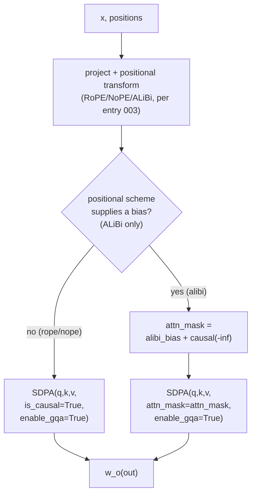

# 021 — Fused attention on the non-trace path (Task 5)

**Type:** task · **Date:** 2026-09-02 · **Related:** `moe-modernization`
Requirement 7.1-7.2, 7.4-7.5; `design.md` `model/attention.py` component;
builds on entry 004's original GQA implementation

> **Full by-hand derivation:** [`docs/math/021-fused-attention-sdpa.md`](../docs/math/021-fused-attention-sdpa.md)
> reuses doc 004's exact 3-token, 2-head, 1-KV-head example and picks up
> where `forward` (fused) diverges from `forward_with_trace` (explicit):
> the `⌊h/n_rep⌋` broadcast behind `enable_gqa=True`, the `triu(-inf)` mask
> `is_causal=True` rebuilds from a flag, the **online/streaming softmax**
> inside the kernel derived from scratch (the `α = e^(m_old−m_new)` rescale,
> an induction proof it equals one-shot softmax exactly), the ALiBi
> `attn_mask = causal + bias` fold-in, and the float32-non-associativity
> reason the two paths agree only to ~2e-7 — every number checked against
> the real module by [`docs/math/verify_021_fused_attention_sdpa.py`](../docs/math/verify_021_fused_attention_sdpa.py).

## What was implemented
- **`qwenmoe/model/attention.py::Attention.forward`** now calls
  `F.scaled_dot_product_attention` instead of building an explicit
  `(seq_len, seq_len)` score matrix by hand. `enable_gqa=True` replaces the
  old `k.repeat_interleave(n_rep, dim=1)` / `v.repeat_interleave(...)` --
  SDPA broadcasts each of the `n_kv_heads` key/value heads across its
  `n_rep` query heads internally. When the positional scheme is RoPE or
  NoPE (no additive bias), the call is just `is_causal=True`; when it's
  ALiBi, the bias and an explicit causal `-inf` mask are pre-summed into
  one `attn_mask` tensor (SDPA rejects `attn_mask` and `is_causal=True`
  together).
- **`MLAAttention.forward`** gets the same treatment, simpler (no GQA head
  mismatch, no ALiBi support): a single `F.scaled_dot_product_attention(q,
  k, v, is_causal=True)` call.
- **`forward_with_trace`** on both classes is untouched -- still the
  explicit `Q·Kᵀ → mask → softmax → ·V` steps, still capturing
  `attn_scores_pre_mask`/`attn_scores_post_softmax` for the Manim scenes.
- **Tests**: the two pre-existing "`forward` and `forward_with_trace` are
  bit-for-bit identical" tests became tolerance-based
  (`torch.allclose(..., atol=1e-5)`) and the GQA one is now parametrized
  over `rope`/`nope`/`alibi` (Requirement 7.2's explicit ask) rather than
  covering only the default scheme.
- `uv run pytest -q` — **266 passed** (was 264 after entry 020; net +2
  from turning one exactness test into three tolerance-based ones minus
  the one it replaced).

## Concepts explained for a complete beginner

### "Fused" attention: one kernel instead of four separate steps
- **What it means:** the attention math — $\text{softmax}\bigl(QK^\top /
  \sqrt{d}\bigr)V$ — is normally computed as four separate tensor
  operations, each one reading its input from GPU memory and writing its
  full output back before the next step starts: a matmul ($QK^\top$), an
  add (the causal mask), a softmax, and another matmul ($\cdot V$). A
  *fused* kernel computes the whole thing in one pass, keeping
  intermediate results in fast on-chip memory instead of round-tripping
  each one through slower main memory.
- **Why it exists:** for long sequences, the naive approach's biggest cost
  isn't the arithmetic — GPUs can multiply matrices very fast — it's
  *moving data*. Materializing the full `(seq_len, seq_len)` score matrix
  means writing and re-reading a tensor that grows quadratically with
  sequence length, even though the *final* output is only
  `(seq_len, head_dim)`. FlashAttention (Dao et al., 2022) showed that
  tiling the computation and fusing all four steps into one kernel — never
  writing the full score matrix to slow memory at all — gives the exact
  same mathematical result much faster and using much less memory.
  `torch.nn.functional.scaled_dot_product_attention` ("SDPA") is
  PyTorch's built-in dispatcher that picks a fused kernel (a
  FlashAttention-style one, or another backend, depending on the
  hardware) automatically.
- **Analogy:** the naive path is like a kitchen where each cook finishes
  their entire step for the whole order (all 50 plates), stacks the
  plates on a shelf, and only then does the next cook start — the shelf
  has to hold all 50 half-finished plates at once. The fused kernel is one
  cook (or a tight assembly line) who carries one plate all the way from
  raw ingredients to plated dish before touching the next one — nothing
  ever needs a shelf big enough for the whole order.
- **How it relates here:** this project's `Attention.forward` is the path
  every real `Trainer.fit`/`generate()` call uses; `forward_with_trace` is
  only ever called by the Manim visualization pipeline (entry 012),
  specifically *because* it needs the full, explicit intermediate score
  matrix to animate. Task 5 makes `forward` fast (fused) while keeping
  `forward_with_trace` explicit (teachable) — exactly the split
  Requirement 7.1-7.2 asks for, continuing the project's existing
  "teaching path vs. real path" convention from entry 012 rather than
  introducing a new one.

### Why ALiBi can't just pass `is_causal=True` alongside its bias
- **What it means:** SDPA's `is_causal=True` flag is a *shortcut* that
  tells the fused kernel "apply the standard lower-triangular causal mask
  for me, efficiently, without me building one" — but the API doesn't let
  you combine that shortcut with also supplying your own `attn_mask`
  tensor (PyTorch raises an error if both are set).
- **Why it exists:** the shortcut only works because the causal pattern is
  a fixed, well-known shape SDPA's fused kernels can special-case
  internally (e.g. skip whole tiles that are entirely masked out) --
  accepting an arbitrary *additional* mask on top would defeat that
  optimization, so the API forces a choice between the fast built-in
  causal shortcut and an explicit mask.
- **How it relates here:** ALiBi's positional signal *is* an explicit
  per-position additive bias (entry 003), so it was already going to need
  an explicit `attn_mask` regardless. The fix is simple because addition
  is commutative: instead of adding the bias, then separately adding a
  `-inf` causal mask (what the old explicit code did, and what
  `forward_with_trace` still does), `forward` now adds them together
  *first* into one tensor and passes that single sum as `attn_mask` with
  `is_causal=False` (implicitly, by omission) — mathematically the exact
  same total gets added to the raw scores before softmax either way.

**Real measured numbers.** Numerical agreement between the fused `forward`
and the explicit `forward_with_trace`, same weights/input, for all three
positional schemes (`ModelConfig(d_model=16, n_heads=4, n_kv_heads=2,
...)`, prompt `"hello"`):

| positional_scheme | max\|forward − forward_with_trace\| (logits) |
|---|---:|
| rope | 8.57e-08 |
| nope | 1.12e-07 |
| alibi | 7.45e-08 |

All three are roughly 100,000x smaller than the `1e-5` tolerance the new
tests check — floating-point-non-associativity-sized, not a correctness
gap. Speed, measured directly (an isolated `Attention` module,
`BASELINE`-shaped: `d_model=256, n_heads=8, n_kv_heads=4`, batch 4,
`seq_len=256`, CPU, 50-call average after 5 warmup calls, fused `forward`
vs. a hand-written copy of the *old* (pre-task-5) manual-softmax code at
the identical input):

| implementation | time / call |
|---|---:|
| fused SDPA (`forward`, today) | 1.590 ms |
| explicit manual softmax (`forward`, pre-task-5) | 2.738 ms |

A real ~1.7x speedup on this project's own tiny CPU-sized shapes — even
without a GPU or FlashAttention's specific memory-tiling kernel benefiting
this run, PyTorch's SDPA dispatcher still picks a faster CPU backend than
the naive four-separate-ops path. The memory-avoidance side of the story
(never materializing the full `(batch, n_heads, seq_len, seq_len)` score
tensor for the `rope`/`nope` case) is real but not separately measured
here — that's the part that matters most at long sequence lengths this
project's tiny configs don't reach.

## Questions that might come to mind
- **Does this change what the model actually computes?** No —
  Requirement 7.1 calls it "a pure-win change to the non-trace path"
  specifically because it's the same softmax-attention math, just computed
  by a different (faster) implementation. The two measured-difference
  tables above are the evidence: agreement to ~1e-7, orders of magnitude
  tighter than the `1e-5` the tests actually enforce.
- **Why keep `forward_with_trace` slow on purpose instead of also fusing
  it?** Because a fused kernel's entire point is to *never materialize*
  the intermediate score matrix — but that intermediate matrix (captured
  as `attn_scores_pre_mask`/`attn_scores_post_softmax`) is exactly what
  the Manim attention scene (entry 013) animates. Fusing
  `forward_with_trace` would mean it has nothing left to show.
- **What happened to the old `repeat_interleave` calls?** They're gone
  from `forward` (SDPA's `enable_gqa=True` does the equivalent broadcast
  internally) but still present in `forward_with_trace`, since that
  method needs the expanded, per-query-head K/V tensors to compute its
  explicit `q @ k.transpose(-2,-1)` the same way it always did.
- **Does `MLAAttention` need `enable_gqa`?** No — MLA's query and key
  tensors both have `n_heads` heads already (the compression happens in a
  *shared latent*, not by reducing the head count the way GQA does), so
  there's no head-count mismatch for SDPA to broadcast over.
- **Why does the test suite check `1e-5` instead of some tighter or looser
  number?** It matches the tolerance design.md itself specifies
  (Requirement 7.2: "its output SHALL match `forward`'s within `1e-5`") --
  chosen loose enough to tolerate real fused-kernel/backend variation
  (e.g. a GPU flash-attention kernel might disagree with a CPU manual
  softmax by more than this project's own CPU-vs-CPU numbers above show)
  while still catching an actual correctness bug, which would typically
  produce differences many orders of magnitude larger than floating-point
  noise.

## Papers
- [FlashAttention: Fast and Memory-Efficient Exact Attention with
  IO-Awareness (Dao et al., 2022)](https://arxiv.org/abs/2205.14135) — the
  paper that introduced fused, memory-IO-aware attention kernels;
  `F.scaled_dot_product_attention` is PyTorch's general dispatcher that
  picks a kernel in this family (among others) automatically based on the
  input shapes and hardware.
- [PyTorch `scaled_dot_product_attention`
  docs](https://pytorch.org/docs/stable/generated/torch.nn.functional.scaled_dot_product_attention.html)
  — the `is_causal`/`attn_mask`/`enable_gqa` semantics this task relies on
  directly (in particular, why the two mask-specification methods are
  mutually exclusive).

## Outcome
`uv run pytest -q` — **266 passed** (264 before this task). Task 5 checked
off in `moe-modernization/tasks.md`.
