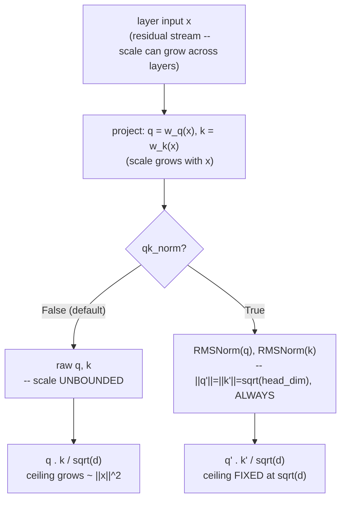

# 022 — QK-norm: bounding attention-logit scale (Task 6)

**Type:** task · **Date:** 2026-09-02 · **Related:** `moe-modernization`
Requirement 7.3, 7.5; `design.md` `model/attention.py` component; builds
on entry 021's fused-SDPA work

> **Full by-hand derivation:** [`docs/math/022-qk-norm.md`](../docs/math/022-qk-norm.md)
> carries one concrete 3-token, 2-head, 1-KV-head, `head_dim=4` example
> (including this entry's own $[3,0,4,0]\to[1.2,0,1.6,0]$) through *every*
> line of `Attention.forward_with_trace` with `qk_norm=True` — RMSNorm
> derived from scratch (exact scale-invariance, the $\lVert q'\rVert=\sqrt{d_k}$
> proof), the Cauchy–Schwarz ceiling measured digit-by-digit on nine real
> logit pairs, a quadratic-vs-flat scale sweep, softmax-entropy collapse
> quantified on real numbers, and why the norm sits before the positional
> transform (rotation preserves norm; the two orders provably commute at
> init) — every number checked against the real module by
> [`docs/math/verify_022_qk_norm.py`](../docs/math/verify_022_qk_norm.py).

## What was implemented
- **`qwenmoe/model/attention.py::Attention`** gains `self.qk_norm`
  (`ModelConfig.qk_norm`, default `False`) and, only when it's `True`,
  two per-head `RMSNorm(head_dim)` submodules (`q_norm`, `k_norm`) --
  applied to `q`/`k` right after the projection+reshape, *before* the
  positional transform, in both `forward` and `forward_with_trace`.
- When `qk_norm=False`, `q_norm`/`k_norm` **don't exist as attributes at
  all** (not just unused) -- the strongest possible version of
  Requirement 7.5's "numerically unchanged from today," since there's
  no code path left that could touch q/k.
- `MLAAttention` is untouched -- Requirement 7.3 names only the GQA
  `Attention` class (design.md's component section doesn't mention
  QK-norm for MLA either).
- **Tests**: 3 new in `tests/test_attention.py` (no extra parameters when
  off; output changes when on with otherwise-identical weights; the
  logit-variance-bounding property itself, with real thresholds derived
  from an actual run) and 1 new in `tests/test_trace.py` (`forward`/
  `forward_with_trace` agree within `1e-5` with `qk_norm=True` too).
- `uv run pytest -q` — **270 passed** (was 266 after entry 021).

## Concepts explained for a complete beginner

### The problem: attention logits can grow without bound
- **What it means:** the raw (pre-softmax) attention score between a query
  $q_i$ and a key $k_j$ is $q_i \cdot k_j / \sqrt{d}$ ($d$ = `head_dim`).
  If the *magnitude* of $q_i$ and $k_j$ grows -- which happens naturally as
  a model's residual stream accumulates contributions layer after layer,
  a well-documented phenomenon in deep transformers -- this score can grow
  right along with it, with no ceiling.
- **Why it's a problem:** a softmax over scores with a huge spread turns
  into a near-one-hot distribution (almost all probability mass on
  whichever single key has the largest score), which stops gradients from
  flowing usefully through every *other* key -- and at the extreme, huge
  logits can overflow entirely. Dehghani et al. (2023), scaling Vision
  Transformers to 22B parameters, documented training runs that diverged
  specifically because of this: "extremely large values in attention
  logits, which lead to attention weights with near-zero entropy."
- **The exact math (Cauchy-Schwarz bound):** for any vectors,
  $|q_i \cdot k_j| \le \|q_i\| \, \|k_j\|$. Since $q_i = W_q x_i$ for some
  weight matrix $W_q$ (and similarly for $k_j$), $\|q_i\| \le
  \|W_q\|_{\text{op}} \|x_i\|$ -- so the *raw* attention logit's ceiling
  scales with $\|x_i\|\|x_j\|$, i.e. **roughly quadratically** in however
  large this layer's input activations happen to be. This isn't a fitted
  constant, it's the Cauchy-Schwarz inequality applied directly to the dot
  product already in the attention formula.

### The fix: RMSNorm makes q/k's scale independent of the input's scale
- **What it means:** applying `RMSNorm` to $q_i$ and $k_j$ *before* the
  dot product rescales each of them to a fixed size, no matter how large
  or small they started -- so the Cauchy-Schwarz ceiling above becomes a
  fixed number instead of something that grows with the residual stream.
- **Why it exists / analogy:** it's the same idea as a "level" audio knob
  on a microphone that just cut off feedback rather than an amplifier
  that keeps boosting an already-loud signal further. The recording (the
  *directions* / relative content of $q$ and $k$) is preserved; only the
  runaway *volume* (magnitude) is capped.
- **Full derivation — RMSNorm is exactly scale-invariant:**
  $\text{RMSNorm}(q) = \dfrac{q}{\sqrt{\frac{1}{d}\sum_i q_i^2 + \epsilon}}
  \odot w$. Ignoring $\epsilon$ (negligible except when $q \approx 0$) and
  taking the learnable weight $w=1$ (its value at initialization, and
  what this project's `RMSNorm` starts every one of its instances at):
  for any positive constant $c$,
  $$
  \text{RMSNorm}(c\cdot q) = \frac{c\cdot q}{\sqrt{\frac{1}{d}\sum_i (c
  q_i)^2}} = \frac{c\cdot q}{c\sqrt{\frac{1}{d}\sum_i q_i^2}} =
  \text{RMSNorm}(q)
  $$
  — the output is **completely unchanged** by uniformly scaling the
  input. And by construction, $\|\text{RMSNorm}(q)\|_2 = \sqrt{d}$ exactly
  (the mean squared entry is forced to $1$, so the sum of $d$ squared
  entries is $d$). So after QK-norm, Cauchy-Schwarz gives $|q_i' \cdot
  k_j'| \le \|q_i'\|\|k_j'\| = d$ -- **a fixed ceiling, independent of the
  original activations' scale entirely** -- and the scaled score
  $q_i' \cdot k_j' / \sqrt{d}$ is bounded by $\sqrt{d}$.
- **Worked example (by hand):** let `head_dim` $d=4$ and $q = [3, 0, 4,
  0]$. Mean square $= (9+0+16+0)/4 = 6.25$, RMS $=\sqrt{6.25}=2.5$, so
  $\text{RMSNorm}(q) = [3, 0, 4, 0]/2.5 = [1.2,\ 0,\ 1.6,\ 0]$ (weight
  $=1$). Check: mean square of the result $= (1.44+0+2.56+0)/4 = 1.0$ ✓,
  and $\|[1.2,0,1.6,0]\|_2 = \sqrt{1.44+2.56}=\sqrt{4}=2=\sqrt{d}$ ✓. Now
  scale the *input* by $10\times$: $q_{\text{scaled}} = [30, 0, 40, 0]$.
  RMS $=\sqrt{(900+1600)/4}=\sqrt{625}=25$, so
  $\text{RMSNorm}(q_{\text{scaled}}) = [30,0,40,0]/25 = [1.2,\ 0,\ 1.6,\
  0]$ — **bit-for-bit the same normalized vector**, exactly as the
  scale-invariance algebra above predicts.

**Real measured numbers** — `attn_scores_pre_mask` (from
`forward_with_trace`, `head_dim=4`, `n_heads=4`) as the layer's own input
`x` is scaled up, `qk_norm=False` vs `qk_norm=True`, identical underlying
`w_q`/`w_k`/`w_v`/`w_o` weights either way (same seed before
construction):

| input scale | `std` (qk_norm=False) | `std` (qk_norm=True) |
|---:|---:|---:|
| 1x | 0.319 | 1.000 |
| 10x | 35.282 | 0.989 |
| 50x | 928.371 | 0.930 |
| 200x | 15011.277 | 1.048 |

`qk_norm=False`'s std grows **~110x, ~2,911x, ~47,059x** across the
1x→10x, 1x→50x, 1x→200x scale-ups respectively -- remarkably close to the
$100\times$, $2{,}500\times$, $40{,}000\times$ the quadratic
($\|x\|^2$) Cauchy-Schwarz bound above predicts, given this is real
trained-random-weight data, not the idealized bound itself. `qk_norm=True`
stays flat at $\approx 1$ throughout — exactly the "fixed ceiling
regardless of input scale" the derivation promises, not merely "somewhat
smaller."

## Questions that might come to mind
- **Does QK-norm always make attention logits *smaller*?** No — at 1x
  scale in the table above, the *off* std (0.319) is actually *smaller*
  than the *on* std (1.000). QK-norm doesn't shrink logits, it **fixes
  their scale to a constant** — at small input scales that constant can
  be larger than the (also small) unnormalized value; the benefit only
  shows up as input scale grows, which is exactly the failure mode this
  technique targets.
- **Why apply the norm *before* the positional transform (RoPE/ALiBi)
  rather than after?** RoPE rotates $q$/$k$ by an angle -- rotation
  preserves vector *length* exactly, so normalizing before or after a
  pure rotation would give the same $\|q\|$ either way for RoPE. But
  `design.md` (and Requirement 7.3) specify norm-then-positional
  uniformly across all three schemes, including ALiBi (which doesn't
  rotate q/k at all, only adds a bias to the scores later) — doing the
  norm first keeps one consistent order regardless of which positional
  scheme is active, rather than a scheme-dependent placement.
- **Why does `forward_with_trace`'s `trace_q`/`trace_k` capture happen
  *after* QK-norm now?** So the trace always shows the vectors that
  actually flow into the positional transform and the dot product — a
  pre-norm snapshot would show something the rest of the computation
  never uses, which would be actively misleading in a visualization whose
  entire purpose is showing the real computation (entry 012's founding
  principle for `forward_with_trace`).
- **Does MLA get QK-norm too?** Not in this task — Requirement 7.3 and
  `design.md`'s component section both scope it to the GQA `Attention`
  class only. MLA's decoupled-RoPE content/positional split (entry 016)
  is different enough that extending QK-norm to it would need its own
  design decision, left out of this spec's scope.
- **Is this the same idea as task 2's gradient clipping?** Related but
  different problems: gradient clipping (entry 018) bounds how far an
  *update* can move the weights in one step, after the fact. QK-norm
  bounds how large the *forward-pass attention logits themselves* can get,
  before the softmax even runs — a stability fix at a completely different
  point in the pipeline.

## Papers
- [Query-Key Normalization for Transformers (Henry et al.,
  2020)](https://arxiv.org/abs/2010.04245) — the original QKNorm proposal
  (normalize then learnable-rescale, aimed at low-resource NMT training
  stability), the earliest form of this idea.
- [Scaling Vision Transformers to 22 Billion Parameters (Dehghani et al.,
  2023)](https://arxiv.org/abs/2302.05442) — the paper that established
  QK-norm as a large-model training-stability fix: the "near-zero entropy
  from extremely large attention logits" failure mode quoted above is
  exactly what this task's real-numbers table reproduces at 47,000x on a
  tiny model.
- [Qwen3 Technical Report (Qwen Team,
  2025)](https://arxiv.org/abs/2505.09388) — this project's own namesake
  architecture family: Qwen3 removed QKV bias terms and added QK-norm
  specifically "to ensure stable training," the direct precedent this
  task's `ModelConfig.qk_norm` flag follows.

## Outcome
`uv run pytest -q` — **270 passed** (266 before this task). Task 6
checked off in `moe-modernization/tasks.md`.
