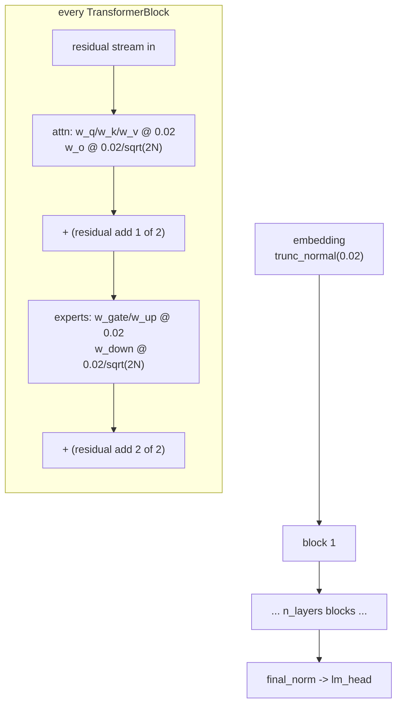

# 023 — Principled initialization: depth-aware residual scaling (Task 7)

**Type:** task · **Date:** 2026-09-02 · **Related:** `moe-modernization`
Requirement 9.1-9.5; `design.md` `model/transformer.py` component;
directly follows up entry 010's "embedding init blew up the logits" bug

## What was implemented
- **`QwenMoEModel.__init__`** now runs a real init scheme instead of
  leaving every `nn.Linear` on PyTorch's default Kaiming-uniform:
  - `self.apply(self._init_weights)` sets **every** `nn.Linear` weight and
    the `nn.Embedding` weight to a truncated normal at
    `ModelConfig.init_std` (default `0.02`), biases to zero.
  - a second pass then re-initializes the **residual-path output
    projections** — `Attention.w_o` / `MLAAttention.w_o`, and every
    expert's down-projection (`w_down` for SwiGLU/GEGLU, `w_2` for plain
    GELU) — at `init_std / sqrt(2 · n_layers)`.
  - a tied LM head (`lm_head.weight is embedding.weight`) is skipped by
    `_init_weights` so it keeps exactly the embedding's init, not a
    second linear-style pass (Requirement 9.3).
- The old `_EMBEDDING_INIT_STD = 0.02` module constant is gone; the
  embedding now gets `init_std` through the same `_init_weights` path
  (same 0.02 default, so entry 010's bug fix — "don't use `nn.Embedding`'s
  `N(0,1)` default" — stays fixed, just expressed through the config).
- **This is a deliberate, journaled default change** (Requirement 9.5):
  every linear's init distribution changes (Kaiming-uniform →
  trunc-normal at 0.02), so an existing *trained* checkpoint still loads
  (same shapes) but was trained from a different starting point. No test
  regressed.
- **Tests**: 4 new in `tests/test_model.py` (every linear is
  trunc-normal at `init_std`; residual projections scaled by
  `1/sqrt(2n)`; untrained logits have O(1) std; tied head keeps embedding
  init).
- `uv run pytest -q` — **274 passed** (was 270 after entry 022).

## Concepts explained for a complete beginner

### Why initialization scale matters at all
- **What it means:** before training starts, every weight is a random
  number. The *scale* (standard deviation) of those random numbers
  determines how big the activations are as a signal passes through the
  untrained network — too big and the first few training steps see
  exploding losses/gradients (entry 010 hit exactly this); too small and
  the signal vanishes and early training barely moves.
- **Why it exists:** each layer roughly multiplies the incoming activation
  variance by something proportional to (fan-in) × (weight variance).
  Chain enough layers and small deviations from "keep variance ≈ 1"
  compound exponentially with depth. Initialization schemes (Xavier/Glorot,
  Kaiming/He, and the transformer-specific one here) all pick the weight
  variance to keep activation variance stable through one layer.
- **Analogy:** a line of people passing a whispered message. If each
  person amplifies it slightly (speaks a bit louder than they heard), by
  the end it's a shout; if each softens it, the last person hears nothing.
  Good init is everyone agreeing to repeat it at exactly the volume they
  heard.
- **How it relates here:** the parent project (entry 010) originally
  custom-init'd *only* the embedding (to fix a blow-up) and left every
  `nn.Linear` on PyTorch's default. PyTorch's default `nn.Linear` init is
  Kaiming-uniform tuned for a plain ReLU MLP, not for a residual
  transformer — it ignores depth entirely. Task 7 replaces it with the
  scheme GPT-2 and Llama actually use.

### Truncated normal instead of Kaiming-uniform
- **What it means:** draw each weight from a normal distribution of the
  chosen std, but *reject and redraw* (here: clip) any value beyond ±2
  std, so there are no extreme outlier weights.
- **Why it exists:** a plain normal occasionally produces a weight 4–5 std
  out; in a large matrix that's several genuinely huge entries, which can
  create a lopsided initial function. Truncating at ±2 std removes that
  tail. GPT-2, T5, and ViT all use ±2 std truncation.
- **A real quirk worth knowing:** PyTorch's `nn.init.trunc_normal_(std=s)`
  does *not* re-inflate the distribution to compensate for the variance
  the truncation removes, so the *realized* std of the weights comes out
  around `0.88·s`, not `s` exactly. Measured on this project's
  `_tiny_config` (`init_std=0.02`): `w_q.weight.std()` ≈ `0.0178`. This is
  a known, small, and universally-tolerated discrepancy — the tests assert
  `0.7·init_std < std < init_std` rather than `≈ init_std` to bake the
  fact in rather than pretend it away.

### The `1/sqrt(2·n_layers)` residual-scaling rule
- **What it means:** the specific linear layers that write a block's
  output *back into the residual stream* (the attention output projection
  and each expert's final down-projection) get their init std divided by
  `sqrt(2·n_layers)` — a smaller starting scale than every other weight.
- **Why it exists / full derivation:** a pre-norm transformer's residual
  stream is `x → x + f₁(x) → x + f₁(x) + f₂(...) → ...`. Each block adds
  its contribution; nothing subtracts. If every block's output `fᵢ` has
  variance `v` and there are `N_res` of them (**two per layer** — one
  attention residual, one MoE residual — so `N_res = 2·n_layers`), then
  after all the additions the stream's variance is roughly
  $$
  \text{Var}(\text{stream}) \approx \text{Var}(x_0) + N_{\text{res}}\cdot v
  $$
  — it **grows linearly with depth**. To keep it depth-independent, make
  each block's contribution variance `v` shrink as `1/N_res`. Since a
  linear layer's output variance is proportional to its weight variance
  (`= std²`), scaling the weight *std* by `1/sqrt(N_res) =
  1/sqrt(2·n_layers)` scales the output *variance* by `1/N_res` exactly —
  giving `Var(stream) ≈ Var(x₀) + v`, constant in depth. This is exact
  algebra on variance-of-a-sum; the only "chosen" part is the decision to
  target constant (rather than slowly-growing) residual variance, which is
  GPT-2's design choice (Radford et al., 2019, §2.3: "scale the weights of
  residual layers at initialization by a factor of `1/√N`").
- **Worked example (`n_layers = 2`):** `N_res = 2·2 = 4`, scale factor
  `1/sqrt(4) = 0.5`. So `w_o` and the expert down-projections init at
  `0.02 · 0.5 = 0.01` std (nominal), every other linear at `0.02`.
  Measured on a real `_tiny_config(n_layers=2)` model: `w_q.weight.std()`
  = `0.01779`, `w_o.weight.std()` = `0.00862` — ratio `0.485`, matching
  the predicted `0.5` (the ~0.88 truncation factor cancels in the ratio).
  For `n_layers=6`: predicted ratio `1/sqrt(12) = 0.289`, measured
  `0.00506 / 0.01761 = 0.287`. For `n_layers=32`: `1/sqrt(64) = 0.125`.

**Real measured numbers** — residual-stream `std` after the embedding,
then after each of `BASELINE`'s 6 blocks (untrained, random input),
**with** the `1/sqrt(2N)` scaling vs. **without** it (residual projections
forced back to plain `0.02`):

| after | scaled init | unscaled init |
|---|---:|---:|
| embedding | 0.018 | 0.018 |
| block 1 | 0.020 | 0.038 |
| block 3 | 0.028 | 0.097 |
| block 6 | 0.042 | 0.159 |
| **total growth** | **2.4x** | **9.1x** |

Without the rule, the residual stream nearly quadruples its growth rate
(9.1x vs 2.4x over 6 blocks). At `BASELINE`'s modest depth the final logit
std ends up ≈ 0.28 either way (the `final_norm` RMSNorm rescales just
before the LM head regardless), so this isn't yet a *stability* problem
here — but the growth-*rate* gap is exactly what turns into exploding
early-training loss at the 24–80-layer depths real models use, which is
why the rule exists and why it's depth-*aware* (`sqrt(2·n_layers)`) rather
than a fixed constant.

## Questions that might come to mind
- **Does this break my existing checkpoints?** No — a saved
  `model_state_dict` loads into the new code unchanged (identical
  architecture and parameter shapes). What changed is only the *starting
  point* a fresh, untrained model begins from, so a model you train from
  scratch *now* will follow a different (better-behaved) trajectory than
  one trained before this task. Requirement 9.5 explicitly allows this as
  "a deliberate, journaled default change."
- **Why scale by `sqrt(2·n_layers)` and not just `sqrt(n_layers)`?**
  Because each transformer block adds to the residual stream *twice* —
  once after attention, once after the MoE/MLP — so a model with
  `n_layers` blocks has `2·n_layers` residual additions, not `n_layers`.
  GPT-2's "`N` = number of residual layers" counts both.
- **Is the router gate a "residual projection"?** No — the router's output
  is a set of logits used to *pick* experts, not a vector added back into
  the residual stream, so it gets the plain `init_std` like `w_q`/`w_k`.
  Only `w_o`, `w_down`, and `w_2` (the things whose output is literally
  `x + their_output`) get the scaling.
- **Why does the untrained logit std end up ~0.28 rather than ~1.0?**
  `init_std = 0.02` is deliberately small (GPT-2's value), and the
  `final_norm` RMSNorm before the LM head normalizes the stream to unit
  RMS before projecting — so the logit scale is set mostly by the
  (tied, `0.02`-init) LM head weights times `sqrt(d_model)`, landing
  sub-1. Requirement 9.4 asks for "within a small factor of 1.0" — `0.28`
  is, and critically it's not `50` (the entry-010 blow-up) or `1e-4`
  (vanished).

## Papers
- [Language Models are Unsupervised Multitask Learners (GPT-2; Radford et
  al., 2019)](https://cdn.openai.com/better-language-models/language_models_are_unsupervised_multitask_learners.pdf)
  — §2.3 introduces the `1/√N` residual-projection scaling this task
  implements (as `1/sqrt(2·n_layers)`, counting both residual adds per
  block).
- [nanoGPT's `_init_weights`](https://github.com/karpathy/nanoGPT/blob/master/model.py)
  — the widely-copied reference implementation of exactly this scheme
  (`torch.nn.init.normal_(p, mean=0.0, std=0.02/math.sqrt(2 *
  config.n_layer))` for every `*.c_proj.weight`), which this task mirrors
  with truncation added and MoE's multiple down-projection names
  (`w_o`/`w_down`/`w_2`) handled.
- [GPT-NeoX-20B (Black et al., 2022)](https://arxiv.org/abs/2204.06745) —
  §2.2 surveys the same small-init + residual-scaling family for a
  from-scratch large model, a useful cross-check that the rule is standard
  practice and not GPT-2-specific.

## Outcome
`uv run pytest -q` — **274 passed** (270 before this task). Task 7
checked off in `moe-modernization/tasks.md`.
