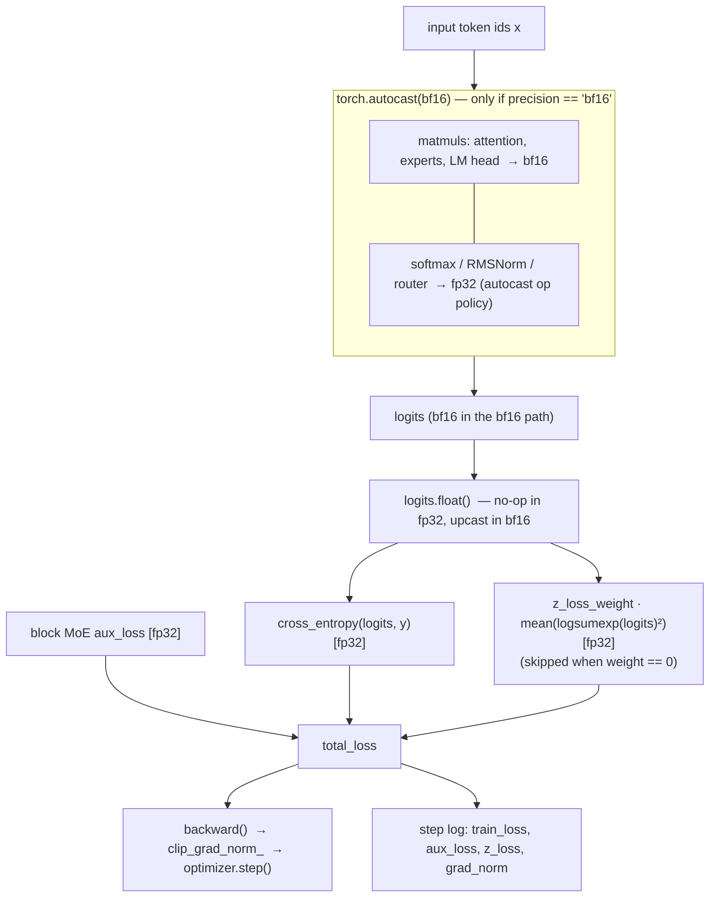

# 024 — Mixed precision (bf16 autocast) and the output z-loss (Task 8)

**Type:** task · **Date:** 2026-09-02 · **Related:** `moe-modernization`
Requirement 3.1-3.4; `design.md` `train/trainer.py` component

## What was implemented

- **`_forward_backward_step` (in `qwenmoe/train/trainer.py`)** grew three
  optional arguments — `device`, `precision`, `z_loss_weight` — all
  defaulting to today's behavior:
  - **bf16 autocast (Requirement 3.1, 3.2):** when
    `TrainConfig.precision == "bf16"`, the forward pass runs inside
    `torch.autocast(device_type=device, dtype=torch.bfloat16)`. When
    `precision == "fp32"` (the default) the context is
    `contextlib.nullcontext()` — literally a no-op — so the fp32 path is
    unchanged.
  - **loss always in fp32:** right after the forward, `logits =
    logits.float()`. On the fp32 path `logits` is *already* float32, so
    `.float()` returns the same tensor (a no-op). On the bf16 path it
    upcasts the bf16 logits so the cross-entropy and the z-loss run in
    float32. No gradient scaler is created (bf16 doesn't need one — see
    below).
  - **output z-loss (Requirement 3.3):** when
    `TrainConfig.z_loss_weight > 0`, add
    `z_loss_weight × mean(logsumexp(logits, dim=-1) ** 2)` to the training
    loss. When the weight is `0` (the default) the term is skipped entirely
    and the returned `z_loss` is `None` — nothing is added, so the loss is
    identical to before this task.
  - Return signature went from `(lm_loss, aux_loss, grad_norm)` to
    `(lm_loss, aux_loss, z_loss, grad_norm)`.
- **`_run_step`** threads `config.precision` / `config.z_loss_weight`
  through to both call sites (the normal one and the mps→cpu fallback one)
  and returns the extra `z_loss` value.
- **`Trainer.fit`:**
  - logs a startup line stating the effective precision, e.g.
    `effective training precision: bf16 (torch.autocast) | device: cpu |
    z_loss_weight: 0` (Requirement 3.2 / design.md Error Handling).
  - the JSON-lines **step record gains a `z_loss` field** (`None` when off),
    alongside the existing `train_loss`, `aux_loss`, `grad_norm`. The
    console line gains `| z_loss …` too. Both are additive — no existing log
    reader breaks.
- **`qwenmoe/model/moe.py` one-line autocast-safety fix:** the routed-expert
  scatter did `routed_output.index_add_(0, token_idx, gate * expert(...))`.
  Under autocast the expert's `nn.Linear`s emit bf16 but `routed_output` is
  the fp32 residual stream, and `index_add_` is dtype-strict (`self` and
  `source` must match). The contribution is now `.to(routed_output.dtype)`
  before the scatter — a no-op in fp32 (byte-identical to before), an
  fp32-accumulate in bf16 (which is the numerically *better* choice anyway).
- **Tests:** 6 new in `tests/test_trainer_integration.py` — fp32 +
  `z_loss_weight=0` reproduces `F.cross_entropy` exactly (`rel=1e-6`);
  positive weight returns a finite non-negative term; bf16 autocast stays
  finite (unit + a 50-step integration run whose loss still decreases);
  the `z_loss` step-log field is `None` off / finite-non-negative on; the
  startup precision line is emitted.
- `uv run pytest -q` — **280 passed** (was 274 after entry 023).

## Concepts explained for a complete beginner

### "Precision": how a number is stored in the machine

- **What it means:** every weight, activation and gradient is a
  floating-point number: `sign × mantissa × 2^exponent`. The format decides
  how many bits go to the mantissa (how many significant digits you keep)
  and how many to the exponent (how big or small the number can get before
  it overflows to infinity or underflows to zero).
- **The three formats that matter here:**

  | format | bits (sign / exp / mantissa) | ~significant decimal digits | largest finite value |
  |---|---|---:|---:|
  | **fp32** (float, the default) | 1 / 8 / 23 | ~7 | ~3.4 × 10³⁸ |
  | **fp16** (half) | 1 / 5 / 10 | ~3 | 65 504 |
  | **bf16** (bfloat16, "brain float") | 1 / 8 / 7 | ~2–3 | ~3.4 × 10³⁸ |

- **The key insight:** bf16 keeps fp32's *8 exponent bits* and sacrifices
  mantissa bits instead. So bf16 has the **same range** as fp32 (it can
  represent 10³⁸ and 10⁻³⁸) but is **coarser** — only 2–3 good digits. fp16
  is the opposite trade: more mantissa (finer), but a tiny range that tops
  out at 65 504.
- **Why this matters for training:** gradients during backprop routinely
  span many orders of magnitude and some are genuinely tiny (10⁻⁷). In
  **fp16** those underflow to exactly `0` and the weight never updates —
  which is why fp16 training needs **loss scaling**: multiply the loss by a
  big constant (say 2¹⁶) before `.backward()` so every gradient is shifted
  up into fp16's representable band, then divide it back out before the
  optimizer step (Micikevicius et al. 2017). In **bf16** the range is
  fp32-wide, so nothing underflows and **no loss scaler is needed** — bf16
  is a genuine drop-in. That is exactly what Requirement 3.1 asks for
  ("require no gradient scaler").
- **Analogy:** fp32 is a tape measure marked in millimetres that reaches
  30 metres. fp16 is marked in tenths of a millimetre but only reaches
  65 cm — very precise, useless for measuring a room. bf16 is marked in
  half-centimetres and still reaches 30 metres — rougher, but it never
  runs out of tape.

### `torch.autocast`: mixed, not uniform, precision

- **What it means:** `with torch.autocast(dtype=torch.bfloat16): y =
  model(x)` doesn't cast *everything* to bf16. PyTorch keeps an internal
  **op policy**: matrix multiplies and convolutions (the expensive,
  precision-tolerant parts) run in bf16; reductions and normalizations that
  are precision-*sensitive* — `softmax`, `log_softmax`, `layer_norm`,
  `cross_entropy`, `sum`, `logsumexp` — are automatically kept in fp32 even
  inside the block.
- **Why it exists:** the speed and memory win comes almost entirely from the
  big matmuls (attention scores, the MoE expert projections, the LM head).
  A softmax over the vocabulary, by contrast, adds up tens of thousands of
  `exp(...)` terms — do that in bf16's 2–3 digits and the rounding error
  swamps the answer. Autocast gets the win where it's safe and skips it
  where it isn't, with zero code from you.
- **Measured, under `torch.autocast(device_type="cpu",
  dtype=torch.bfloat16)`** on this project's model:

  | op | dtype inside the autocast block |
  |---|---|
  | `a @ a.T` (a matmul) | `bfloat16` |
  | `F.softmax(...)` | `float32` (autocast override) |
  | `model(x)` logits (ends in a `Linear`) | `bfloat16` |
  | `extras["aux_loss"]` (built from a softmax) | `float32` |

- **How it relates here:** this is the honest answer to *"why does the
  router stay fp32?"* — **we don't do anything special.** The router's
  `F.softmax(router_logits)` (in `qwenmoe/model/moe.py`) is on autocast's
  fp32 list, so it already runs in fp32 inside the bf16 region. We
  additionally cast the *output* logits to fp32 by hand
  (`logits.float()`) so the whole final-loss subgraph — not just the
  softmax kernel — is fp32, which is where the z-loss below also lives.

### The z-loss: pinning down the softmax normalizer

- **Terms first:**
  - **logits** `z` — the raw pre-softmax scores, one per vocabulary token,
    shape `(…, V)`.
  - **softmax** turns them into probabilities:
    `p_i = exp(z_i) / Σ_j exp(z_j)`. The denominator `Z = Σ_j exp(z_j)` is
    the **normalizer** (a.k.a. the partition function).
  - **logsumexp** `= log Z = log Σ_j exp(z_j)`. It's the numerically stable
    way to compute `log` of that sum, and PyTorch exposes it as
    `torch.logsumexp`.
  - **cross-entropy** for the true token `y` is
    `CE = −log p_y = −z_y + log Z`.

- **The problem — cross-entropy is shift-invariant.** Add the *same*
  constant `c` to every logit:
  $$
  \log Z' = \log \sum_j e^{z_j + c} = \log\!\Big(e^{c}\sum_j e^{z_j}\Big)
          = c + \log Z
  $$
  and `z_y' = z_y + c`, so
  $$
  CE' = -(z_y + c) + (\log Z + c) = -z_y + \log Z = CE .
  $$
  The loss is **completely blind** to the absolute level of the logits —
  only their *differences* matter. So during training nothing stops the
  whole logit vector from slowly drifting to large magnitudes. In fp32
  that's harmless; in bf16 a `log Z` of 20–30 means `Z ≈ e^30 ≈ 10¹³`, a
  sum of huge `exp` terms computed in 2–3 digits — rounding error, then
  overflow, then a loss spike. (ST-MoE reports the same failure inside the
  *router's* matmuls; PaLM reports it at the output softmax.)

- **The fix — penalize `(log Z)²`.** Add
  $$
  \mathcal{L}_z = \lambda \cdot \operatorname{mean}\big[(\log Z)^2\big],
  \qquad \lambda \approx 10^{-4}
  $$
  Its gradient w.r.t. each logit is
  $\partial \mathcal{L}_z / \partial z_i = 2\lambda (\log Z)\, p_i$, i.e. it
  pushes `log Z` toward `0` (so `Z → 1`), and it does so **proportionally to
  `p_i`** — a uniform-ish pull that shifts the whole vector down without
  disturbing the differences that encode the probabilities. Squaring (not
  `|log Z|`) makes the penalty negligible while `log Z` is small and sharply
  increasing once it isn't — a soft barrier, not a constant tax.

- **Hand-worked example** (`V = 3`, `λ = 10⁻⁴`, true token = index 0),
  verified against `torch`:

  | all logits shifted by | `logsumexp` (`log Z`) | `z_loss = λ·(log Z)²` | cross-entropy | softmax probs |
  |---:|---:|---:|---:|---|
  | `+0`  | 2.4076  | 5.797 × 10⁻⁴ | 0.4076 | `[0.665, 0.245, 0.090]` |
  | `+5`  | 7.4076  | 5.487 × 10⁻³ | 0.4076 | `[0.665, 0.245, 0.090]` |
  | `+10` | 12.4076 | 1.539 × 10⁻² | 0.4076 | `[0.665, 0.245, 0.090]` |

  Start from `z = [2, 1, 0]`: `Z = e² + e¹ + e⁰ = 7.389 + 2.718 + 1 =
  11.107`, `log Z = ln 11.107 = 2.4076`, so `z_loss = 10⁻⁴ × 2.4076² =
  10⁻⁴ × 5.797 = 5.80 × 10⁻⁴`. Shift every logit up by 10 and the
  probabilities and the cross-entropy are **byte-identical**, but `log Z`
  jumps to `12.4076` and the z-loss is **27× larger** (`1.54 × 10⁻²`). The
  z-loss is the *only* part of the objective that sees — and resists — the
  drift.

- **On this project's real (untrained) model** (`d_model=64`, `V=12`): mean
  `log Z ≈ 2.644`, so `z_loss @ 10⁻⁴ ≈ 7.0 × 10⁻⁴` — utterly dominated by
  the `~2.6` cross-entropy, as intended. Artificially scale the logits ×10
  and it climbs to `1.05 × 10⁻²`.

**Real measured** — 60-step run on the period-10 toy stream, fp32 vs
`precision='bf16'`, identical seed (`qwenmoe` model, `d_model=64`,
`n_layers=4`):

| step | fp32 train loss | bf16 train loss | \|diff\| |
|---:|---:|---:|---:|
| 1 | 2.6973 | 2.6974 | 0.0000 |
| 5 | 1.6964 | 1.6910 | 0.0054 |
| 10 | 0.4475 | 0.4329 | 0.0146 |
| 20 | 0.0115 | 0.0108 | 0.0007 |
| 40 | 0.0019 | 0.0006 | 0.0012 |
| 60 | 0.0008 | 0.0005 | 0.0003 |

bf16 tracks fp32 to within `~0.015` at the noisiest point (step 10, mid
transition) and both converge to `< 10⁻³`. The difference is real rounding
noise, not divergence — which is exactly why bf16 is an **opt-in axis**,
not a pure-win default: it's a speed/memory trade with a small accuracy
cost, and the ablation study (task 16) will measure whether it matters at
the TinyStories tier.

## Questions that might come to mind

- **If bf16 needs no loss scaler and has fp32's range, why isn't it the
  default?** Two reasons. (1) It's genuinely lossier — 2–3 significant
  digits vs 7 — so weight updates smaller than ~0.1 % of the weight can be
  rounded away ("stale weights"); real trainers keep an **fp32 master copy**
  of the weights and the optimizer state and only the forward/backward math
  is bf16. This project's optimizer state is already fp32 and stays that
  way; only the forward is autocast. (2) On this project's CPU/MPS target
  there's no dedicated bf16 matmul unit the way an NVIDIA/TPU chip has, so
  the speedup is modest — the point of the flag is to *study* mixed
  precision, and to be ready for the day the study runs on rented hardware.
- **Does `z_loss_weight = 0` really give byte-identical training?** Yes, and
  there's a test pinning it: with `precision="fp32", z_loss_weight=0.0` the
  `logits.float()` is a no-op, the `if z_loss_weight > 0` branch is never
  entered, and the returned `lm_loss` equals a hand-computed
  `F.cross_entropy` to `rel=1e-6` (measured: identical to 10 decimal
  places). The z-loss and autocast are dormant code until you turn them on.
- **Why square `log Z` instead of penalizing `|log Z|` or `Z` directly?**
  `(log Z)²` is smooth at `0` and flat there (zero gradient when already
  centered), so it doesn't fight the main loss in the normal regime, then
  grows quadratically once `log Z` gets large — a soft barrier. `|log Z|`
  has a constant-size gradient everywhere (a fixed tax even when things are
  fine). Penalizing `Z` itself is scale-wrong: `Z` is `exp` of a logit sum,
  so its gradient explodes exactly when you least want a big update.
- **Is this the same as the *router* z-loss in Requirement 4.3?** Same
  formula, different tensor. This task's z-loss is on the **output** logits
  (`vocab`-sized, one softmax per token — the PaLM version). Task 9's
  `router_z_loss_weight` applies the identical `mean(logsumexp(...)²)` to
  the **router** logits (`n_routed_experts`-sized — the ST-MoE version).
  Both guard a softmax against logit blow-up; they're just at different
  layers.
- **What happens on MPS if bf16 autocast isn't supported for some op?**
  `torch.autocast` falls back to running that op in fp32 rather than
  erroring for most ops; if a hard `RuntimeError` does fire mid-step, the
  existing `_run_step` catch-and-fall-back-to-cpu path (from the parent
  spec) handles it — the run continues on cpu, with a logged warning,
  never a crash.
- **Why cast the MoE expert contribution to `routed_output.dtype` rather
  than making `routed_output` bf16?** Accumulating many small expert
  outputs into one running sum is exactly the kind of reduction that loses
  precision in bf16 (the same reason autocast keeps `sum` in fp32).
  Upcasting each contribution and accumulating in fp32 is both the
  dtype-safe fix *and* the more accurate one, and it's a literal no-op when
  autocast is off.

## Papers

- [PaLM: Scaling Language Modeling with Pathways (Chowdhery et al., 2022)](https://arxiv.org/abs/2204.02311)
  — §3 (Training Instability) introduces the output **z-loss**,
  `10⁻⁴ · log²Z`, "to encourage the softmax normalizer `log(Z)` to be close
  to 0", reported to improve training stability. This task's
  `z_loss_weight` default region and formula come from here.
- [ST-MoE: Designing Stable and Transferable Sparse Expert Models (Zoph et
  al., 2022)](https://arxiv.org/abs/2202.08906) — introduces the **router
  z-loss** with the same `mean(logsumexp(logits)²)` shape, motivated by
  "large logits [that] can lead to numeric overflows in the large matrix
  multiplications" of the MoE layer. Task 9 wires the router-side version;
  this entry explains the shared mechanism.
- [Mixed Precision Training (Micikevicius et al., 2017)](https://arxiv.org/abs/1710.03740)
  — the paper that established **loss scaling** for fp16 to combat gradient
  underflow. bf16's fp32-width exponent is precisely what lets this task
  skip loss scaling (Requirement 3.1: "require no gradient scaler").

## Outcome

`uv run pytest -q` — **280 passed** (274 before this task). Task 8 checked
off in `moe-modernization/tasks.md`.
