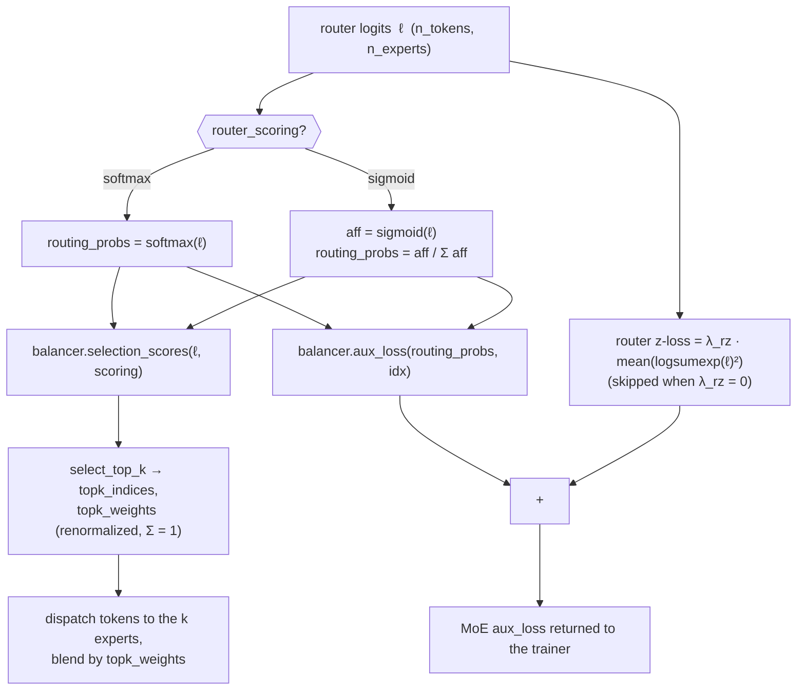

# 025 — MoE routing: sigmoid scoring, router z-loss, config-driven aux weight (Task 9)

**Type:** task · **Date:** 2026-09-02 · **Related:** `moe-modernization`
Requirement 4.1, 4.2, 4.3, 4.5, 4.6; `design.md` `model/moe.py` component;
follows up entries 006 (the router) and 016 (loss-free balancing)

> **Full derivation, solved by hand:** [`docs/math/025-moe-routing-sigmoid-and-router-z-loss.md`](../docs/math/025-moe-routing-sigmoid-and-router-z-loss.md).

## What was implemented

All three knobs default to the pre-spec path, so a config written before
this spec routes bit-identically to today.

- **`score_and_select(router_logits, balancer, top_k, scoring)`** — one new
  function in `qwenmoe/model/moe.py` that replaces the three inline lines
  (`F.softmax` → `balancer.selection_scores` → `select_top_k`) both
  `MoELayer.forward` and `MoELayer.forward_with_trace` used to carry. It
  returns `(topk_indices, topk_weights, routing_probs)`.
  - `scoring == "softmax"` (default): **exactly** the old path — a
    per-token softmax over experts is both `routing_probs` and the source of
    the renormalized top-k combination weights. A test pins
    `torch.equal(...)` against the old code.
  - `scoring == "sigmoid"` (DeepSeek-V3): `affinities =
    sigmoid(router_logits)`; `routing_probs = affinities /
    affinities.sum(-1)`; the top-k are selected and their affinities
    renormalized to sum to 1 for the gate weights.
- **`Balancer.selection_scores(router_logits, scoring="softmax")`** — both
  balancers gained the `scoring` kwarg (default keeps the old behavior, so
  the ~6 external callers that pass one argument are untouched):
  - `AuxLossBalancer`: still returns the raw logits (softmax **and** sigmoid
    are monotonic in the logit, so the top-k *set* is identical either way;
    only the gate weights differ, and those come from `routing_probs`).
  - `LossFreeBalancer`: `sigmoid(logits) + bias` for sigmoid scoring
    (DeepSeek-V3's actual choice), `softmax(logits) + bias` for softmax.
- **Router z-loss (Requirement 4.3)** — new `MoELayer._add_router_z_loss`:
  when `ModelConfig.router_z_loss_weight > 0`, add `weight ×
  mean(logsumexp(router_logits, dim=-1) ** 2)` (computed in fp32) into the
  MoE aux-loss total. It is **balancer-independent** — with the loss-free
  balancer, whose `aux_loss` is normally `None`, the router z-loss becomes
  the whole term rather than being dropped. (design.md sketched this inside
  `AuxLossBalancer`; putting it in `MoELayer` is the correction that makes
  Requirement 4.3 hold for `moe_balancing == "loss_free"` too.)
- **Config-driven aux weight (Requirement 4.5)** — `build_balancer` now
  passes `config.aux_loss_weight` (default `0.01`, the old hard-coded value)
  into `AuxLossBalancer(loss_weight=...)`.
- **Trace** — `forward_with_trace`'s `trace["router_probs"]` now holds
  `routing_probs` (the softmax distribution, or the normalized-sigmoid
  distribution). Same shape `(n_tokens, n_routed_experts)`, same "sums to 1"
  contract, so the Manim scenes and `test_trace.py` are unaffected.
- **Tests** — 12 new (`tests/test_moe.py` ×10, `tests/test_model.py` ×2
  parametrized): softmax path byte-identical to pre-spec; sigmoid selects
  exactly `k` and both `topk_weights` and `routing_probs` sum to 1;
  sigmoid gate weights are the renormalized selected affinities; sigmoid
  and softmax genuinely disagree once the loss-free bias is in play; unknown
  scoring raises; a sigmoid `MoELayer` with idle experts still runs;
  `router_z_loss_weight == 0` leaves `aux_loss` byte-identical; a positive
  weight adds a non-negative term that tracks logit scale and reaches the
  total; the router z-loss works with the loss-free balancer;
  `aux_loss_weight` is config-driven; a full `QwenMoEModel` trains a few
  steps with each `router_scoring`.
- `uv run pytest -q` — **292 passed** (was 280 after entry 024).

## Concepts explained for a complete beginner

### Recap: what "routing" is

- **Terms:** an **expert** is one small feed-forward network. A
  **Mixture-of-Experts (MoE)** layer holds many experts (this project's
  baseline: 8 "routed" + 1 always-on "shared") but sends each token to only
  a few. The **router** is a single linear layer `d_model → n_routed_experts`
  that outputs one **logit** per expert per token; **top-k** selection keeps
  the `k` highest (baseline `k = 2`); the selected experts' outputs are
  blended with **gate weights** (a.k.a. combination weights) that sum to 1.
- **Why:** you get the representational capacity of a big model but only pay
  the compute of `k` small experts per token.

### Softmax scoring (what the project did) vs sigmoid scoring (DeepSeek-V3)

- **Softmax scoring:** `probs = softmax(logits)` turns the whole logit
  vector into one probability distribution — the values are **coupled**,
  they compete for a fixed budget of 1.0. Selecting the top-`k` and
  renormalizing gives the gate weights.
- **Sigmoid scoring:** `aff_i = sigmoid(logit_i) = 1 / (1 + e^{-logit_i})`
  scores **each expert independently** in `(0, 1)` — "how relevant is expert
  `i` to this token?", asked one expert at a time, no competition. The
  selected affinities are then renormalized to sum to 1 for the gate
  weights, and the *full* affinity vector is rescaled to sum to 1 to serve
  as `routing_probs` (what the load-balancing loss and the trace consume).

- **Worked example — 1 token, 4 experts, `logits = [3.0, 1.0, 0.5, −2.0]`,
  `k = 2`** (verified against `torch`):

  | | expert 0 | expert 1 | expert 2 | expert 3 | sum |
  |---|---:|---:|---:|---:|---:|
  | `softmax(logits)` | 0.8169 | 0.1106 | 0.0671 | 0.0055 | **1.0000** |
  | `sigmoid(logits)` | 0.9526 | 0.7311 | 0.6225 | 0.1192 | 2.4253 |

  Both pick experts **{0, 1}** (the two biggest logits — as they always
  will, since both transforms are monotonic). The **gate weights differ**:
  - softmax: `0.8169 / (0.8169 + 0.1106) = 0.8808`, and `0.1192` → gate
    `[0.881, 0.119]` — sharply skewed toward expert 0.
  - sigmoid: `0.9526 / (0.9526 + 0.7311) = 0.5658`, and `0.4342` → gate
    `[0.566, 0.434]` — much gentler.

  **Why the difference matters:** softmax's shared denominator *amplifies*
  the logit gap (a 2-unit gap became an 7:1 weight ratio); sigmoid's
  independent scoring keeps the blend closer to even (the same 2-unit gap
  is only a 1.3:1 ratio). Sigmoid experts are also less likely to be
  starved of gradient — a runner-up expert still gets a substantial gate
  weight, so its parameters keep learning.

### Identifiability: softmax has a hidden redundant knob

- **The fact:** `softmax(logits + c) = softmax(logits)` for any constant
  `c` — adding the same number to every router logit changes *nothing*
  downstream. So the router has a **whole direction in parameter space
  (the all-ones direction of its output) that the loss can't see** — it is
  *unidentifiable*. During training the logits can wander along that
  direction indefinitely.
- **Sigmoid removes it:** `sigmoid(logit_i + c) ≠ sigmoid(logit_i)` —
  each logit's absolute value now controls its expert's affinity, so
  there's no free direction. The parameterization is identifiable.
- **Why you care:** an unidentifiable drift is exactly what pushes router
  logits to large magnitudes, and large logits are what overflow the MoE
  layer's matmuls in low precision (ST-MoE's reported failure mode). Sigmoid
  scoring is structurally more resistant; for the softmax path, the **router
  z-loss** below is the fix.

### The router z-loss

- **What it is:** the identical term from entry 024's *output* z-loss, but
  applied to the **router** logits instead of the vocabulary logits:
  $$
  \mathcal{L}_{\text{router-}z}
    = \lambda_{\text{rz}} \cdot
      \operatorname{mean}\!\big[\,(\log\textstyle\sum_j e^{\,\ell_j})^2\,\big],
  $$
  where `ℓ_j` is the router logit for expert `j` and `log Σ e^{ℓ_j} =
  logsumexp(ℓ)`. It penalizes the log of the router's softmax normalizer,
  pulling it toward 0 (normalizer toward 1) — i.e. it keeps the router
  logits from drifting large without touching their *differences* (which
  decide the routing). Full derivation of the shift-invariance that makes
  this necessary, and why we square, is in [[024-mixed-precision-and-z-loss]].
- **Where it comes from:** ST-MoE (Zoph et al., 2022) introduced it
  *specifically* for the router: "large logits ... can lead to numeric
  overflows in the large matrix multiplications" inside an MoE layer.
- **Measured** on this project's untrained router (`d_model=64`, 8 experts,
  `λ_rz = 10⁻³`):

  | router logits | mean \|logit\| | mean logsumexp | router z-loss |
  |---|---:|---:|---:|
  | as initialized | 0.485 | 2.190 | 4.9 × 10⁻³ |
  | × 5 | 2.425 | 4.449 | 2.2 × 10⁻² |
  | × 20 (blow-up) | 9.699 | 16.152 | **3.2 × 10⁻¹** |

  At normal scale it's a rounding-error-sized nudge (`~5 × 10⁻³` against a
  `~2.6` cross-entropy); once the logits blow up 20× it's a `0.3` penalty
  that the optimizer cannot ignore — a soft barrier, exactly as intended.

### Config-driven aux-loss weight

- **What changed:** `AuxLossBalancer` (the Switch-Transformer load-balancing
  loss) had its `loss_weight` hard-coded to `0.01`. It now reads
  `ModelConfig.aux_loss_weight`, default `0.01` — so nothing changes unless
  you set it, but "how hard do we push for balanced experts?" is now a
  study axis instead of a magic number.
- **Reminder of what that loss does:** `L_aux = weight · N · Σ_i f_i · P_i`
  where `f_i` = fraction of tokens routed to expert `i` and `P_i` = mean
  router probability for expert `i`. It's minimized when load is uniform.
  (Derivation and worked example: journal entry 007.)

**Real measured** — 60-step run on the period-10 toy stream, identical seed,
8 routed experts, `top_k = 2` (`d_model=64`, `n_layers=3`):

| scoring | loss @1 | loss @10 | loss @60 | layer-0 expert token fractions |
|---|---:|---:|---:|---|
| softmax | 2.625 | 0.278 | 0.0004 | `0.14 0.11 0.14 0.21 0.13 0.12 0.12 0.03` |
| sigmoid | 2.625 | 0.301 | 0.0002 | `0.12 0.12 0.14 0.14 0.10 0.11 0.12 0.14` |

Both converge. Notably the **sigmoid run is visibly better balanced** — its
busiest expert takes 14 % of tokens and its quietest 10 %, versus softmax's
21 % / 3 % spread — consistent with DeepSeek-V3's finding that
independent-affinity scoring interacts more gently with the load balancer.
(One toy run, one layer — the real evidence comes from the multi-seed
TinyStories study in task 16; this is a sanity check that the axis behaves.)

## Questions that might come to mind

- **Does `router_scoring="softmax"` really change nothing?** Yes — a test
  asserts `torch.equal` (not `allclose`) between `score_and_select(...,
  "softmax")` and the exact three lines it replaced. The refactor is a
  pure code move on that path.
- **Why does `AuxLossBalancer` not bother applying sigmoid in
  `selection_scores`?** Because top-k only needs the *ranking*, and
  `sigmoid` is strictly increasing, so `topk(logits) == topk(sigmoid(
  logits))` — applying it would be wasted compute. The `LossFreeBalancer`
  *does* apply it, because adding its per-expert `bias` to the score only
  makes sense on the bounded `(0,1)` affinity, not on an unbounded logit,
  and the bias is what breaks the ranking equivalence.
- **How much do softmax and sigmoid actually differ in practice?** With no
  loss-free bias, *never* on selection (monotonic) — only on gate weights.
  *With* the loss-free bias: measured **18 %** of tokens get a different
  top-2 set at a bias range of ±0.1, rising to **40 %** at ±0.3. So sigmoid
  is a real axis mainly in combination with loss-free balancing.
- **Is the router z-loss the same as the output z-loss from task 8?** Same
  formula, different logits. Task 8's is on the `vocab`-sized output logits
  (PaLM). This one is on the `n_experts`-sized router logits (ST-MoE). A run
  can enable either, both, or neither.
- **Why put the router z-loss in `MoELayer` and not `AuxLossBalancer` like
  the design said?** Because `LossFreeBalancer.aux_loss` returns `None` —
  if the z-loss lived inside the balancer it would be silently dropped for
  every loss-free run, and Requirement 4.3 has no "unless loss-free" clause.
  `MoELayer._add_router_z_loss` handles the `None` case (the z-loss becomes
  the whole term).
- **Do the sigmoid `routing_probs` really sum to 1?** Yes, by the explicit
  `aff / aff.sum(-1, keepdim=True)`. The raw affinities do *not* (they're
  independent), which is the whole point of sigmoid scoring — the
  normalization is a separate, deliberate step, and it's only applied to
  build the distribution the aux loss / trace expect.

## Papers

- [DeepSeek-V3 Technical Report (DeepSeek-AI, 2024)](https://arxiv.org/abs/2412.19437)
  — §2.1.2: "we use the sigmoid function to compute the affinity scores,
  and applies a normalization among all selected affinity scores to produce
  the gating values", replacing DeepSeek-V2's softmax. Also the source of
  the auxiliary-loss-free bias this project already had (entry 016).
- [ST-MoE: Designing Stable and Transferable Sparse Expert Models (Zoph et
  al., 2022)](https://arxiv.org/abs/2202.08906) — introduces the **router
  z-loss**, `mean(logsumexp(router_logits)²)`, to stop large router logits
  from overflowing the MoE layer's matmuls.
- [Switch Transformers (Fedus, Zoph & Shazeer, 2021)](https://arxiv.org/abs/2101.03961)
  — the load-balancing auxiliary loss `α · N · Σ f_i · P_i` whose weight
  `α` (this project's `aux_loss_weight`) is now config-driven; the paper
  uses `α = 10⁻²`, which stays the default.
- [DeepSeek-V2 (DeepSeek-AI, 2024)](https://arxiv.org/abs/2405.04434) — the
  softmax-gated predecessor, for contrast: the routing this project's
  baseline was modeled on.

## Outcome

`uv run pytest -q` — **292 passed** (280 before this task). Task 9 checked
off in `moe-modernization/tasks.md`.
