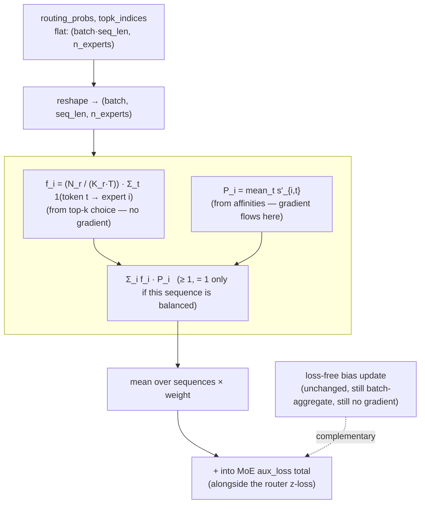

# 026 — The loss-free balancer's complementary per-sequence balance loss (Task 10)

**Type:** task · **Date:** 2026-09-02 · **Related:** `moe-modernization`
Requirement 4.4, 4.6; `design.md` `model/moe.py` component;
directly extends entry 016 (loss-free bias balancing) and entry 007 (the
batch-wide auxiliary loss)

> **Full by-hand derivation:** [`docs/math/026-per-sequence-balance-loss.md`](../docs/math/026-per-sequence-balance-loss.md)
> carries a 2-sequence, 3-token, 2-expert, top-1 example — every sequence
> internally 100% collapsed, yet the batch itself perfectly balanced —
> through every line of `LossFreeBalancer.sequence_balance_loss` and
> `MoELayer._add_seq_balance_loss`: the reshape's row-major invariant,
> `f_i`/`P_i` each derived from their exact sum constraints, an exact
> covariance identity for `Σf_i·P_i` (plus a real counterexample showing
> the popular "always ≥ 1" claim isn't a theorem), a real side-by-side
> against the batch-wide Switch loss on identical routing, and the
> gradient chased in closed form into the router weight — all checked
> against the real module by
> [`docs/math/verify_026_per_sequence_balance_loss.py`](../docs/math/verify_026_per_sequence_balance_loss.py).

## What was implemented

- **`LossFreeBalancer.sequence_balance_loss(routing_probs, topk_indices,
  seq_len, top_k, weight)`** — a new method implementing DeepSeek-V3's
  "complementary sequence-wise auxiliary loss" (arXiv:2412.19437, Eq.
  17-19). It reshapes the flat `(batch·seq_len, n_experts)` routing tensors
  back to `(batch, seq_len, n_experts)`, computes the classic
  `Σ_i f_i · P_i` load-balance quantity **within each sequence separately**,
  and averages over the batch. Returns `weight · mean_seq(Σ_i f_i P_i)`.
- **`MoELayer._add_seq_balance_loss(...)`** — folds that term into the MoE
  aux-loss total (the same total that already carries the router z-loss from
  task 9), in both `forward` and `forward_with_trace`. It is a **no-op**
  unless *both*:
  - `ModelConfig.seq_balance_loss_weight > 0` (default `0.0`), **and**
  - the balancer actually has a `sequence_balance_loss` method — i.e.
    `moe_balancing == "loss_free"`. The aux-loss balancer already carries a
    batch-wide term, so Requirement 4.4 explicitly scopes this to the
    loss-free path; `_add_seq_balance_loss` checks `getattr(self.balancer,
    "sequence_balance_loss", None)`.
- **`MoELayer.__init__`** stores `self.seq_balance_loss_weight =
  config.seq_balance_loss_weight`.
- No trainer change: the term rides in `extras["aux_loss"]`, which the step
  log already records — matching how task 9's router z-loss is surfaced
  (design.md's step-log section adds only `z_loss`/`grad_norm`/`mtp_loss` as
  *new* keys).
- **Tests** — 5 new in `tests/test_moe.py`: `seq_balance_loss_weight == 0`
  ⇒ a loss-free layer still reports `aux_loss is None`; a collapsed sequence
  scores `1.4` vs the balanced floor of `1.0`; **a batch that is Switch-loss
  balanced but per-sequence collapsed is caught by this term and not by the
  Switch loss**; an aux-loss layer ignores the weight entirely
  (`torch.equal` on the aux loss); the term reaches a loss-free layer's aux
  total, trains the router, and leaves the bias buffer gradient-free.
- `uv run pytest -q` — **297 passed** (was 292 after entry 025).

## Concepts explained for a complete beginner

### The problem: "balanced on average" is not "balanced"

- **Terms:**
  - **routed expert** — one of the `n_routed_experts` (baseline: 8) small
    FFNs the router picks `top_k` of (baseline: 2) per token.
  - **load** of an expert — how many tokens got sent to it.
  - **load balancing** — keeping every expert roughly equally busy, so no
    expert is a bottleneck and none is starved of training signal.
  - **loss-free balancing** (entry 016) — the current default balancing
    strategy: a per-expert **bias** is *added to the routing score for
    selection only* and nudged after every step (down for busy experts, up
    for idle ones). There is **no gradient-based loss term** — hence
    "loss-free".
- **The gap loss-free balancing leaves:** the bias is updated from
  **batch-aggregate** counts. It happily reaches a state where, over a whole
  batch, every expert gets its fair share — while *within* any single
  sequence, all tokens pile onto one or two experts. That is
  **per-sequence routing collapse**: fine for the aggregate statistics,
  bad for the model (a sequence's tokens stop specializing; at inference,
  where you often decode one sequence at a time, the "balance" evaporates).
- **Analogy:** a library with 8 identical help desks. Averaged over a week,
  each desk serves the same number of readers — the manager's dashboard is
  green. But every *morning* everyone queues at desk 1 and the afternoon
  crowd all go to desk 2. The daily total looks balanced; the actual
  experience is a permanent queue. You need a *per-session* check, not just
  a weekly average.

### The fix: a tiny gradient-based term, computed per sequence

DeepSeek-V3 keeps loss-free balancing as the main mechanism but adds back a
**very small** auxiliary loss — small enough not to hurt model quality the
way a large aux loss does (that was the whole motivation for going
loss-free) — computed **per sequence**:

For one sequence of `T` tokens, with `K_r = top_k`, `N_r = n_experts`, and
`s'_{i,t}` = the token's normalized routing affinity for expert `i`:

$$
f_i = \frac{N_r}{K_r\,T}\sum_{t=1}^{T}\mathbb{1}\!\left(\text{token }t\text{ selects expert }i\right)
\qquad
P_i = \frac{1}{T}\sum_{t=1}^{T} s'_{i,t}
\qquad
\mathcal{L}_{\text{seq}} = \alpha \sum_{i=1}^{N_r} f_i\,P_i
$$

then average `L_seq` over the sequences in the batch.

- **`f_i`** is the *realized* load: fraction of this sequence's
  selection-slots that went to expert `i`, scaled by `N_r/K_r` so that
  `Σ_i f_i = N_r` and a perfectly even sequence has every `f_i = 1`.
  It depends only on the discrete top-k choice → **no gradient** flows
  through it.
- **`P_i`** is the *intended* load: how much routing probability mass this
  sequence's tokens, on average, put on expert `i`. `Σ_i P_i = 1`. The
  gradient flows through here, into the router.
- **Why `Σ f_i P_i`?** It is a dot product of "where tokens actually went"
  and "where the router wanted them to go". By the rearrangement
  inequality, with `Σ f_i = N_r` and `Σ P_i = 1` fixed, `Σ f_i P_i` is
  **minimized (value 1) exactly when both vectors are flat** — `f_i = 1`,
  `P_i = 1/N_r` for all `i`. Any concentration (a big `f_i` lining up with a
  big `P_i`) pushes the sum above 1. Minimizing it therefore pushes the
  router toward spreading each sequence's tokens evenly. This is the same
  algebra as the batch-wide Switch loss (entry 007) — the *only* change is
  the sum is over one sequence's tokens, not the whole batch's.

### Worked example (verified against `torch`)

Batch of **2 sequences**, `T = 4` tokens each, `N_r = 2` experts,
`K_r = 1`. Sequence 0 routes all 4 tokens to expert 0 (with affinity
`s' = [0.7, 0.3]`); sequence 1 routes all 4 to expert 1 (`s' = [0.3, 0.7]`).

- **Batch-wide (Switch) view:** expert 0 got 4 of 8 tokens, expert 1 got 4
  of 8 → `f = [0.5, 0.5]`; mean affinity `P = [0.5, 0.5]`. Switch loss
  `= α · N_r · Σ f_i P_i = α · 2 · (0.25 + 0.25) = α` — **exactly its
  floor.** The batch-wide loss sees nothing wrong.
- **Per-sequence view, sequence 0:** `f = (2/(1·4)) · [4, 0] = [2, 0]`;
  `P = [0.7, 0.3]`; `Σ f_i P_i = 2·0.7 + 0·0.3 = 1.4`. Sequence 1 is
  symmetric → also `1.4`. `L_seq = α · mean(1.4, 1.4) = 1.4 α`.

So with `α = 0.01`: **batch-wide loss `= 0.01000`** (at its minimum), while
**per-sequence loss `= 0.01400`** — the per-sequence term is the only one
that flags the collapse.

**Real measured** — 8 experts, `top_k = 2`, `seq_len = 32`, batch of 8,
`weight = 0.01`:

| routing pattern | batch-wide Switch loss | per-sequence balance loss |
|---|---:|---:|
| random (balanced every way) | 0.02027 | 0.01064 |
| each sequence favors its own 2 experts, but sequences spread so the **batch** stays balanced | 0.02160 | 0.03840 |
| **ratio (imbalanced / random)** | **1.07×** | **3.61×** |

When routing collapses *per sequence* but not *per batch*, the batch-wide
loss barely twitches (`1.07×`) while the per-sequence loss more than triples
(`3.61×`). That 2.5×-larger sensitivity gap is exactly the signal
loss-free balancing was blind to.

## Questions that might come to mind

- **Doesn't adding a loss defeat the point of "loss-free" balancing?** The
  concern with aux losses is that a *large* one distorts the model's
  objective (the router optimizes for balance instead of for the task).
  This term runs at a **tiny** weight (`seq_balance_loss_weight`, default
  `0.0`, DeepSeek-V3 uses `~1e-4`) and only has to catch the *pathological*
  case — a whole sequence collapsing onto one expert — that the bias
  mechanism structurally cannot see. It's a guardrail, not the steering
  wheel. DeepSeek-V3 calls it "complementary" for exactly this reason.
- **Why is it gated to the loss-free balancer only?** The aux-loss balancer
  (`moe_balancing == "aux_loss"`) already computes a `Σ f_i P_i` term every
  step — adding a per-sequence one on top would be double-counting a
  mechanism that path already has. Requirement 4.4's `WHERE ... ==
  "loss_free"` makes this explicit; `_add_seq_balance_loss` enforces it by
  only calling a `sequence_balance_loss` method, which only
  `LossFreeBalancer` defines.
- **Does the loss-free bias buffer get a gradient now?** No — a test
  asserts `moe.balancer.bias.grad is None` even with the term active. The
  gradient flows through `P_i` (the affinities → the router's linear
  weights), never through `f_i` (a function of the discrete top-k indices)
  and never through `bias` (which only affects *selection*, not
  `routing_probs`). The bias stays a pure buffer updated by the sign rule.
- **What if `batch == 1`?** Then "per sequence" and "per batch" coincide and
  the term equals a single-sequence balance loss — still well-defined.
  `forward_with_trace` (which requires `batch == 1`) computes it fine.
- **Why average over sequences instead of summing?** Averaging keeps the
  term's scale independent of `batch_size`, so `seq_balance_loss_weight`
  means the same thing regardless of how big a batch the laptop can fit —
  the same reasoning behind averaging the per-block aux losses in
  `QwenMoEModel.forward`.
- **`routing_probs` here is the softmax distribution unless
  `router_scoring="sigmoid"` — does that matter?** DeepSeek-V3 pairs this
  with sigmoid affinities, but the term only needs *a* per-token
  distribution over experts that sums to 1, which `score_and_select`
  produces for either scoring. It composes with task 9's sigmoid routing
  without special-casing.

## Papers

- [DeepSeek-V3 Technical Report (DeepSeek-AI, 2024)](https://arxiv.org/abs/2412.19437)
  — §2.1.2 "Complementary Sequence-Wise Auxiliary Loss" (Eq. 17-19): the
  per-sequence `Σ f_i P_i` term added at a small weight on top of
  auxiliary-loss-free balancing, "to prevent extreme imbalance within any
  single sequence". This task implements it verbatim.
- [Auxiliary-Loss-Free Load Balancing for MoE (Wang, Gao, Zhao, Sun & Dai,
  2024)](https://arxiv.org/abs/2408.15664) — the bias-update mechanism this
  loss complements (already implemented in entry 016), and its argument for
  why a large auxiliary loss hurts quality.
- [Switch Transformers (Fedus, Zoph & Shazeer, 2021)](https://arxiv.org/abs/2101.03961)
  — the original `α · N · Σ f_i · P_i` load-balancing loss whose algebra
  this per-sequence version reuses (derived with a worked example in
  journal entry 007).

## Outcome

`uv run pytest -q` — **297 passed** (292 before this task). Task 10 checked
off in `moe-modernization/tasks.md`.
