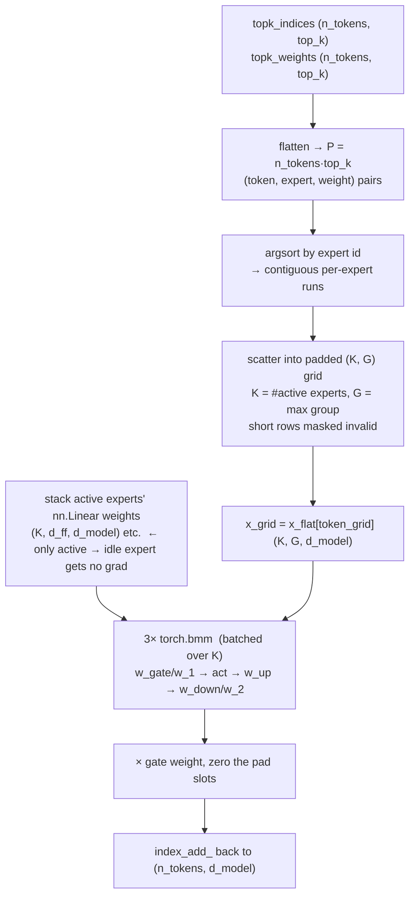

# 027 — Batched expert computation: one `bmm`, not a loop of `n_experts` (Task 11)

**Type:** task · **Date:** 2026-09-02 · **Related:** `moe-modernization`
Requirement 5.1-5.5; `design.md` `model/moe.py` component;
follows up entry 006 (the MoE layer) and entry 009 (the expert dispatch loop)

> **Full derivation:** [`docs/math/027-batched-expert-computation.md`](../docs/math/027-batched-expert-computation.md) works `dispatch_batched` line by line, by hand, on a fully-worked tiny example (with an idle expert and unequal padding), verified against the real module.

## What was implemented

- **`dispatch_batched(x_flat, topk_indices, topk_weights, routed_experts,
  activation)`** — a new module-level function in `qwenmoe/model/moe.py`
  that computes *all* routed experts of one MoE layer as **three batched
  `torch.bmm` calls** instead of the previous Python `for` loop over
  `n_routed_experts` separate `expert(...)` calls (Requirement 5.1). It:
  1. flattens each token's `top_k` choices into `P = n_tokens · top_k`
     `(token, expert)` **dispatch pairs**;
  2. `argsort`s the pairs by expert id so each expert's tokens are
     contiguous;
  3. lays each *active* expert's tokens into row `k` of a padded
     `(K, G, d_model)` grid — `K` = number of experts that got ≥ 1 token,
     `G` = the largest group;
  4. runs the expert FFN batched over `K` (`bmm` for `w_gate`/`w_1`, the
     gate activation, `bmm` for `w_up` if gated, `bmm` for
     `w_down`/`w_2`);
  5. multiplies by the gate weights, **masks padded slots to exactly 0**,
     and `index_add_`s the results back to `(n_tokens, d_model)`.
- **`MoELayer.forward`** now calls `dispatch_batched` where it used to run
  the loop. Everything else — router, `score_and_select`, the loss-free
  bias update, shared experts, `_add_router_z_loss`,
  `_add_seq_balance_loss` — is unchanged.
- **`MoELayer.forward_with_trace` keeps the explicit per-expert loop**
  (Requirement 5.4) so the Manim scenes still get one `expert_outputs[e]`
  tensor per dispatched expert.
- **Deliberate deviation from `design.md`.** The design's *primary*
  suggestion was to store routed-expert weights as 3-D `nn.Parameter`s
  (`RoutedExperts` module) with a `load_state_dict` pre-hook to migrate
  parent-spec checkpoint keys. Its *secondary* suggestion — "hold the
  experts as `nn.ModuleList` … and [stack] each forward … cheap at this
  scale" — is what I took, because it is strictly less disruptive:
  - **no checkpoint migration hook** — the state-dict keys
    (`routed_experts.3.w_gate.weight`) are *identical* to the parent
    spec's, so a parent checkpoint loads with `strict=True` and no remap;
  - **Muon (task 4) needs no changes** — `split_muon_adamw_params` still
    sees 2-D `nn.Linear` weights and routes each expert matrix to Muon as
    Requirement 1.4 wants; a 3-D parameter would have needed a batched
    Newton-Schulz;
  - **`moe.routed_experts[i]` still works** — `qwenmoe/train/scaling.py`,
    `qwenmoe/viz/scenes_norm_act.py`, `scripts/export_trace.py` and
    several tests index it as a list; none had to change.

  The only cost is a `torch.stack` of this step's active-expert weights on
  every forward — `O(K · d_ff · d_model)` copy, dominated by the matmuls
  themselves. The design explicitly sanctioned this.
- **Tests** — 8 new in `tests/test_moe.py`: batched output matches the
  reference loop within `1e-5` for `swiglu`/`geglu`/`gelu`, with and
  without idle experts; an idle expert's params get `grad is None` (not
  just zero); `MoELayer.forward` matches a hand-rolled reference loop; a
  parent-spec state-dict loads with no migration; the batched path's
  wall-clock scales sub-linearly with `n_experts`.
- `uv run pytest -q` — **305 passed** (was 297 after entry 026), including
  every pre-existing MoE / trace / trainer / optimizer test unchanged.

## Concepts explained for a complete beginner

### Why the per-expert loop is slow

- **What the old code did** (journal entry 009): for each of the
  `n_routed_experts` experts, find the tokens routed to it
  (`(topk_indices == e).nonzero()`), run that expert's little
  feed-forward network on just those tokens (`expert(x_flat[token_idx])` —
  which is 2-3 matrix multiplies), scale by the gate weight, and add the
  result into the output (`index_add_`).
- **Why it's slow:** every one of those operations is a separate call into
  PyTorch. Each call has fixed **overhead** — Python bytecode dispatch,
  building the operation, launching a compute kernel — that doesn't shrink
  when the matrices are small. With 8 experts you pay that overhead ~40
  times per MoE layer (8 × [`nonzero` + 3 matmuls + `index_add_`]); with 32
  experts, ~160 times. The *actual arithmetic* barely grew (the same tokens
  are processed, just split into more, smaller groups), but the overhead
  grew 4×. On a laptop CPU/MPS — no massively-parallel GPU to hide the
  overhead behind — that overhead **is** the runtime for small models.
- **Analogy:** mailing 100 letters. The paper and ink (the arithmetic) is
  fixed. Whether you make 100 separate trips to the post office (the loop)
  or one trip with all 100 (the batched call) is the difference. More
  experts = more trips.

### The fix: sort by expert, then one big batched multiply

`torch.bmm` ("batch matrix-multiply") multiplies a *stack* of matrices in a
single call: `bmm(A, B)` where `A` is `(K, m, n)` and `B` is `(K, n, p)`
gives `(K, m, p)` — `K` independent matmuls, one kernel launch. To use it
for MoE we need every expert to get the **same-shaped** slab of tokens.
Experts don't naturally get equal token counts, so:

1. **Enumerate dispatch pairs.** Token `t` routed to experts `[e1, e2]`
   becomes two pairs `(t, e1)`, `(t, e2)`. `P = n_tokens · top_k` pairs.
2. **Sort the pairs by expert id** (`argsort`). Now all of expert 0's pairs
   are together, then all of expert 1's, etc.
3. **Reshape into a padded grid.** Let `G` = the largest expert's pair
   count. Build a `(K, G)` table where row `k` holds active expert `k`'s
   pairs, left-aligned, and the unused tail of short rows is marked invalid.
4. **Gather + batched FFN.** `x_grid = x_flat[token_of_each_slot]` →
   `(K, G, d_model)`. Then `bmm` against the stacked expert weights
   `(K, d_ff, d_model)` → `(K, G, d_ff)`, apply the activation, `bmm` back
   down to `(K, G, d_model)`.
5. **Scale, mask, scatter.** Multiply each slot by its gate weight, set the
   invalid (padding) slots to exactly `0`, and `index_add_` every slot's
   result back to its token's row of the output.

The padding is wasted work — expert `k` computes `G` rows even if it only
had `G/2` real tokens. But the load-balancing machinery (aux loss / the
loss-free bias) keeps group sizes *roughly equal*, so `G ≈ P/K` and the
waste is a small constant factor, not `K×`. The total cost is now
`~O(P · d_model · d_ff)` — **independent of how many experts you have** —
so 32 experts costs about what 8 experts cost, not 4×.

### Worked example (`n_tokens = 5`, `n_experts = 3`, `top_k = 2`)

`topk_indices` (each token's two chosen experts):

| token | experts |
|---|---|
| 0 | [0, 1] |
| 1 | [2, 0] |
| 2 | [1, 2] |
| 3 | [0, 2] |
| 4 | [1, 0] |

- **Flatten to pairs** (`pair_expert`): `[0,1, 2,0, 1,2, 0,2, 1,0]` — 10
  pairs; `pair_token`: `[0,0, 1,1, 2,2, 3,3, 4,4]`.
- **`bincount`**: expert 0 → 4 pairs, expert 1 → 3, expert 2 → 3. So
  `K = 3`, `G = 4`.
- **`argsort(pair_expert)`** = `[0, 3, 6, 9, 1, 4, 8, 2, 5, 7]`; the sorted
  tokens are `[0,1,3,4, 0,2,4, 1,2,3]`.
- **Grid** (`K=3` rows, padded to `G=4`):

  | expert | slot 0 | slot 1 | slot 2 | slot 3 |
  |---|---|---|---|---|
  | 0 | tok 0 | tok 1 | tok 3 | tok 4 |
  | 1 | tok 0 | tok 2 | tok 4 | *(pad)* |
  | 2 | tok 1 | tok 2 | tok 3 | *(pad)* |

- `x_grid` is `(3, 4, d_model)`; three `bmm`s later, `y_grid` is
  `(3, 4, d_model)`; the two `(pad)` slots are zeroed; `index_add_` sends
  every real slot's vector back to its token's output row. Token 0 gets
  contributions from row 0 slot 0 (expert 0) **and** row 1 slot 0 (expert
  1) — its two experts — each already scaled by that token's gate weight.

**Real measured** — `dispatch_batched` vs the per-expert loop, on identical
weights and routing, `d_model = 256`, 1024 tokens, `top_k = 2`, routed
param count held fixed at ~3.1 M by shrinking `d_ff` as `n_experts` grows
(CPU, ms per call, mean of 30):

| experts | `d_ff` | per-expert loop | batched | speed-up |
|---:|---:|---:|---:|---:|
| 8 | 512 | 4.61 ms | 3.95 ms | 1.17× |
| 16 | 256 | 5.35 ms | 4.21 ms | 1.27× |
| 32 | 128 | 5.41 ms | **2.67 ms** | 2.02× |
| 64 | 64 | 7.37 ms | **2.46 ms** | 2.99× |

The point isn't the peak speed-up — it's the **shape** of the batched
column: it *falls* from 3.95 ms to 2.46 ms as experts go 8 → 64, while the
loop *climbs* from 4.61 ms to 7.37 ms. The batched path's cost tracks the
token budget; the loop's tracks the expert count. A 32-expert fine-grained
config is now practical on the laptop (Requirement 5.5) — a full 32-expert,
`top_k = 4` model trains 40 steps on the toy stream in 4.4 s, loss
`2.68 → 0.004`.

**Numerical agreement** — `max |batched − loop|` over a 256-token batch:
`0` (swiglu), `3.0 × 10⁻⁸` (geglu), `6.0 × 10⁻⁸` (gelu) — all far inside
the `1e-5` the invariant test allows (Requirement 5.2). The tiny non-zero
residuals are `bmm` vs `mm` accumulating in a different order, not a
behavior change.

## Questions that might come to mind

- **Does this change training results?** No — Requirement 5.2 is pinned by
  tests: the batched routed-expert output matches the old loop within
  `1e-5` (measured max diff `6e-8`), and every pre-existing MoE / trainer /
  trace test passes unchanged. It is a performance refactor of the *same*
  math.
- **What about an expert that gets zero tokens this batch?** It is not in
  the `active` list, so its weights are never stacked, never multiplied,
  and its `.grad` stays `None` — byte-for-byte the same as the old loop's
  `continue`. A test asserts exactly one of four experts has non-`None`
  grads when one token with `top_k = 1` is routed.
- **Isn't padding wasteful?** Yes, a bit. Expert `k` computes `G` rows even
  if it had fewer real tokens, where `G` is the *largest* group. With
  balanced routing (which the aux loss / loss-free bias enforce) `G ≈ P/K`,
  so the overhead is a small constant. The pathological case — every token
  to one expert — degrades to `K×` waste, but that's the case the balancer
  exists to prevent. MegaBlocks (below) removes the padding entirely with
  custom block-sparse GPU kernels; that's out of scope for a dependency-free
  CPU/MPS project.
- **Why keep the explicit loop in `forward_with_trace`?** The Manim scenes
  want one clearly-labelled output tensor *per expert*
  (`expert_outputs[e]`), and the batched grid interleaves them. Requirement
  5.4 explicitly permits the trace path to stay explicit "for clarity". The
  two paths agree within `1e-5` (the existing trace-parity test).
- **Why `torch.stack` the weights every forward instead of storing them
  stacked?** Storing them stacked (3-D `nn.Parameter`s) would change the
  checkpoint keys, break `moe.routed_experts[i]` indexing used in four
  other files, and force a batched Muon implementation. The per-forward
  `stack` is an `O(params)` copy — negligible next to the `O(tokens ·
  params)` matmuls — and keeps all of that working. `design.md` listed this
  as an acceptable alternative.
- **Does it work under bf16 autocast (task 8)?** Yes. `dispatch_batched`
  does its final `index_add_` with `.to(out.dtype)`, and `out` is the fp32
  residual stream, so the bf16 `bmm` outputs are upcast before the
  scatter — the same dtype handling the old loop got in task 8.

## Papers

- [MegaBlocks: Efficient Sparse Training with Mixture-of-Experts (Gale,
  Narayanan, Zaharia & Blalock, 2022)](https://arxiv.org/abs/2211.15841) —
  reformulates MoE dispatch as **block-sparse** matmuls to avoid *both*
  token-dropping *and* the padding waste this task accepts; the reference
  for "why the naïve loop and the padded-batch approach are the two easy-
  but-imperfect options". MLSys 2023.
- [GShard (Lepikhin et al., 2020)](https://arxiv.org/abs/2006.16668) —
  introduced the **expert-capacity** formulation: route tokens into a
  fixed-size `(n_experts, capacity, d_model)` buffer and run experts as one
  `einsum`. `dispatch_batched`'s `(K, G, d_model)` grid is the same idea
  with `G` chosen per-batch (dropless) instead of a fixed capacity.
- [Switch Transformers (Fedus, Zoph & Shazeer, 2021)](https://arxiv.org/abs/2101.03961)
  — §2.2's *capacity factor* is exactly the padding-vs-dropping trade-off;
  this project keeps `G = max group size` (capacity factor effectively
  "just enough", no drops), relying on the load balancer to keep `G` small.

## Outcome

`uv run pytest -q` — **305 passed** (297 before this task). Task 11 checked
off in `moe-modernization/tasks.md`.
