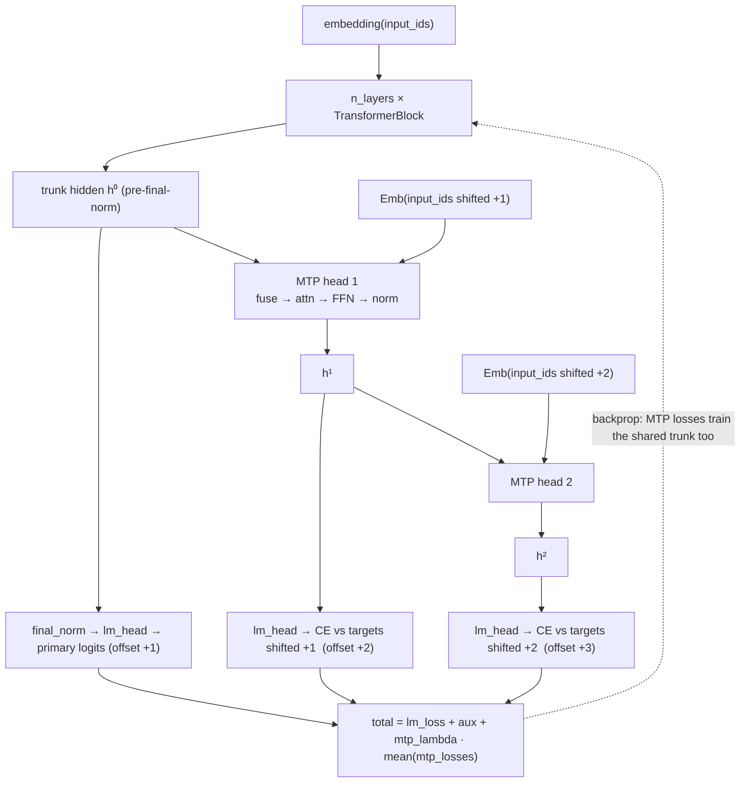

# 028 — Multi-Token Prediction: teaching the trunk to look further ahead (Task 12)

**Type:** task · **Date:** 2026-09-02 · **Related:** `moe-modernization`
Requirement 6.1-6.5; `design.md` `model/mtp.py` + `model/transformer.py`
components

## What was implemented

- **`qwenmoe/model/mtp.py::MTPHead`** — one *optional*, *training-only*
  module. `forward(hidden, next_token_emb, positions)`:
  1. `fuse( [RMSNorm(hidden) ; RMSNorm(next_token_emb)] )` — a
     `nn.Linear(2·d_model → d_model)` that combines the previous depth's
     hidden state with the embedding of the token the head is *told* to
     expect (DeepSeek-V3's fusion step);
  2. one pre-norm **attention** sub-layer with a residual;
  3. one pre-norm **dense SwiGLU FFN** (`SwiGLUExpert`, *no* MoE routing —
     that's the "-lite") with a residual;
  4. a final `RMSNorm`.
  The caller projects the result through the **shared** `lm_head`.
- **`QwenMoEModel`:**
  - `__init__`: `self.mtp_heads = nn.ModuleList(MTPHead(config) for _ in
    range(config.mtp_depth))`. `mtp_depth == 0` (default) ⇒ an *empty*
    `ModuleList` ⇒ **zero extra parameters, nothing in `state_dict`,
    `forward` byte-identical to before** (Requirement 6.2).
  - `forward(self, input_ids, targets=None)` — gained the optional
    `targets`. MTP losses are computed **only** when
    `self.mtp_heads and self.training and targets is not None`. Inference,
    eval, `mtp_depth == 0`, or a caller that passes no `targets` all get
    exactly `(logits, {"aux_loss": ...})` — so `generate()` and every other
    caller are untouched (Requirement 6.4).
  - `_mtp_losses(...)` runs the causal chain (below) and returns one
    `F.cross_entropy` per head; `extras` gains `"mtp_loss"` (their mean) and
    `"mtp_losses"` (the per-head list).
- **`qwenmoe/train/trainer.py`:**
  - `_forward_backward_step` now calls `model(x, targets=y)` and, when
    `extras["mtp_loss"]` is present, adds
    `model.config.mtp_lambda × extras["mtp_loss"]` to the total loss
    (Requirement 6.3). Its return type changed from a 4-tuple to
    `(metrics: dict, grad_norm)` — `metrics` has `lm_loss`, `aux_loss`,
    `z_loss`, `mtp_loss`, `mtp_losses` — because the per-step metric list
    had outgrown a positional tuple.
  - The JSON step-log record gains `mtp_loss` (the mean CE across heads,
    *unweighted* — the interpretable "how well does the +2 head predict"
    number, not the `× mtp_lambda` contribution) and `mtp_losses` (the
    per-depth list). Console line gains `| mtp_loss …`.
- **Init:** an `MTPHead`'s `w_o` / `ffn.w_down` match the existing
  `_RESIDUAL_PROJ_SUFFIXES`, so they get the `1/sqrt(2·n_layers)` residual
  scaling like every other residual projection (a minor over-shrink — an
  MTP head is only one block deep — but harmless and consistent).
- **Tests** — 8 new (`tests/test_model.py` ×5, `test_trainer_integration.py`
  ×2, `test_generate.py` ×1): `mtp_depth=0` is a structural no-op with the
  plain return signature even when `targets` is passed; `mtp_depth=1` adds
  params and exactly one loss term with the primary logits unchanged in
  shape; heads are skipped at inference / without targets; `mtp_depth=2` is
  a two-loss causal chain (grad from head 2's loss reaches head 1);
  checkpoints round-trip; a full `mtp_depth=2` training run decreases loss
  and logs `mtp_losses` of length 2 per step; `generate()` runs unchanged
  on an MTP model.
- `uv run pytest -q` — **313 passed** (was 305 after entry 027).

## Concepts explained for a complete beginner

### The problem: next-token prediction is a myopic teacher

- **Terms:**
  - **next-token prediction** — the standard language-model objective: given
    tokens `t_0 … t_i`, predict `t_{i+1}`. The loss at position `i` is
    `−log p(t_{i+1} | t_0…t_i)`.
  - **teacher forcing** — during training the model always sees the *true*
    previous tokens (not its own guesses), because we have the whole
    sequence in hand.
  - **hidden state** `h_i` — the trunk's internal vector at position `i`,
    just before it's projected to vocabulary logits.
- **Why it's myopic:** the only gradient signal position `i` ever receives
  is "did you get the *very next* token right?". The model is never
  directly asked whether its representation `h_i` is good enough to also
  anticipate `t_{i+2}` or `t_{i+3}`. So it learns representations that are
  locally greedy — enough to pick the next word, not necessarily enough to
  have *planned* the phrase. Gloeckle et al. (2024) show this especially
  hurts on tasks with structure a few tokens out (code, reasoning).
- **Analogy:** learning to drive by only ever being graded on "are you in
  the right lane *right now*". You'd pass, but you'd never learn to look
  down the road. A better teacher occasionally asks "and where will you
  need to be in three seconds?".

### The fix: extra heads that predict further ahead

Add `mtp_depth` small modules on top of the shared trunk. Head `k`
(1-indexed) predicts the token at offset `k + 1` (head 1 → `t_{i+2}`, head
2 → `t_{i+3}`, …). Each has its own cross-entropy loss; all of them
backpropagate into the **same trunk**, so the trunk is now pressured to
build representations useful several steps out — but at *inference* the
extra heads are simply not run, so there's **no speed or memory cost** when
generating.

Two published variants:

- **Gloeckle et al. (2024)** — `n` **independent, parallel** heads, all
  reading the same trunk hidden `h_i`. Simple; heads don't see each other.
- **DeepSeek-V3 (2024)** — a **causal chain**: head `k` consumes head
  `k−1`'s output hidden state (head 1 consumes the trunk's), *plus* the
  embedding of the next token. Head `k` therefore literally predicts one
  step further than head `k−1` did, reusing its work.

**This project follows DeepSeek-V3's causal chain.**

### How one MTP head works (the causal chain, position by position)

At position `i`, head `k`:

1. takes `h_i^{k-1}` — the previous depth's hidden state (`h_i^0` = the
   trunk's pre-final-norm residual stream);
2. takes `Emb(t_{i+k})` — the embedding of the token that head `k−1` was
   trying to predict, now *given* to head `k` (teacher forcing again);
3. `fused = W_fuse · [ RMSNorm(h_i^{k-1}) ; RMSNorm(Emb(t_{i+k})) ]`;
4. `h_i^k = OutNorm( FFN-block( Attn-block( fused ) ) )`;
5. `logits_i^k = lm_head(h_i^k)` — a prediction of `t_{i+k+1}`;
6. loss contribution `−log p(t_{i+k+1} | …)`.

**The alignment, done with slices.** With `input_ids = [t_0 … t_{S-1}]` and
`targets = [t_1 … t_S]` (the usual left-shift), head `k` at position `i`
needs `Emb(input_ids[i+k])` and target `targets[i+k]`, valid for
`i + k < S`. So the code is just:

```python
usable = seq_len - depth
new_hidden   = head(hidden[:, :usable],
                    embedding(input_ids[:, depth:depth+usable]),
                    positions[:usable])
depth_logits = lm_head(new_hidden)
loss_k       = cross_entropy(depth_logits, targets[:, depth:depth+usable])
hidden       = new_hidden          # feed the chain
```

Each depth loses one usable position off the end (nothing to predict), so
depth `k` trains on `S − k` positions.

### Worked 2-token example

Sequence `input_ids = [A, B, C, D, E]` (so `S = 5`), `targets =
[B, C, D, E, ·]` (last has no target). `mtp_depth = 2`.

- **Main head**, position 1: sees `A B`, predicts `targets[1] = C`.
- **MTP head 1** (`k=1`, predicts offset +2), position 1: fuses `h_1^0`
  with `Emb(input_ids[2]) = Emb(C)`, predicts `targets[2] = D`. Usable
  positions: `i ∈ {0,1,2,3}` (need `i+1 < 5`).
- **MTP head 2** (`k=2`, predicts offset +3), position 1: fuses `h_1^1`
  (head 1's output at position 1) with `Emb(input_ids[3]) = Emb(D)`,
  predicts `targets[3] = E`. Usable positions: `i ∈ {0,1,2}`.

Head 2 builds directly on head 1's hidden state — the chain — so it isn't
solving the +3 problem from scratch.



**Real measured** — on this project's model (`d_model = 64`, 4 layers, 8
experts):

- **Parameter cost** (training-only): `+4.8 %` per MTP depth (13 tensors
  per head — 4 norms, the fuse projection, 4 attention weights, 3 FFN
  weights). `mtp_depth=0` adds **exactly 0** and puts nothing in the state
  dict.
- **Untrained per-depth CE** (`mtp_depth=3`, 8×32 random batch): main head
  `3.938`, offset-+2 head `3.934`, +3 `3.932`, +4 `3.923` — all just above
  `ln(50) = 3.912` (the uniform-guess floor), as an untrained model
  should be.
- **During training** (period-10 toy stream, `mtp_depth=2`, `mtp_lambda =
  0.3`):

  | step | main loss (+1) | MTP +2 | MTP +3 |
  |---:|---:|---:|---:|
  | 1 | 2.655 | 2.478 | 2.468 |
  | 5 | 1.489 | 1.343 | 1.231 |
  | 10 | 0.223 | 0.237 | 0.221 |
  | 30 | 0.144 | 0.009 | 0.001 |
  | 60 | 0.0006 | 0.0003 | 0.0002 |

  The MTP heads' losses fall right alongside the main loss — they are
  genuinely learning to predict 2 and 3 steps ahead. (On a *periodic*
  stream, +2 and +3 are no harder than +1, so this is a "does it work and
  not hurt" check; MTP's real benefit shows on structured data and is left
  to the TinyStories ablation, task 16.)

## Questions that might come to mind

- **Is `mtp_depth=0` really free?** Yes — `nn.ModuleList([])` registers no
  parameters and contributes nothing to `state_dict()`, `forward` never
  enters the MTP branch (`self.mtp_heads` is falsy), and a test asserts
  `model(x, targets=y)` returns exactly `{"aux_loss": ...}` with the same
  logits as `model(x)`.
- **Why do the MTP heads only run in training?** They exist to shape the
  *trunk's* gradients. At generation time you only want `t_{i+1}` from the
  primary head; the extra heads would be wasted compute. `generate()` calls
  `model.eval()` and never passes `targets`, so the MTP path is skipped —
  a test confirms generation is unchanged.
- **What is `mtp_lambda` and why 0.3?** It's the weight on the *averaged*
  MTP loss in the total: `total = lm_loss + aux + mtp_lambda ·
  mean(mtp_losses)`. `0.3` is DeepSeek-V3's value — small enough that
  next-token prediction stays the dominant objective, large enough that the
  look-ahead signal actually reaches the trunk. It's a `ModelConfig` field,
  so it's an ablation axis.
- **Why average the per-depth losses instead of summing?** So `mtp_lambda`
  means the same thing whether you use 1 head or 4 — a sum would make the
  effective MTP weight scale with `mtp_depth`.
- **Why is the step-logged `mtp_loss` unweighted?** Because the useful
  quantity to watch is "the +2 head's cross-entropy" (comparable to
  `train_loss`), not `0.3 × its mean`. This differs from how `z_loss` is
  logged (weighted) — `z_loss`'s raw value isn't independently
  interpretable, an MTP CE is.
- **Does the causal chain make training unstable?** Head `k`'s gradient
  flows back through head `k−1`, so a deep chain is a deep-ish extra
  network. Each head is only one block, `mtp_depth` is typically 1-2, and
  every head is pre-norm with residuals — the same stability structure as
  the trunk. No instability seen in the runs.
- **`forward`'s signature changed — does that break callers?** `targets`
  has a default of `None`, so every existing `model(x)` call is unaffected.
  The four visualization/script call sites and `generate()` all pass one
  argument.

## Papers

- [DeepSeek-V3 Technical Report (DeepSeek-AI, 2024)](https://arxiv.org/abs/2412.19437)
  — §2.1.3 "Multi-Token Prediction": the **causal-chain** MTP design this
  task implements (fusion projection, sequential depth modules reusing the
  shared embedding + output head, `mtp_lambda ≈ 0.3`, training-only).
- [Better & Faster Large Language Models via Multi-token Prediction
  (Gloeckle, Idrissi, Rozière, Lopez-Paz & Synnaeve, 2024)](https://arxiv.org/abs/2404.19737)
  — the earlier Meta paper: `n` **independent parallel** heads on a shared
  trunk, the sample-efficiency and downstream-capability gains, and the
  finding that MTP helps *more* at larger model scale. The contrast case
  for "why a chain, not parallel heads".
- [Blockwise Parallel Decoding (Stern, Shazeer & Uszkoreit, 2018)](https://arxiv.org/abs/1811.03115)
  — the original "add auxiliary heads to predict several future tokens"
  idea (there, for decoding speed via a propose-and-verify scheme); the
  ancestor of both modern MTP papers.

## Outcome

`uv run pytest -q` — **313 passed** (305 before this task). Task 12 checked
off in `moe-modernization/tasks.md`.
