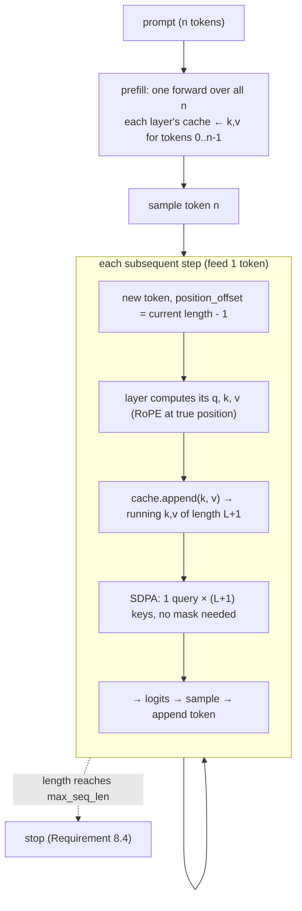

# 029 — The KV cache: O(n²) → O(n) generation, and why MLA's is smaller (Task 13)

**Type:** task · **Date:** 2026-09-02 · **Related:** `moe-modernization`
Requirement 8.1-8.4; `design.md` `model/kv_cache.py` + `model/attention.py`
components; follows up entries 004 (GQA) and 012 (MLA)

> **Full by-hand derivation:** [`docs/math/029-kv-cache.md`](../docs/math/029-kv-cache.md)
> extends doc 004's GQA example and doc 016's MLA example by one
> incremental "token 3" each: the $O(n)$-vs-$O(n^2)$/$O(n^3)$ counting
> argument derived from exact sum formulas, `LayerKVCache`/`LatentKVCache`'s
> `append` mechanics, a prefill proven bit-identical to no cache at all,
> the incremental step's RoPE rotation at the *true* `position_offset`,
> `_causal_position_mask` derived for the non-square 1-query/N-key case,
> the full scores→softmax→weighted-sum digit-by-digit (checked against a
> full recompute), the cache-byte ledger re-deriving the journal's own
> `0.156` ratio independently, and `generate()`'s branch selection verified
> end-to-end on a real model — every number reproduced by
> [`docs/math/verify_029_kv_cache.py`](../docs/math/verify_029_kv_cache.py).

## What was implemented

- **`qwenmoe/model/kv_cache.py`** (new):
  - `LayerKVCache` — GQA: `append(k_new, v_new)` concatenates the
    post-RoPE `k`/`v` (`(batch, n_kv_heads, len, head_dim)`) along the
    length axis and returns the running tensors. `.length`, `.nbytes`.
  - `LatentKVCache` — MLA: stores **only** the shared low-rank latent
    `c_kv` `(batch, len, latent_dim)` and the *one* shared decoupled-RoPE
    key `(batch, 1, len, rope_head_dim)`. The `n_heads`-wide K/V are
    re-derived from `c_kv` every step, never stored.
  - `build_kv_cache(model)` — one cache per block, `LatentKVCache` where
    the block's attention is `MLAAttention`, `LayerKVCache` otherwise.
- **`Attention.forward(x, positions, kv_cache=None)`** and
  **`MLAAttention.forward(x, positions, kv_cache=None)`** — when a cache is
  passed, this call's freshly-projected/RoPE'd `k`/`v` (or `c_kv`/`k_rope`)
  are appended and the full running tensors used for attention. If the
  query positions no longer line up `1:1` with the keys (an incremental
  step: 1 query, `N` keys) or an ALiBi bias needs folding in, an explicit
  additive `attn_mask` from the new `_causal_position_mask(q_positions,
  kv_len, …)` helper replaces `is_causal=True`. **With `kv_cache=None` the
  fast `is_causal=True` path is untouched** — every training call.
- **`AlibiBias.attention_bias_positions(q_positions, k_positions)`** — the
  ALiBi bias for queries/keys at *arbitrary* absolute positions (an
  incremental step is not a square block). `RotaryEmbedding` / `NoPositional`
  return `None`. The old square `attention_bias(seq_len)` now delegates to
  it, so `forward_with_trace` is unchanged.
- **`QwenMoEModel.forward(..., kv_caches=None, position_offset=0)`** and
  **`TransformerBlock.forward(x, positions, kv_cache=None)`** — thread one
  cache per block through, and offset the position indices so an
  incremental token gets its *true* absolute position for RoPE/ALiBi. Both
  defaults inert.
- **`generate(..., use_kv_cache=False)`** — with the cache on: encode the
  prompt once (a "prefill"), then feed only `sequence[:, -1:]` each step
  with `position_offset = len - 1`. Sampling logic factored into
  `_sample_next(...)` so the cached and uncached loops can't drift.
- **Tests** — a new `tests/test_kv_cache.py` (7) + 1 in `test_generate.py`:
  the two cache objects append/measure correctly; `build_kv_cache` matches
  each block's variant; cached incremental logits match a full recompute
  within `1e-4`; **cached vs uncached greedy generation is token-identical**
  for GQA (rope/nope/alibi) and MLA; the `max_seq_len` stop still holds
  with the cache; MLA's retained bytes < GQA's at matched shape;
  `use_kv_cache` composes with `temperature`/`top_k`/`top_p`.
- `uv run pytest -q` — **321 passed** (was 313 after entry 028).

## Concepts explained for a complete beginner

### Why generation without a cache is quadratic

- **Terms:**
  - **autoregressive generation** — produce text one token at a time; each
    new token is sampled from the model's prediction given everything so
    far, then appended, then the model runs again.
  - **keys / values (`k` / `v`)** — inside attention, every token produces a
    `k` vector (what it offers to be matched against) and a `v` vector
    (what it contributes if matched). A new token's **query** `q` is
    dot-producted against *every* previous token's `k` to decide how much
    of each `v` to mix in.
- **The waste:** to generate token `n`, the naïve loop runs a full forward
  pass over all `n` tokens — recomputing `k` and `v` for tokens `0 … n−2`
  that **haven't changed since last step**. Worse, the attention score
  matrix for that pass is `n × n`. Summed over generating `n` tokens:
  `1 + 4 + 9 + … + n² ≈ n³/3` score entries, and `O(n²)` redundant k/v
  projections. On a laptop, generating a few hundred tokens visibly slows
  down as it goes.
- **Analogy:** re-reading the entire book from page 1 every time you want to
  write the next sentence.

### The fix: keep the keys and values around

Each layer keeps a growing buffer of every token's `k` and `v`. To generate
token `n`:

1. run the model on **just the new token** (`seq_len = 1`);
2. each layer computes that one token's `q`, `k`, `v`;
3. append its `k`, `v` to the layer's buffer;
4. attention: the single `q` against **all `n` cached `k`s** → one row of
   scores, length `n`;
5. no masking needed — the single newest query is allowed to see every
   earlier token and itself.

Per new token the work is `O(n)` (one score row), and `O(1)` k/v
projections. Cumulative over `n` tokens: `O(n²)` score entries (down from
`O(n³)`) and `O(n)` projections (down from `O(n²)`). The first forward — the
**prefill** — still processes the whole prompt at once (that part is
genuinely `O(prompt²)`, unavoidable), but every step after is cheap.

**Measured** (this project, `d_model=128`, 4 layers, CPU, greedy):

| tokens generated | uncached | cached | speed-up |
|---:|---:|---:|---:|
| 50 | 0.206 s | 0.086 s | 2.4× |
| 150 | 0.734 s | 0.241 s | 3.0× |

The speed-up *grows* with length — exactly the `O(n²)` vs `O(n)` signature.

### RoPE and the cache: store post-rotation, feed the true position

RoPE rotates each token's `q`/`k` by an angle proportional to its **absolute
position**. So the cache stores the *already-rotated* `k` (rotate once, at
the position the token actually has), and an incremental step must tell the
model that position — hence `position_offset`. `generate` passes
`position_offset = len(sequence) - 1` for the one new token, so its RoPE
angle is identical to what a full recompute would have used. NoPE needs
nothing; ALiBi needs the bias computed for `(one query at position N−1) ×
(keys at 0…N−1)` — the new `attention_bias_positions`.

### Why MLA's cache is dramatically smaller

Recall (entry 012): **GQA** caches a full `k` and `v` per KV-head:
`2 · n_kv_heads · head_dim` numbers per token per layer. **MLA** caches only
the shared low-rank latent `c_kv` (dimension `latent_dim`) plus one shared
decoupled-RoPE key (`rope_head_dim`) — `latent_dim + rope_head_dim` numbers
per token per layer — and reconstructs the `n_heads`-wide K/V from `c_kv`
on the fly with `w_uk` / `w_uv`.

**Worked cache-growth table** — `d_model = 128`, `n_heads = 8` ⇒
`head_dim = 16`, `rope_head_dim = 8`; MLA `latent_dim = 32`; MHA (`n_kv_heads
= n_heads = 8`); fp32 (4 bytes); **per layer**:

| tokens | GQA/MHA cache (`2·8·16` floats/tok) | MLA cache (`32 + 8` floats/tok) | ratio |
|---:|---:|---:|---:|
| 16 | 16,384 B | 2,560 B | 0.156 |
| 64 | 65,536 B | 10,240 B | 0.156 |
| 256 | 262,144 B | 40,960 B | 0.156 |

`40 / 256 = 0.156`, constant in length. This is a **measured**
retained-bytes result (`cache.nbytes`), replacing the parent spec's
static `kv_cache_elements_per_token` estimate (Requirement 8.3). With real
GQA (`n_kv_heads < n_heads`) the gap narrows but MLA still wins — a test
asserts `MLA.nbytes < GQA.nbytes` at matched `d_model`/`n_heads`/`n_layers`.

## Questions that might come to mind

- **Do cached and uncached generation really give the same text?** For
  **greedy** decoding, yes — token-identical, and a test checks it for GQA
  (rope/nope/alibi) and MLA. Each token attends over the identical prefix
  at its true positions; the only difference is a fused SDPA kernel summing
  in a different order (measured `< 1e-4` on the logits), which argmax
  absorbs. For **sampling**, a `1e-6` logit difference can in principle
  flip a `multinomial` draw on a near-tie, so the guarantee is greedy-only
  — the cache is an efficiency optimization, not a bit-exact replay.
- **Is `kv_caches=None` really free?** Yes. `Attention.forward` /
  `MLAAttention.forward` only build an explicit mask when a cache is
  present *or* ALiBi is active; with `kv_cache=None` and RoPE/NoPE it's the
  same `F.scaled_dot_product_attention(is_causal=True)` call as before, and
  `_causal_position_mask` for `q_positions == arange(seq_len)`,
  `kv_len == seq_len` is *exactly* `torch.triu(-inf, diagonal=1)` anyway.
  All 313 pre-task tests pass unchanged.
- **Why does MLA re-decompress K/V every step instead of caching them?**
  That's the entire trade. Caching the decompressed `n_heads`-wide K/V
  would defeat the purpose — you'd be back to GQA's cache size. MLA spends
  a small matmul (`w_uk`/`w_uv` on the cached latent) per step to *buy* the
  cache-size reduction, which on memory-bound inference hardware is the
  bottleneck that matters.
- **What about the prefill — isn't that still `O(prompt²)`?** Yes, and
  that's fine: it happens once, and the prompt is usually short relative
  to the generation. The cache attacks the *per-generated-token* cost,
  which is where a long generation spends its time.
- **Does the cache change training?** No — training never passes a cache,
  and `QwenMoEModel.forward`'s new params default to `None` / `0`. MTP
  (task 12) and the cache are mutually exclusive: MTP runs only in training
  mode with targets, the cache only in `generate()`'s eval mode.
- **Why cache `k` *after* RoPE, not before?** RoPE's rotation depends only
  on the token's own position, which never changes once the token exists.
  Rotating once at append time and reusing the result is both correct and
  cheaper than re-rotating every step. (MLA is the subtle case — its
  *content* K can't be pre-rotated, which is exactly why it carries a
  separate small *decoupled* RoPE key; see entry 012.)

## Papers

- [DeepSeek-V2 (DeepSeek-AI, 2024)](https://arxiv.org/abs/2405.04434) —
  §2.1 introduces **Multi-head Latent Attention**: compress K/V into one
  shared latent, cache only that (plus the decoupled RoPE key), decompress
  per head at use. The `LatentKVCache` here is the runtime object that
  realizes the paper's cache-size claim as *measured bytes*.
- [GQA: Training Generalized Multi-Query Transformer Models (Ainslie et
  al., 2023)](https://arxiv.org/abs/2305.13245) — sharing K/V across groups
  of query heads to shrink the cache; the `n_kv_heads` knob this project's
  `LayerKVCache` sizes itself from.
- [Fast Transformer Decoding: One Write-Head is All You Need (Shazeer,
  2019)](https://arxiv.org/abs/1911.02150) — the original observation that
  incremental decoding is **memory-bandwidth bound on the KV cache**, and
  that shrinking it (there: multi-query attention) is the lever. The
  motivation behind both GQA and MLA.

## Outcome

`uv run pytest -q` — **321 passed** (313 before this task). Task 13 checked
off in `moe-modernization/tasks.md`.
