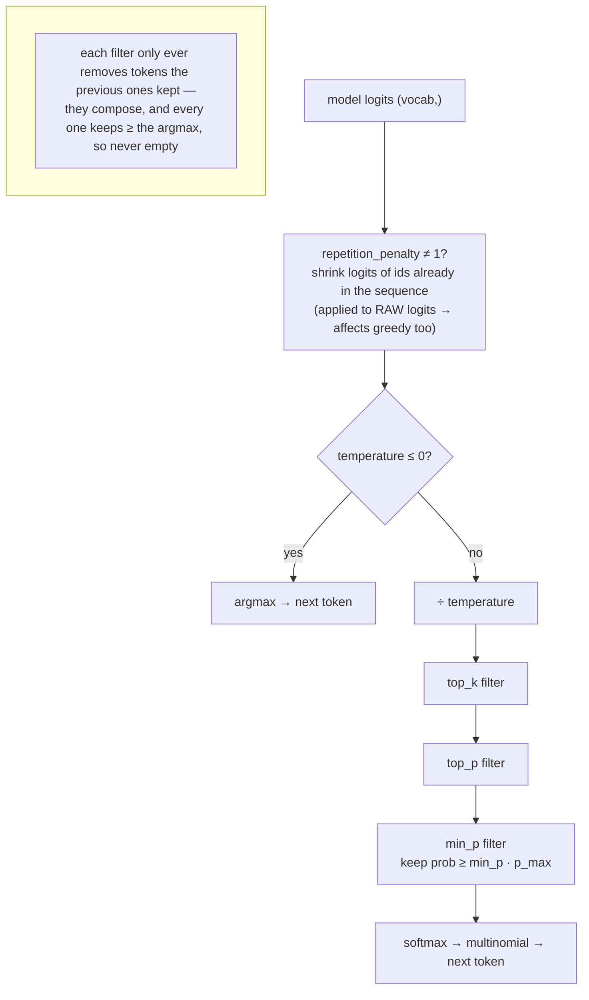

# 030 — Sampling: min-p's adaptive cutoff and the repetition penalty (Task 14)

**Type:** task · **Date:** 2026-09-02 · **Related:** `moe-modernization`
Requirement 11.1-11.4; `design.md` `model/generate.py` component;
follows up entry 015 (temperature / top-k / top-p sampling)

> **Full derivation, solved by hand:** [`docs/math/030-min-p-and-repetition-penalty.md`](../docs/math/030-min-p-and-repetition-penalty.md)
> — the sign-aware penalty and the `min_p·p_max` threshold traced line by
> line on one worked example, including a closed-form proof of *why* min-p
> is adaptive, and the penalty run against this project's own real
> `"DADDDD"` degeneration.

## What was implemented

- **`filter_min_p(logits, min_p)`** in `qwenmoe/model/generate.py` — mirrors
  `filter_top_k` / `filter_top_p`: keeps only tokens whose probability is
  `>= min_p × p_max` (`p_max` = the single most likely token's
  probability), `-inf`-ing the rest. Since `min_p <= 1`, the argmax always
  clears its own threshold ⇒ the result is never all-`-inf`.
- **`apply_repetition_penalty(logits, generated_ids, penalty)`** — CTRL /
  Hugging Face style: for every token id already in `generated_ids`, a
  *positive* logit is **divided** by `penalty`, a *negative* one
  **multiplied** — both push the token's probability down. `penalty == 1.0`
  is a no-op.
- **`_sample_next(...)`** (shared by the cached and uncached decode loops)
  gained `min_p`, `repetition_penalty`, `generated_ids`. Order: repetition
  penalty on the raw logits (so it also shapes greedy/argmax) → temperature
  → `top_k` → `top_p` → `min_p` → softmax → multinomial. Each filter
  further restricts the previous survivors (Requirement 11.4).
- **`generate(...)`** gained `min_p: float | None = None` and
  `repetition_penalty: float = 1.0`, both validated, both passed through
  with `generated_ids = sequence` (prompt + everything generated so far).
- **Deviation note (Requirement 11.2).** The requirement's literal wording
  is "divide the logit … by the penalty". Applied blindly that would
  *raise* the probability of a seen token whose logit is negative (dividing
  a negative number by `> 1` moves it toward 0). The sign-aware
  divide-or-multiply is what actually "lowers a repeated token's
  probability" in every case, so that's what's implemented — same spirit as
  the literal wording, correct where it isn't.
- **Tests** — 11 new in `tests/test_generate.py`: min-p keeps the right
  set, is adaptive (confident step keeps few, unsure step keeps many),
  never masks everything, rejects out-of-range; repetition penalty lowers
  seen-token probability (positive *and* negative logits), is a no-op at
  `1.0`, rejects `<= 0`; `generate` with neutral params is byte-identical
  to before, a strong penalty changes the greedy output toward more
  distinct tokens, min-p composes with `top_k`/`top_p` without stalling,
  bad values raise.
- `uv run pytest -q` — **332 passed** (was 321 after entry 029).

## Concepts explained for a complete beginner

### Recap: how a token is chosen

The model outputs one **logit** per vocabulary token. `softmax` turns them
into a probability distribution; we **sample** from it. Left unrestricted,
sampling occasionally picks a genuinely bad low-probability token (they
have small but nonzero mass, and there are thousands of them, so *some*
long-tail token gets picked distressingly often). **Truncation** methods
zero out the tail first:

- **top-k** — keep the `k` highest-probability tokens. Fixed *count*.
- **top-p (nucleus)** — keep the smallest set whose probabilities sum to
  `>= p`. Fixed *cumulative mass*.

### min-p: a cutoff relative to the top token

- **What it does:** keep every token with `prob >= min_p × p_max`. The
  threshold *scales with the model's confidence*:
  - **Confident step** — one token has `p_max = 0.95`. Threshold (with
    `min_p = 0.1`) is `0.095`. Almost nothing else clears it → a *narrow*
    candidate set, so a confident model isn't forced to gamble.
  - **Unsure step** — the distribution is flat, `p_max = 0.15`. Threshold
    is `0.015` → *many* tokens survive, so a genuinely uncertain model
    gets to be creative.
- **Why it beats top-p at high temperature:** temperature flattens the
  distribution. Under top-p, a flatter distribution means the fixed mass
  `p` is reached only after scooping up a long, low-quality tail. min-p's
  threshold *drops* proportionally with `p_max`, but it's still *relative* —
  it never lets in a token that's, say, 20× less likely than the best one.
  Nguyen et al. (2024) show this keeps outputs coherent at temperatures
  where top-p produces mush.

**Measured** (this project's `filter_min_p`):

| step | `p_max` | `min_p = 0.1` keeps |
|---|---:|---:|
| confident (`softmax([7,2,1,…])`) | 0.988 | **1 of 6** |
| unsure (`softmax([1.0,0.8,0.7,…])`) | 0.237 | **6 of 6** |

Same `min_p`, opposite behavior — that's the adaptivity. On one
moderately-peaked distribution (`p = [0.614, 0.137, 0.101, 0.083, …]`):
`min_p = 0.2` keeps 2 tokens (threshold `0.123`), `min_p = 0.1` keeps 4
(threshold `0.061`), for comparison `top_p = 0.9` also keeps 4 and
`top_p = 0.95` keeps 5.

### The repetition penalty: breaking the loop

- **The failure it fixes** — the parent project's journal (entry 015) hit
  it: a small model, sampling greedily or near-greedily, falls into
  `"the the the the"` or `"I I I I"`. Once a token becomes locally likely,
  picking it makes the context that produced it *more* prominent, which
  makes it likely again — a self-reinforcing loop.
- **What it does** — before sampling, look at every token id already in the
  sequence and shrink its logit toward `-inf` by a factor `penalty`
  (`> 1`). CTRL's exact rule, because the sign matters:
  - logit `> 0`: `logit / penalty` (e.g. `2.0 / 1.3 = 1.54` — smaller,
    less likely);
  - logit `< 0`: `logit × penalty` (e.g. `-0.5 × 1.3 = -0.65` — more
    negative, even less likely).
- It's applied to the **raw** logits, before temperature, so it shapes
  greedy decoding too (Requirement 11.2's intent).

**Worked example** (`penalty = 1.3`; token 1, logit `2.0`, was already
generated; it's *not* the argmax):

| token | logit before | logit after | P before | P after |
|---|---:|---:|---:|---:|
| 0 (argmax, unseen) | 3.0 | 3.0 | 0.636 | **0.697** |
| 1 (**seen**) | 2.0 | 1.538 | 0.234 | **0.162** |
| 2 (unseen) | 1.0 | 1.0 | 0.086 | 0.092 |

The seen token's probability drops from `0.234` to `0.162`; the freed mass
goes mostly to the argmax. (When the *seen* token is itself the argmax and
dominates, penalizing it can raise the small tokens' *absolute* probs even
though its own drops — softmax couples them all. The penalty always lowers
the seen token *relative to what it would otherwise be*.)

## Questions that might come to mind

- **Are the defaults really a no-op?** Yes — `min_p = None` skips
  `filter_min_p` entirely, `repetition_penalty = 1.0` returns the logits
  object unchanged (`apply_repetition_penalty` early-returns). A test
  asserts `generate(...)` with the new params at their defaults produces
  byte-identical greedy output to before this task (Requirement 11.3).
- **Can min-p ever mask every token?** No. `min_p <= 1`, so
  `threshold = min_p · p_max <= p_max`, and the argmax token has
  `prob == p_max >= threshold` — it always survives. Composed after
  `top_k` / `top_p` (which also always keep ≥ 1), the set stays non-empty
  (Requirement 11.4). Tested with a degenerate one-hot-ish distribution and
  a uniform one.
- **Why apply the repetition penalty before temperature, not after?**
  Temperature is a smooth global rescale; the penalty is a targeted nudge
  on specific tokens. Applying the penalty first (on raw logits) means its
  *relative* effect — "this seen token is now 1.3× less favored" — is
  preserved regardless of the temperature you then pick, and it also
  applies to greedy (`temperature <= 0`) decoding, which skips the
  temperature step entirely. This matches Hugging Face's ordering.
- **Does the penalty look at the prompt too, or only generated tokens?**
  The whole sequence (`generated_ids = sequence`) — a token that appeared
  in the prompt is also "already seen". That's the standard behavior;
  Requirement 11.2 says "already-generated token id" but in practice
  penalizing prompt tokens too is what stops the model parroting the
  prompt back.
- **min-p vs top-p — should I use both?** They compose (min-p runs after
  top-p here), but in practice you pick one as your primary nucleus method.
  min-p is the better default at `temperature > 1`; top-p is the
  battle-tested choice at `temperature ≈ 1`. Having both as knobs lets the
  ablation study (task 17) actually compare them on this project's models.
- **Does `use_kv_cache` change any of this?** No — sampling happens in
  `_sample_next` on the last-position logits, identically whether those
  came from a cached incremental step or a full forward.

## Papers

- [Turning Up the Heat: Min-p Sampling for Creative and Coherent LLM
  Outputs (Nguyen, Baker, Kirsch & Neo, 2024)](https://arxiv.org/abs/2407.01082)
  — introduces min-p: a truncation threshold that scales with the top
  token's probability, shown to keep coherence at high temperature where
  top-p degrades. This task's `filter_min_p` implements its Eq. 1.
- [CTRL: A Conditional Transformer Language Model for Controllable
  Generation (Keskar, McCann, Varshney, Xiong & Socher, 2019)](https://arxiv.org/abs/1909.05858)
  — §4.1 introduces the **repetition penalty** with the sign-aware
  divide/multiply rule `apply_repetition_penalty` uses.
- [The Curious Case of Neural Text Degeneration (Holtzman, Buys, Du,
  Forbes & Choi, 2019)](https://arxiv.org/abs/1904.09751) — the paper that
  named the repetition / blandness failure modes of likelihood-maximizing
  decoding and introduced top-p; the backdrop both of this task's knobs
  push against.

## Outcome

`uv run pytest -q` — **332 passed** (321 before this task). Task 14 checked
off in `moe-modernization/tasks.md`.
