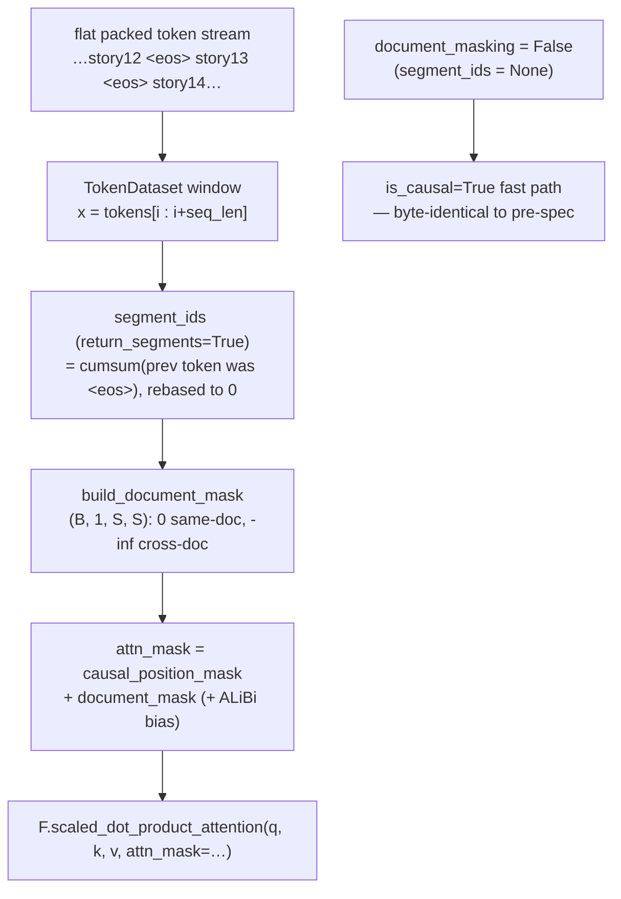

# 031 — Document boundaries: packing stories without letting them bleed together (Task 15)

**Type:** task · **Date:** 2026-09-04 · **Related:** `moe-modernization`
Requirement 10.1-10.4; `design.md` `data/dataset.py` + `scripts/prepare_data.py`
+ `model/attention.py` components; follows up entry 008 (`TokenDataset` /
`train_val_split`) and entry 013 (fused SDPA + additive masks)

> **Full derivation, solved by hand:** [`docs/math/031-document-boundaries.md`](../docs/math/031-document-boundaries.md)
> — `build_document_mask` derived from broadcasting first principles and
> traced digit by digit through `Attention.forward`'s causal-plus-document
> mask fold-in, on doc 004/021's exact GQA example plus one real
> `TokenDataset`-derived `segment_ids`; proves (not just measures) that
> document isolation is bit-for-bit exact, and follows it through
> `MLAAttention` and a full 2-layer `QwenMoEModel`.

## What was implemented

- **`ByteBPETokenizer(..., eos_token=False)`** (`qwenmoe/tokenizer/bpe.py`) —
  opt-in. When `True`, one id past the learned byte+merge vocabulary is
  reserved as a dedicated document separator, exposed as `.eos_id`. `encode`
  never produces it (it isn't a byte value); `decode` silently drops it;
  `save`/`load` round-trip the flag. Off by default ⇒ a tokenizer written
  before this spec has the exact same `vocab_size` and ids (Requirement
  10.1, and the backward-compat invariant).
- **`scripts/prepare_data.py`** — new `--split-documents` flag (bpe only).
  With it: the raw corpus is split on `<|endoftext|>` (TinyStories' native
  separator), each document is encoded **independently**, and the pieces
  are joined by `eos_id` — so no BPE merge is ever learnt or applied across
  a boundary and every document is followed by exactly one separator token.
  Two pure, unit-tested helpers do the work: `split_documents(text)` and
  `encode_corpus(text, tokenizer, document_aware=...)`.
- **`TokenDataset(..., return_segments=False, eos_id=None)`**
  (`qwenmoe/data/dataset.py`) — with `return_segments=True`, `__getitem__`
  returns a **3-tuple** `(x, y, segment_ids)`, where `segment_ids` is a
  `(seq_len,)` integer tensor giving each position's document index
  *within that window*, rebased so the window starts at document `0`. A new
  document begins at the position **after** each separator (the `<eos>`
  token is the last token of the document it terminates — the Llama-3
  convention). `return_segments=True` without `eos_id` raises.
- **`build_document_mask(segment_ids)`** (`qwenmoe/model/attention.py`) —
  `(batch, seq_len)` int → `(batch, 1, seq_len, seq_len)` **additive**
  `0.0` / `-inf` mask: `0` where query `i` and key `j` share a document,
  `-inf` where they don't. The size-1 head axis broadcasts across all query
  heads inside SDPA.
- **`Attention.forward` / `MLAAttention.forward`** gained
  `document_mask=None`. When supplied it is *added* onto the causal
  position mask (and any ALiBi bias) and handed to
  `F.scaled_dot_product_attention` as `attn_mask` — the same additive-mask
  machinery entry 013 already built for the KV cache. `document_mask=None`
  ⇒ the fast `is_causal=True` path is byte-for-byte unchanged (Requirement
  10.3).
- **`TransformerBlock.forward` / `QwenMoEModel.forward`** thread
  `document_mask` / `segment_ids` through. The model builds **one** mask
  from `segment_ids` and shares it across every block. `segment_ids=None`
  everywhere ⇒ `document_mask=None` everywhere.
- **`train_val_split(tokens, val_fraction=0.1, *, mode="tail", eos_id=None)`** —
  `mode="documents"` holds out **whole** documents (split on `eos_id`,
  taking documents from the tail until ≥ `val_fraction` of tokens are in
  val), so validation perplexity is never measured on a document with a
  truncated context. `mode="tail"` (default) is today's contiguous cut,
  bit-identical.
- **`Trainer`** — consumes `(x, y, segment_ids)` batches when
  `TrainConfig.document_masking` is on, forwards the ids for both training
  and validation, and raises eagerly if `document_masking=True` but the
  dataset only yields `(x, y)`. `DataConfig.val_split_mode` and the two
  new `scripts/train.py` flags (`--val-split-mode`, `--document-masking`)
  wire it end to end; `tokenizer_meta` now carries `eos_id`.
- **Tests** — +27 (332 → **359**): `tests/test_prepare_data.py` (new, 5);
  `test_bpe_tokenizer.py` (+4); `test_dataset.py` (+11); `test_attention.py`
  (+3); `test_model.py` (+2); `test_trainer_integration.py` (+3). Every
  numerical path has a `flag off ⇒ identical to today` test
  (`torch.equal`, not just `allclose`).
- `uv run pytest -q` — **359 passed** (was 332 after entry 030).

## Concepts explained for a complete beginner

### Term: document

A **document** is one self-contained piece of text in the training corpus —
for TinyStories, one short story; for a code corpus, one file; for
Wikipedia, one article. The corpus is millions of these concatenated
together. A document has an *internal* coherence (sentence 3 follows from
sentence 2) that does **not** extend to the next document (story #58 has
nothing to do with story #59).

### Term: sequence packing

Transformers train on fixed-length windows — this project's `seq_len` is
128 or 256 tokens. Most documents are shorter than that (a TinyStories
story is ~200 words ≈ 300 tokens, but many are far shorter). Rather than
pad every short document out to `seq_len` with useless padding tokens
(wasted compute), the standard trick is **sequence packing**: lay every
document end-to-end in one long token stream and slice fixed-length windows
out of it, ignoring document boundaries. A single window might contain
`...end of story 12 | all of story 13 | start of story 14...`.

`qwenmoe`'s `TokenDataset` (entry 008) has always done this — it's just
`tokens[i : i+seq_len]` over a flat stream.

### Term: causal mask (recap from entry 004)

Inside attention, every token computes a score against every other token,
then a softmax turns those scores into weights that mix the other tokens'
values. The **causal mask** sets the score to `-inf` (⇒ softmax weight
exactly `0`) for every position *after* the current one, so a token can
only attend to itself and the past. This is what makes the model a
left-to-right language model.

### The problem: cross-document contamination

With sequence packing **and only a causal mask**, a token near the start of
story 14 can attend all the way back into story 13 and story 12. Those are
unrelated texts. The model is being asked "predict the next token of story
14, and by the way here are 100 tokens of a *different* story as context."

Two concrete harms:

1. **Training signal is noisier.** The attention mechanism spends capacity
   learning to *ignore* the previous document — or worse, gets distracted
   by a spurious correlation ("story 13 mentioned a dog, so predict 'dog'").
   Zhao et al. (2024) measured that removing this contamination improves
   language-modelling loss and downstream in-context-learning accuracy.
2. **Validation perplexity is measured on nonsense.** If a val window
   straddles a boundary, the first few tokens of the new document are
   scored with a garbage context — the number you're tracking to decide
   "is the model improving?" is partly measuring the model's reaction to
   an incoherent prompt.

**Measured** (this project's code, a random 8-token stream cut into two
4-token documents, plain causal mask): the first token of document 2 puts
**78.4%** of its attention weight on document-1 keys. The next three put
61.7%, 73.5%, 33.5%. That is not a rounding error — under packing, a
new-document token attends *mostly* at the previous document until it has
built up enough of its own context.

### The fix: intra-document (document-boundary) masking

Add a second mask on top of the causal one: score `-inf` for any key that
is in a **different document** than the query. Now story 14's tokens attend
only within story 14 — exactly as if each document had been its own
padded sequence, but with none of the padding waste. Llama 3 does this for
all of pretraining; the same 8-token test above drops document-2→document-1
attention weight to **exactly 0.0**.

### How the two masks combine

Both masks are **additive** in score-space (`0` = allowed, `-inf` =
blocked), and `-inf + anything = -inf`, so you just add them:

```
final_score[i,j] = raw_score[i,j]
                 + causal_mask[i,j]        (0 if j ≤ i else -inf)
                 + document_mask[i,j]      (0 if same doc else -inf)
                 + alibi_bias[i,j]         (a finite number, or absent)
```

Addition is commutative and associative, so the order doesn't matter and —
crucially — when `document_mask` is `None` the sum is *identical* to the
pre-spec `causal (+ alibi)` total. That's the whole backward-compat story
in one line.



### Deriving `segment_ids`: where does a document start?

Given a window of token ids and the separator id `E`, the document index of
each position is:

```
starts[p] = 1 if position p-1 held a separator, else 0   (starts[0] = 0)
doc_id[p] = starts[0] + starts[1] + … + starts[p]        (a running sum)
```

The running sum increments **one position after** each separator, so the
separator token itself keeps the id of the document it ends. Then the
window is rebased: `segment_ids = doc_id[window] - doc_id[window][0]`, so
every window starts at document `0` regardless of where it was sliced from
(only *equality* of ids matters to the mask, but small ids keep the tests
readable).

**Worked example.** Stream (separator `E = 99`):

```
position:  0   1   2   3    4    5    6    7    8     9
token:     0   1   2   99   10   11   12   13   99    20
starts:    0   0   0   0    1    0    0    0    0     1     (starts[4]=1 because token[3]=99)
doc_id:    0   0   0   0    1    1    1    1    1     2
```

Window `tokens[2:7]` = `[2, 99, 10, 11, 12]` → `doc_id[2:7]` = `[0,0,1,1,1]`
→ rebased `segment_ids` = `[0, 0, 1, 1, 1]`. The `99` (position 3) is the
end of document 0; the `10` after it opens document 1.

### Deriving the mask from `segment_ids`

```
document_mask[b, 0, i, j] = 0.0    if segment_ids[b, i] == segment_ids[b, j]
                          = -inf   otherwise
```

**Worked example.** `segment_ids = [0, 0, 0, 1, 1]` (a window holding the
tail of one story and the head of the next):

```
          key j:  0     1     2     3     4
query i=0:        0     0     0    -inf  -inf
query i=1:        0     0     0    -inf  -inf
query i=2:        0     0     0    -inf  -inf
query i=3:      -inf  -inf  -inf    0     0
query i=4:      -inf  -inf  -inf    0     0
```

(this is the actual printout of `build_document_mask(torch.tensor([[0,0,0,1,1]]))[0,0]`).
Add the causal mask (`-inf` above the diagonal) and query 3 can attend to
{3}, query 4 to {3, 4} — document 1 in complete isolation from document 0.

### Why isolation is *exact*, not approximate

Because a blocked score is `-inf`, its softmax weight is `exp(-inf) = 0`
exactly — not "very small". So a document-1 token's output has **zero**
dependence on any document-0 token. The test proves it with `torch.equal`
(not `allclose`): perturb a document-0 token by +50, and every document-1
logit is *bit-identical*.

**Measured**, `Attention` layer, window `[d0, d0, d0, d1, d1]`, perturb
position 0 by +50:

| position | document | max |Δ output| |
|---|---|---:|
| 1 | 0 | 44.65 |
| 2 | 0 | 25.13 |
| 3 | **1** | **0.00000** |
| 4 | **1** | **0.00000** |

Same story at the full-model level (2 layers, `positional_scheme="nope"`,
perturb a document-0 token): document-0 logits move by up to 0.33,
document-1 logits move by `0.0` exactly.

### `train_val_split(mode="documents")`

Holding out whole documents means the split point must land *on* a
separator. The implementation walks documents from the end of the stream,
adding each to the validation set until the accumulated token count reaches
`val_fraction × total`, then everything before is training.

**Measured.** 10 documents × 9 tokens (8 content + separator) = 90 tokens,
`val_fraction=0.25` → target 22.5 val tokens. Documents are added from the
tail: 9 → 18 → 27 ≥ 22.5, stop. Result: **3 whole documents (27 tokens)**
in val, **7 (63 tokens)** in train. Both halves end exactly on a separator;
no document is ever split between train and val.

## Questions that might come to mind

- **Is `document_masking=False` *really* unchanged?** Yes, three ways.
  (1) `segment_ids` defaults to `None` in `QwenMoEModel.forward`, so
  `document_mask` is `None`, so `Attention` takes the exact
  `is_causal=True` branch it took before this task. (2) The `Trainer` only
  reads `batch[2]` when `config.document_masking` is `True`. (3) A test
  asserts `torch.equal` between `attn(x, pos)` and
  `attn(x, pos, document_mask=None)`, and between `model(ids)` and
  `model(ids, segment_ids=None)`.
- **Does the `<eos>` token change the vocabulary size for existing
  models?** Only if you opt in. `ByteBPETokenizer(eos_token=True)` adds one
  id; `eos_token=False` (the default, and what every pre-spec
  `tokenizer.json` loads as) is untouched. A `BASELINE` run on
  tiny-Shakespeare (char tokenizer, one document) never sees any of this.
- **Why encode each document separately in `prepare_data.py` instead of
  encoding the whole text and splicing?** So a BPE merge can't span a
  boundary. If you encoded `"…happily ever after.<|endoftext|>Once upon…"`
  in one pass, the tokenizer might learn/apply a merge like
  `"after.Once"` — a token that only exists *because* two documents were
  concatenated. Encoding per-document guarantees every learned token is
  real within-document text.
- **Which token "owns" the separator — the document before or after?** The
  one before. `doc_id` increments *after* the separator, so `<eos>` is the
  final token of the document it terminates. This matches how the model
  should learn to *predict* `<eos>` as the natural end of a story, and how
  Llama 3 / the `TokenDataset` here treat it.
- **Is the mask rebuilt for every layer?** No — `QwenMoEModel.forward`
  builds it once from `segment_ids` and passes the same `(B, 1, S, S)`
  tensor to all `n_layers` blocks. The `(B, 1, S, S)` shape (head axis =
  1) also means it costs `S²` floats per batch item, not `n_heads × S²`.
- **Does this interact with the KV cache (entry 013)?** Not in this task.
  Document masking is a *training-time* concern (packed windows);
  `generate()` decodes a single ongoing sequence with no packed
  boundaries, so `generate()` never builds a document mask. The additive-
  mask plumbing they share is the only overlap.
- **What about MLA?** `MLAAttention.forward` got the same `document_mask`
  parameter and the same `attn_mask` addition. Tested: a document-1 token
  is fully isolated from a document-0 perturbation under MLA too.
- **Does the trace path (`forward_with_trace`) support this?** No, and it
  doesn't need to — the visualizations show a single clean prompt, not
  a packed training batch. `forward_with_trace` is unchanged; document
  masking is exercised through `forward` and its own tests, the same
  decision entry 013 made for the KV cache.
- **Why not just shuffle documents so contamination is "random noise"?**
  Shuffling changes *which* wrong document precedes each one, but a token
  still attends to unrelated text. The point of masking is that the
  attention weight on other documents is *zero*, not *randomised*.

## Papers

- [The Llama 3 Herd of Models (Grattafiori et al., Meta, 2024)](https://arxiv.org/abs/2407.21783)
  — §3.1: "we use an attention mask that prevents self-attention between
  different documents within the same sequence." Reports the effect is
  small for standard 8K-context pretraining but "important in continued
  pre-training on very long sequences." This task implements exactly that
  mask.
- [Analysing the Impact of Sequence Composition on Language Model
  Pre-Training (Zhao, Qu, Staniszewski, Tworkowski, Liu, Miłoś, Wu &
  Minervini, ACL 2024)](https://arxiv.org/abs/2402.13991) — the systematic
  study of packing-induced contamination. Shows naïve causal masking over
  packed sequences includes "distracting information from previous
  documents" that hurts language modelling *and* downstream tasks, and
  that **intra-document causal masking** removes it. Also proposes
  `BM25Chunk` (retrieval-based packing), a follow-up this project doesn't
  take.
- [Efficient Sequence Packing without Cross-contamination (Krell, Kosec, Fu
  & Bharti, 2021)](https://arxiv.org/abs/2107.02027) — earlier work
  (BERT-era) making the same point: packing to avoid padding is a large
  throughput win, but attention and the loss must respect the boundaries or
  accuracy degrades.

## Outcome

`uv run pytest -q` — **359 passed** (332 before this task). Task 15 checked
off in `moe-modernization/tasks.md`. `document_masking` and
`val_split_mode="documents"` are both opt-in axes for the ablation study
(tasks 16–17); the default path is untouched.
