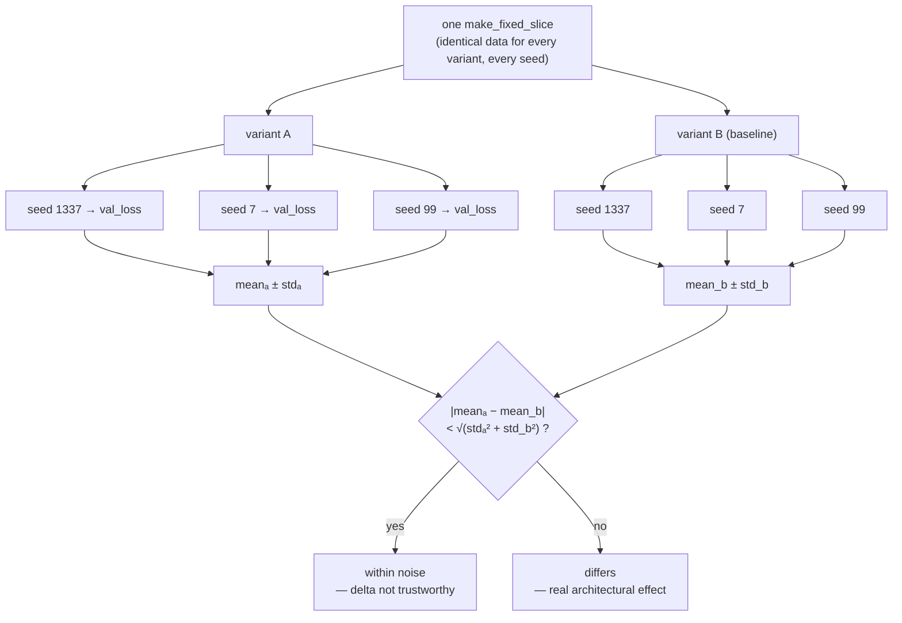

# 032 — Why one seed lies: multi-seed noise bands and parameter-matched variants (Task 16)

**Type:** task · **Date:** 2026-09-04 · **Related:** `moe-modernization`
Requirement 12.1, 12.2, 12.4; `design.md` `train/compare.py` component;
follows up entry 008 (`make_fixed_slice` / compute-matched comparison) and
the `extra-manim-preview-task15` preview of `run_comparison`

## What was implemented

- **`run_comparison(..., *, seeds=None, param_matched=False,
  baseline_name=None)`** (`qwenmoe/train/compare.py`):
  - `seeds` — a tuple of random seeds. Each variant is trained **once per
    seed**, on the *same* fixed token slice (the slice seed is separate and
    unchanged), and its result carries the mean and standard deviation of
    final val loss / perplexity across seeds. Default `(train_config.
    seed,)` — a single run, byte-for-byte today's behavior.
  - `param_matched` — before training, each non-baseline variant's `d_ff`
    is bisected so its **total** parameter count lands within 2% of the
    baseline's. `comparison_mode` on each `VariantResult` records
    `"compute_matched"` or `"param_matched"`.
  - `baseline_name` — which variant is the reference (default: the first
    key of `variants`).
- **`VariantResult`** gained (all additive — every pre-task field kept, and
  with one seed the scalars are exactly that run's numbers): `seeds`,
  `per_seed_val_loss`, `per_seed_val_perplexity`, `val_loss_mean`,
  `val_loss_std`, `val_perplexity_mean`, `val_perplexity_std`,
  `log_paths`, `comparison_mode`, `within_noise_of_baseline`.
- **`ComparisonReport`** gained `baseline_name`, `seeds`, and a
  `summary_table()` rendering `mean ± std` with a per-variant note:
  `baseline` / `within noise` / `differs` / `n/a (1 seed)`.
- **`within_noise_of_baseline`** — set once every variant has run, only
  when there are ≥ 2 seeds: `True` when
  `|meanᵥ − mean_baseline| < hypot(stdᵥ, std_baseline)` (the pooled
  seed-to-seed noise band), else `False`; `None` for the baseline itself
  and for single-seed runs.
- **`match_d_ff_to_param_budget(variant_config, target_total_params)`** —
  integer bisection on `d_ff` (total params are monotone increasing in it),
  returning the `d_ff` whose model total is closest to the target. Raises
  if the variant is bigger than the target even at `d_ff = 1`.
- **`scripts/run_comparison.py`** — new `--seeds` and `--param-matched`
  flags; prints `report.summary_table()`; the JSON summary now records
  per-seed losses, the noise flag, and `comparison_mode`.
- **Tests** — +6 in `tests/test_compare.py` (359 → **365**): single-seed
  default keeps the scalar fields and claims no noise band; `len(seeds)=3`
  ⇒ `std > 0`, three distinct per-seed losses, one log dir per seed; an
  identical-config "twin" variant is flagged `within noise`;
  `summary_table()` shows `±` and a note; `match_d_ff_to_param_budget`
  brings a GELU variant within 2% of a SwiGLU baseline; `param_matched=True`
  marks the mode and hits the 2% budget.
- `uv run pytest -q` — **365 passed** (was 359 after entry 031).

## Concepts explained for a complete beginner

### Term: random seed

Training a neural network uses randomness in several places: the initial
weights are drawn from a random distribution, the data is shuffled into a
random order each epoch, and (here) `torch.multinomial` picks tokens during
any sampling. A **random seed** is a single integer that fixes *all* of
that: `torch.manual_seed(1337)` makes every subsequent "random" draw a
fixed, reproducible sequence. Change the seed and you get a *different*
fixed sequence — a different initialization, a different shuffle — and so a
slightly different trained model, even with identical code, data, and
hyperparameters.

### Term: ablation

An **ablation** (from "ablate" = remove) is an experiment that changes
**one** thing about a system and measures the effect. "Does QK-norm help?"
→ train the model with QK-norm on, train it with QK-norm off, everything
else identical, compare the validation loss. This project's
`run_comparison` (entry 008) is built for exactly this: it pins the
training data (`make_fixed_slice`) and the compute budget
(`total_tokens`) so the *only* difference between two runs is the
architectural axis being studied.

### Term: validation loss / perplexity (recap)

**Validation loss** is the average cross-entropy of the model's next-token
predictions on held-out text it never trained on — lower is better.
**Perplexity** is `exp(val_loss)`: loosely, "how many equally-likely tokens
is the model effectively choosing between at each step" — a perplexity of
25 means the model is about as uncertain as if it were guessing uniformly
among 25 options. It's the same information as the loss, on a more
interpretable scale.

### The problem: a single run is a sample, not "the answer"

Run the *same* ablation twice with two different seeds and the two
validation losses **differ** — not because the architecture changed, but
because the initial weights and data order did. That difference is
**noise**. If the architectural effect you're trying to measure is *smaller
than the noise*, a single-seed comparison will regularly tell you the wrong
thing: variant A "beats" B on seed 1337 and *loses* to it on seed 7, and
you have a 50/50 chance of publishing whichever you happened to run.

**Measured** (this project, real tiny-Shakespeare, a 60k-token fixed slice,
120 steps, `SMOKE_TEST` shape, 3 seeds `{1337, 7, 99}`):

| variant | per-seed val_loss | mean ± std |
|---|---|---|
| `SMOKE_TEST` (baseline) | 3.2153, 3.2210, 3.2003 | **3.2122 ± 0.0107** |
| `POS_NOPE` (NoPE) | 3.2149, 3.2211, 3.2000 | **3.2120 ± 0.0109** |
| `ACT_GELU` (non-gated FFN) | 3.1648, 3.1583, 3.1693 | **3.1642 ± 0.0055** |

Look at `POS_NOPE`. Its mean is `0.0002` below the baseline — but the
seed-to-seed spread *within* each variant is `~0.011`, **fifty times
larger**. On seed 99, NoPE "wins" by 0.0003; on seed 7 it "loses" by
0.0001. A single-seed ablation run at seed 1337 would have reported "NoPE:
3.2149 vs baseline 3.2153 — NoPE slightly better!" — a conclusion that is
pure seed luck. `ACT_GELU`, by contrast, is `0.048` below the baseline,
**four times** the noise band — that one is real.

### The fix: train each variant on N seeds, report mean ± std

`run_comparison(..., seeds=(1337, 7, 99))` trains every variant three
times (same slice, same budget, three seeds) and reports
`val_loss_mean ± val_loss_std`. The std is the sample standard deviation
(`statistics.stdev`, the `n−1` estimator) of the per-seed losses.

### Deriving the "within noise" flag

Two variants each have a mean and a std over seeds. The question "is the
difference between their means real?" is a two-sample comparison. A simple,
honest test: the combined uncertainty of a *difference of two independent
means* adds in quadrature —

```
noise_band = sqrt(std_variant² + std_baseline²)
within_noise = |mean_variant − mean_baseline| < noise_band
```

(`math.hypot(a, b)` computes `sqrt(a² + b²)`.) This is deliberately
*loose* — it's roughly a "1σ of the difference" band, not a p<0.05
significance test — because at this project's scale (3 seeds, tiny models)
a real significance test would almost never fire, and the goal is a
**caution flag** in a lab notebook, not a publication claim.

**Worked example** with the measured numbers:

```
POS_NOPE:  |3.2120 − 3.2122| = 0.0002
           noise_band = sqrt(0.0109² + 0.0107²) = sqrt(0.0001188+0.0001145) = 0.01528
           0.0002 < 0.01528  →  within noise  ✅  (don't trust this delta)

ACT_GELU:  |3.1642 − 3.2122| = 0.0480
           noise_band = sqrt(0.0055² + 0.0107²) = sqrt(0.00003+0.0001145) = 0.01203
           0.0480 < 0.01203  is FALSE  →  differs  ✅  (real effect, 4× the band)
```

`run_comparison`'s output annotates exactly this:

```
variant              val_loss (mean±std)   val_ppl (mean±std)  tokens/sec             mode  note
SMOKE_TEST               3.2122 ± 0.0107      24.835 ± 0.265    149054.2   compute_matched  baseline
POS_NOPE                 3.2120 ± 0.0109      24.830 ± 0.269    164065.0   compute_matched  within noise
ACT_GELU                 3.1642 ± 0.0055      23.669 ± 0.130    162910.9   compute_matched  differs
```



### Term: compute-matched vs parameter-matched

Two ways to make an A/B comparison "fair":

- **Compute-matched** (what `run_comparison` always did): both variants see
  the same number of training tokens and do the same FLOPs per token. This
  is the right frame for "given a fixed training budget, which is better?"
  But a variant that has *more parameters* at the same FLOPs (e.g. more
  experts) can win simply by having more capacity — you learn "bigger is
  better", which you already knew.
- **Parameter-matched**: both variants have the same *total* parameter
  count; you shrink the bigger one until they match. This isolates
  "is this a better *use* of a fixed parameter budget?" — the question
  that matters when memory, not compute, is the constraint.

The Switch Transformer paper reports both framings side by side for exactly
this reason: a sparse MoE beats a dense model on compute-matched
perplexity, but the same MoE has far more parameters, which shows up as
worse fine-tuning overfitting — a fact only the parameter-matched view
surfaces.

### Deriving the `d_ff` match

The only architectural knob `run_comparison` adjusts to match parameters is
`d_ff`, the per-expert feed-forward width, because it's the one that moves
parameter count smoothly and doesn't change the model's *shape*
(`d_model`, `n_layers`, `n_heads` all stay put, so the comparison still
means something).

Every expert's parameter count is linear in `d_ff`:

- **SwiGLU / GEGLU** (gated): 3 matrices per expert — `w_gate`, `w_up`
  (both `d_model × d_ff`), `w_down` (`d_ff × d_model`) → `3 · d_model ·
  d_ff` params.
- **plain GELU** (non-gated): 2 matrices — `w_1` (`d_model × d_ff`), `w_2`
  (`d_ff × d_model`) → `2 · d_model · d_ff` params.

Everything else in the model (embedding, attention, norms, router) is
**independent of `d_ff`**, so total params `= C + k · d_ff` for constants
`C` (the `d_ff`-free part) and `k` (experts per layer × matrices per expert
× `d_model` × `n_layers`). Strictly monotone increasing ⇒ **bisection**
converges: find the smallest `d_ff` whose total ≥ target, then compare it
and its predecessor and return the closer one.

**Worked example** (`SMOKE_TEST` shape, `vocab_size=65`):

```
SwiGLU baseline, d_ff=128:  275,328 total params
GELU variant,    d_ff=128:  193,408 total params   (−29.75% — it's missing one matrix per expert)

bisection on the GELU variant, target 275,328:
   d_ff=160 → 234,368  (−14.9%)   too small, search up
   d_ff=176 → 254,848  ( −7.4%)   too small
   d_ff=184 → 265,088  ( −3.7%)   too small
   d_ff=192 → 275,328  (  0.00%)  exact
   →  match_d_ff_to_param_budget returns 192
```

`192 = 128 × 3/2` exactly — the GELU expert needs `3/2×` the width to make
its 2 matrices carry the same parameters as SwiGLU's 3. (`GEGLU` is *also*
gated, so it already matches at `d_ff=128` with no adjustment — a nice
sanity check the test relies on.) The report then labels the GELU row
`param_matched` instead of `compute_matched`.

## Questions that might come to mind

- **Is the default really unchanged?** Yes. `seeds=None` →
  `(train_config.seed,)`, a single run. A test asserts that with one seed
  the scalar `final_val_loss` equals `val_loss_mean`, `val_loss_std == 0.0`,
  `within_noise_of_baseline is None`, and the log lands at the old
  un-nested path `output_dir/<name>/logs/train.jsonl`. Every one of the six
  pre-existing `run_comparison` tests still passes untouched.
- **Why is the *data* seed separate from the *training* seeds?** The whole
  point of `make_fixed_slice` (entry 008) is that every variant trains on
  the *identical* tokens — that's what makes it an ablation and not just
  two unrelated runs. Varying the training seed varies init + shuffle
  *order*; the token *content* stays pinned by `fixed_slice_seed`. Mixing
  them would reintroduce the confound the fixed slice exists to remove.
- **Why sample std (`n−1`), not population std?** The seeds are a *sample*
  from the infinite population of "all possible seeds"; we want to estimate
  that population's spread, and the `n−1` (Bessel-corrected) estimator is
  the standard unbiased choice. With `n=1` there's no spread to estimate,
  so the code returns `0.0` and refuses to compute a noise band at all
  (`within_noise_of_baseline` stays `None`) rather than pretend.
- **3 seeds isn't many — is the noise band trustworthy?** It's a rough
  guide, not a significance test (see the derivation). Bouthillier et al.
  (2021) show that even a handful of seeds, combined with varying *other*
  noise sources, estimates the true benchmark variance far better than one
  seed — and at this project's scale, 3 seeds is what a laptop can afford.
  The flag's job is to stop you over-reading a 0.0002 delta, and for that
  it's plenty.
- **Why bisect a full `QwenMoEModel` per step instead of a closed-form
  formula?** `count_params` (entry 009 / Requirement 11.1) is the single
  source of truth for "how many parameters does this config have"; a
  hand-derived formula could silently drift from it as the model changes.
  At `SMOKE_TEST` scale a model builds in milliseconds and bisection needs
  ~8 iterations, so it's cheap; for the real ablation study it's a
  one-time setup cost before hours of training.
- **What if a variant is *bigger* than the baseline (e.g. more experts)?**
  `match_d_ff_to_param_budget` raises if the variant exceeds the target
  even at `d_ff=1` — you can't shrink it into range by `d_ff` alone, and
  silently returning `d_ff=1` would produce a crippled model. The caller
  (the ablation study) is then expected to param-match by a *different*
  knob, or accept a compute-matched comparison and say so.
- **Does `param_matched` touch the baseline?** No — the baseline defines
  the target, so its `comparison_mode` stays `"compute_matched"` and its
  `d_ff` is untouched. Only the other variants are adjusted.

## Papers

- [Accounting for Variance in Machine Learning Benchmarks (Bouthillier,
  Delaunay, Bronzi, … Varoquaux & Vincent, MLSys 2021)](https://arxiv.org/abs/2103.03098)
  — models the full benchmarking process and shows that init-seed, data-
  order, and hyperparameter variance each materially move reported results;
  recommends randomizing multiple noise sources rather than fixing one
  seed. The direct justification for `seeds` and the noise band.
- [Show Your Work: Improved Reporting of Experimental Results (Dodge,
  Gururangan, Card, Schwartz & Smith, EMNLP 2019)](https://arxiv.org/abs/1909.03004)
  — documents multiple published NLP model comparisons whose conclusion
  *flips* under a fair accounting of run-to-run variation and compute
  budget; argues for reporting distributions, not single point estimates.
- [Switch Transformers: Scaling to Trillion Parameter Models with Simple
  and Efficient Sparsity (Fedus, Zoph & Shazeer, JMLR 2022 / arXiv
  2021)](https://arxiv.org/abs/2101.03961) — §4 reports sparse-vs-dense
  comparisons in **both** FLOP-matched and parameter-matched framings, and
  shows they lead to different takeaways (compute win vs fine-tuning
  overfitting). The model for `comparison_mode` / `param_matched`.

## Outcome

`uv run pytest -q` — **365 passed** (359 before this task). Task 16 checked
off in `moe-modernization/tasks.md`. Multi-seed and `param_matched` are
opt-in; `run_comparison` with its old signature is unchanged. Tasks 17–18
build the refreshed ablation menu on top of this.
