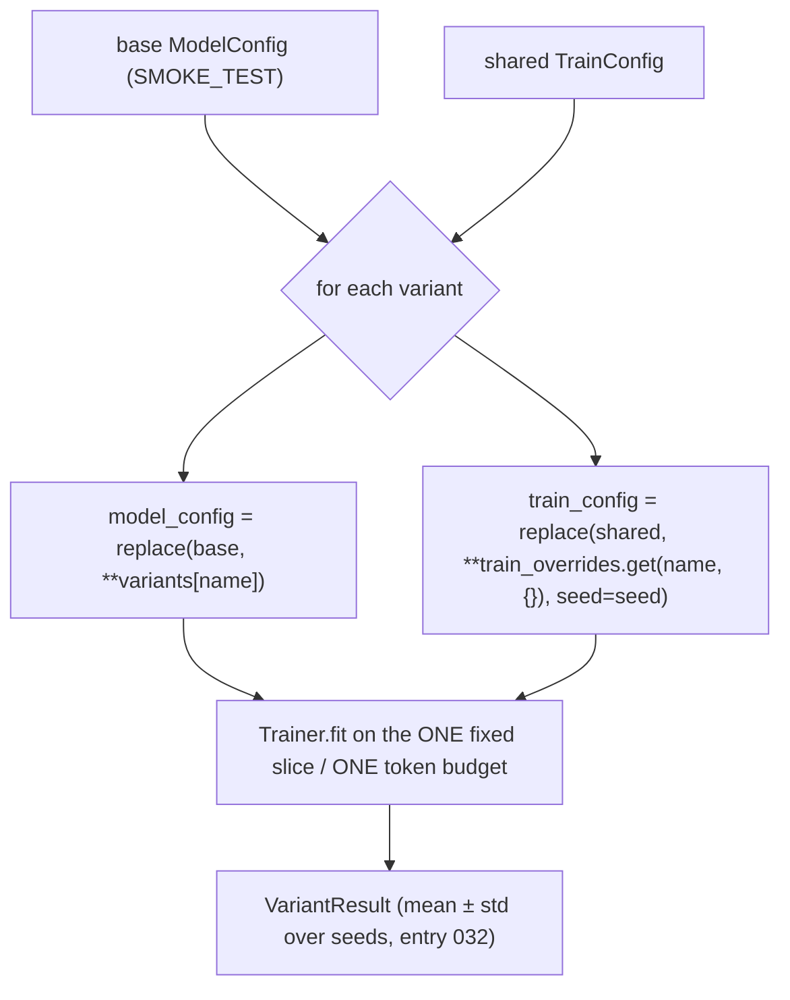

# 033 — The 2026 ablation menu, per-variant train overrides, and the MoE budget caveat (Task 17)

**Type:** task · **Date:** 2026-09-04 · **Related:** `moe-modernization`
Requirement 12.3, 12.5, 12.6; `design.md` `train/compare.py` +
`scripts/run_ablation_study.py` + `scaling.py` components; builds on
entries 008/015 (the original menu), 024–030 (each new axis), and 032
(multi-seed / param-matched)

## What was implemented

- **`scripts/run_ablation_study.py::VARIANTS`** — extended from 8 entries
  to 14. Each entry is now a **4-tuple** `(axis, label, ModelConfig,
  train_overrides)`. New rows:
  - `OPT_MUON` — `train_overrides={"optimizer": "muon"}`
  - `SCHED_WSD` — `train_overrides={"lr_schedule": "wsd"}`
  - `ROUTE_SIGMOID` — `ModelConfig(router_scoring="sigmoid")`
  - `ATT_QKNORM` — `ModelConfig(qk_norm=True)`
  - `MTP_D1` — `ModelConfig(mtp_depth=1)`
  - `MOE_FINEGRAINED` — 16 routed experts of `d_ff=32`, `top_k=8`, 4 shared
- **`configs/presets.py`** — new named presets `ROUTE_SIGMOID`,
  `ATT_QKNORM`, `MTP_D1` (one axis off `SMOKE_TEST` each), and
  `MOE_FINEGRAINED` (multi-axis by nature). `OPT_MUON` / `SCHED_WSD` are
  **not** presets — they're `TrainConfig` axes, so they live only in the
  `VARIANTS` table.
- **`run_comparison(..., train_overrides=None)`** — `{name: {field:
  value}}` `TrainConfig` deltas per variant, applied as
  `dataclasses.replace(train_config, **overrides, seed=seed)`. Lets the
  optimizer / schedule axes be compared without a second base config. The
  shared token budget must not be overridden (the caller's job).
- **`qwenmoe/train/scaling.py::moe_budget_note(total_params,
  active_params)`** — a paragraph to print next to `chinchilla_budget`
  (Requirement 12.6): states that `20×` is a **dense**-model constant
  (where `total == active`), that a sparse MoE's compute-optimal budget
  sits **between** `20 × active` and `20 × total` (Clark et al. 2022), and
  that `20 × active` is a floor. A near-dense model (`sparsity < 1.05×`)
  gets a one-line "applies directly" instead.
- **Startup logging** — `scripts/train.py`, `scripts/run_comparison.py`,
  and `scripts/run_ablation_study.py` now log the baseline's total/active
  param counts, `chinchilla_budget`, and `moe_budget_note` before training.
- **Default corpus → TinyStories BPE** — `run_ablation_study.py` defaults
  to `corpus="tiny_stories", tokenizer_type="bpe"` (parent Tier 2,
  Requirement 12.3); a new `--smoke` flag restores the fast char-level
  tiny-Shakespeare run.
- **Tests** — +17 (365 → **382**): `moe_budget_note` arithmetic + wording
  + validation (`test_scaling.py`); `ROUTE_SIGMOID`/`ATT_QKNORM`/`MTP_D1`
  added to the "exactly one axis off SMOKE_TEST" check and a dedicated
  FFN-budget test for `MOE_FINEGRAINED` (`test_config.py`); a new
  `test_run_ablation_study.py` — every `VARIANTS` entry is a valid 4-tuple
  whose train override names only real `TrainConfig` fields, each of the 6
  new axes constructs and trains a few steps through `run_comparison`, and
  a `train_overrides` Muon delta actually reaches the trainer (Muon
  checkpoint vs AdamW checkpoint, identical `ModelConfig`).
- `uv run pytest -q` — **382 passed** (was 365 after entry 032).

## Concepts explained for a complete beginner

### Term: ablation axis

An **axis** is one independent design choice you can vary. This project's
comparison study (entry 008 / 015) is organized as a menu of axes: the
positional scheme (`rope` / `nope` / `alibi`), the activation
(`swiglu` / `geglu` / `gelu`), the balancer (`aux_loss` / `loss_free`), and
so on. For each axis, `run_comparison` trains the baseline and one variant
that differs *only* on that axis, on identical data and compute, and
compares final validation loss.

### Why the menu needed refreshing

The original 8 variants (entries 008/015) tested choices that were
already-active research questions in 2023: does NoPE generalize better than
RoPE? Is GEGLU worth the third matrix over SwiGLU? Those axes stay in the
menu, but by 2026 the interesting open questions have moved on — to the
techniques this spec spent entries 024–030 implementing. Task 17 adds a
variant for each:

| new variant | axis | what it tests | journal |
|---|---|---|---|
| `OPT_MUON` | optimizer | Muon's orthogonalized update vs AdamW | 022 |
| `SCHED_WSD` | LR schedule | warmup-stable-decay vs cosine | 021 |
| `ROUTE_SIGMOID` | router scoring | DeepSeek-V3 normalized-sigmoid gate vs softmax | 025 |
| `ATT_QKNORM` | attention | per-head RMSNorm on q/k | 026 (task 6) |
| `MTP_D1` | training objective | one multi-token-prediction head | 028 |
| `MOE_FINEGRAINED` | expert granularity | 16 small experts, top-8, vs 4 large, top-2 | 027 |

### The `ModelConfig` vs `TrainConfig` split, and why `train_overrides`
### exists

`run_comparison` was built to vary **`ModelConfig`** — every variant is
`dataclasses.replace(base_config, **overrides)`, one shared `TrainConfig`
for all. But two of the new axes — *which optimizer* (`optimizer="muon"`)
and *which LR schedule* (`lr_schedule="wsd"`) — are **`TrainConfig`**
fields, not `ModelConfig`. They describe *how* you train, not *what* you
train.

Rather than bolt a second base config onto every call, `run_comparison`
grew a `train_overrides={name: {field: value}}` parameter. For a variant
with an entry there, its effective config is

```python
dataclasses.replace(train_config, **train_overrides[name], seed=seed)
```

— everything else (data slice, token budget, batch size) stays pinned, so
it's still a fair compute-matched comparison; only the one training knob
moves. `MOE_FINEGRAINED`'s `ModelConfig` and `OPT_MUON`'s `TrainConfig`
delta are handled by the same loop, one via `variants`, one via
`train_overrides`.



### Fine-grained experts, and why parameter budgets are held constant

**Fine-grained expert segmentation** (DeepSeekMoE): instead of `N` experts
each with FFN width `d_ff`, use `k·N` experts each with width `d_ff/k`, and
raise `top_k` by the same factor `k`. The total and active *FFN parameter*
counts are unchanged; what changes is the **granularity** of the routing
decision — the router now composes the token's computation from 8 small
specialists instead of 2 large generalists, which DeepSeekMoE shows lets
each expert specialize harder.

`MOE_FINEGRAINED` is built to isolate exactly that. From `SMOKE_TEST`
(4 routed experts, `d_ff=128`, `top_k=2`, 1 shared):

| budget | SMOKE_TEST | MOE_FINEGRAINED | held? |
|---|---:|---:|:---:|
| routed FFN, total | 4 × 128 = 512 | 16 × 32 = 512 | ✅ |
| routed FFN, active/token | 2 × 128 = 256 | 8 × 32 = 256 | ✅ |
| shared FFN | 1 × 128 = 128 | 4 × 32 = 128 | ✅ |
| router | 4·d_model | 16·d_model | grows (unavoidable) |

**Measured** whole-model counts (`vocab_size=65`): `SMOKE_TEST` = 275,328
total / 177,024 active; `MOE_FINEGRAINED` = 276,864 / 178,560 — **+0.6% /
+0.9%**, the entire difference being the 4×-wider router. So a
`SMOKE_TEST` vs `MOE_FINEGRAINED` comparison measures granularity, not
capacity.

### Deriving the MoE budget note

`chinchilla_budget(active_params)` returns `20 × active_params` — the
compute-optimal tokens-per-parameter ratio Hoffmann et al. (2022) fitted.
That fit was on **dense** models, where every parameter is used for every
token, so "parameters" is unambiguous: `total == active`.

A sparse MoE breaks that. `BASELINE` (measured): **23,477,504 total** but
only **9,321,728 active** per token — a 2.52× ratio. Which number goes in
`20 × N`?

- `20 × active` = 186M tokens — treats the 14M inactive parameters as free.
  But they're not: every expert still has to be *trained*, and a token that
  never routes to expert #7 still contributed gradient to it on some other
  step.
- `20 × total` = 470M tokens — treats the MoE as a dense 23M model. But it
  never does 23M params of work per token, so this over-feeds it relative
  to its actual compute.

Clark et al. (2022), fitting scaling laws across routed models from
millions to hundreds of billions of parameters, find the compute-optimal
budget lands **between** these two — a routed model wants more data than
its active count implies, less than its total count implies, and the exact
point depends on the sparsity ratio and scale. `moe_budget_note` doesn't
try to pin that point (this project's scale is far below where the fit is
reliable); it just prints both bounds and says "use `20 × active` as a
floor, not the target":

```
MoE sparsity: 9,321,728 active of 23,477,504 total params (2.5x). Chinchilla's
20x tokens/param is a DENSE-model constant (total == active); for a sparse MoE
the compute-optimal budget lies between 20 x active = 186,434,560 and
20 x total = 469,550,080 tokens (Clark et al. 2022). Use 20 x active as a floor,
not the target.
```

### TinyStories as the default corpus

The parent spec always intended the *headline* study to run on TinyStories
with the from-scratch BPE tokenizer (Tier 2), not char-level
tiny-Shakespeare (Tier 1, a pipeline smoke test). Char-Shakespeare has a
~65-symbol vocabulary and no real notion of a "word", so perplexity
differences between architectures are muddied by how well each models
letter transitions. TinyStories is real English words, real documents
(entry 031's separators), and a 4096-token BPE vocab — a setting where a
routing or attention change can actually show up. `--smoke` keeps the fast
Shakespeare path for when you just want to know the code runs.

## Questions that might come to mind

- **Are the new variants' results in this entry conclusive?** No — the
  numbers below are a single seed, 120 steps, `SMOKE_TEST` scale. Per entry
  032's own lesson, a real conclusion needs `run_comparison(..., seeds=
  (...))` with several seeds on the TinyStories tier. These are here to
  show the menu *runs*, not to rank the techniques.

  | variant | val_loss | Δ vs baseline | tok/s |
  |---|---:|---:|---:|
  | `SMOKE_TEST` | 3.2153 | — | 148,373 |
  | `OPT_MUON` | 3.4451 | +0.230 | 110,826 |
  | `SCHED_WSD` | 3.0184 | −0.197 | 148,577 |
  | `ROUTE_SIGMOID` | 3.2161 | +0.001 | 144,794 |
  | `ATT_QKNORM` | 3.2048 | −0.011 | 117,318 |
  | `MTP_D1` | 3.2009 | −0.014 | 143,233 |
  | `MOE_FINEGRAINED` | 3.2481 | +0.033 | 79,206 |

  Two things *are* worth noting even here: `MOE_FINEGRAINED` runs at half
  the throughput despite matched parameters — 16 experts + 4 shared cost
  real dispatch and Python-loop overhead the batched path (entry 027)
  doesn't fully erase at this tiny scale — and `OPT_MUON` at 120 steps is
  well outside its useful regime (Muon's benefit shows over a full run,
  entry 022). `SCHED_WSD`'s big apparent win is mostly an artifact of
  comparing a flat-then-decay schedule to a cosine over an unrealistically
  short run.
- **Why don't `OPT_MUON` / `SCHED_WSD` get presets in `configs/presets.py`?**
  That file is `ModelConfig` presets only — its whole contract is "a named
  model architecture". An optimizer isn't an architecture. Putting a
  `TrainConfig` concern there would blur the one clean line the config
  module holds.
- **Could `train_overrides` break the compute-matched guarantee?** Yes, if
  you override `total_tokens` / `batch_size` / `seq_len` — so the docstring
  says don't, and the ablation study's `VARIANTS` only ever put
  `optimizer` / `lr_schedule` there. A stricter guard (rejecting
  budget-affecting keys) is a reasonable future addition; for now it's a
  documented contract.
- **Does changing the default corpus break `run_ablation_study.py` for
  people without TinyStories prepared?** It'll raise the same actionable
  `FileNotFoundError` `_load_fixed_slice_datasets` always raised, now
  naming the `tiny_stories` / `bpe` prep command. `--smoke` is the escape
  hatch.
- **Why is `moe_budget_note` a string, not a number?** Because there's no
  single right number at this project's scale — the honest output is "here
  are the bounds and the reason they're bounds". A caller that wants a
  point estimate can pick within `[20·active, 20·total]`; the note exists
  to stop someone typing `20 * total_params` and calling it Chinchilla.

## Papers

- [Unified Scaling Laws for Routed Language Models (Clark, de las Casas,
  Guy, … Simonyan & Sifre, ICML 2022)](https://arxiv.org/abs/2202.01169)
  — fits scaling laws for MoE / routed models across five orders of
  magnitude, showing the compute-optimal tokens/parameter relationship is
  *not* the dense `20×` and depends on expert count and scale. The basis
  for `moe_budget_note`.
- [DeepSeekMoE: Towards Ultimate Expert Specialization in Mixture-of-
  Experts Language Models (Dai, Deng, Zhao, … Liang, ACL 2024)](https://arxiv.org/abs/2401.06066)
  — introduces **fine-grained expert segmentation** ("splitting the FFN
  intermediate hidden dimension while maintaining the number of parameters
  constant") and **shared expert isolation**, exactly the two levers
  `MOE_FINEGRAINED` pulls.
- [Training Compute-Optimal Large Language Models (Hoffmann, Borgeaud,
  Mensch, … Sifre, NeurIPS 2022)](https://arxiv.org/abs/2203.15556) — the
  "Chinchilla" paper: the `D ≈ 20 · N` compute-optimal ratio for **dense**
  models that `chinchilla_budget` implements and `moe_budget_note`
  qualifies.

## Outcome

`uv run pytest -q` — **382 passed** (365 before this task). Task 17 checked
off in `moe-modernization/tasks.md`. The refreshed menu, `train_overrides`,
and the budget note are all additive; a single-preset `run_comparison`
call with no `seeds` / `train_overrides` is unchanged. Task 18 — the
modernized `BASELINE_V2` / `FINEGRAINED` presets — is the last.
