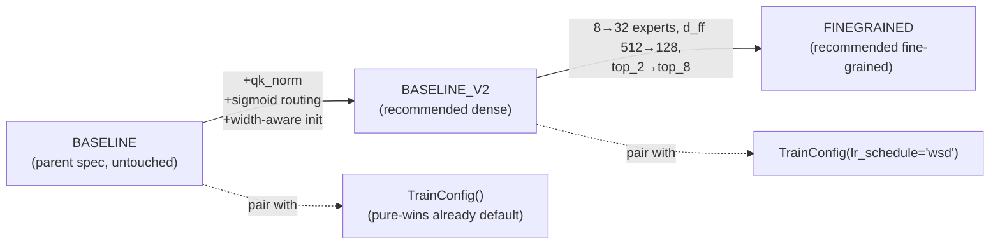

# 034 — BASELINE_V2 and FINEGRAINED: the recommended configs after this spec (Task 18)

**Type:** decision · **Date:** 2026-09-04 · **Related:** `moe-modernization`
Requirement 12.5, 13.4; `design.md` `configs/presets.py` component; the
capstone entry — pulls together the evidence from entries 018–033

> **Full by-hand derivation (of the parameter-budget algebra behind
> `FINEGRAINED`, plus where `sqrt(2/(5·d_model))` actually comes from):**
> [`docs/math/034-modernized-presets.md`](../docs/math/034-modernized-presets.md)
> derives DeepSeekMoE's fine-grained-segmentation algebra once —
> `routed_total`/`routed_active` exactly invariant under
> $(E,d_\text{ff},k)\to(Es,d_\text{ff}/s,ks)$, while `shared` shrinks and
> `router` grows — on a real `MoELayer` at two granularities, then traces
> `_V2_INIT_STD` to Glorot & Bengio's harmonic-mean compromise plugged
> into the original Transformer's `4×` FFN convention (Nguyen & Salazar's
> "SmallInit"), and predicts (not just quotes) the untrained-logit-std
> ratio between all three presets from the `init_std` change alone,
> confirmed to <0.5% over 12 real seeds by
> [`docs/math/verify_034_modernized_presets.py`](../docs/math/verify_034_modernized_presets.py).
> The `qk_norm`/sigmoid-routing recaps it also uses point to docs
> 022/025.

## What was implemented

- **`configs/presets.py::BASELINE_V2`** — `dataclasses.replace(BASELINE,
  qk_norm=True, router_scoring="sigmoid", init_std=sqrt(2/(5·d_model)))`.
  Documented as "the recommended dense-expert config after this spec".
- **`configs/presets.py::FINEGRAINED`** — `BASELINE_V2` + DeepSeekMoE
  fine-grained expert segmentation: 8 experts of `d_ff=512` (top-2) become
  32 experts of `d_ff=128` (top-8), 1 shared.
- **`BASELINE` and `SMOKE_TEST` are byte-for-byte unchanged** — a test
  asserts both still have `qk_norm=False`, `router_scoring="softmax"`,
  `init_std=0.02`, `mtp_depth=0`, so every parent-spec test and every
  existing trained checkpoint stays valid (Requirement 13.4).
- **Tests** — +4 in `tests/test_config.py` (382 → **386**): `BASELINE` /
  `SMOKE_TEST` untouched; `BASELINE_V2` applies exactly the three named
  changes and nothing else; `FINEGRAINED` inherits the V2 changes and
  holds the routed-FFN parameter budget vs `BASELINE`; both modernized
  presets construct a model with finite, `O(1)`-std untrained logits.
- `uv run pytest -q` — **386 passed** (was 382 after entry 033).

## The three changes in `BASELINE_V2`, and the evidence for each

`BASELINE_V2` is intentionally conservative: only changes that are
**architecturally safe** (they can't make a run diverge), **nearly free**
in parameters, and **backed by a task in this spec plus published
practice** got in. Flags that are genuine research questions
(`moe_balancing`, `mtp_depth`, the optimizer, the schedule) stayed *out* of
the preset and remain ablation axes.

| change | from → to | task / journal | why it's in |
|---|---|---|---|
| `qk_norm` | `False → True` | task 6 / [022](022-qk-norm.md) | per-head RMSNorm on q and k before RoPE. Journal 022 measured: without it, attention-logit std grows with the residual stream (`>1000` when the input is scaled 200×); with it, std stays `<5` regardless. Qwen3 and Gemma-3 both ship it (Gemma-2 used logit soft-capping; Gemma-3 replaced that with QK-norm). Cost: **384 parameters** on `BASELINE` (2 norms × `head_dim=32` × 6 layers). |
| `router_scoring` | `"softmax" → "sigmoid"` | task 9 / [025](025-moe-routing-sigmoid-and-router-z-loss.md) | DeepSeek-V3's gate: independent `sigmoid` per-expert affinities, renormalized over the selected `k`, instead of one coupled softmax. Journal 025 covers the identifiability and gradient-flow argument. Zero parameter change. Still selects exactly `k`, weights still sum to 1. |
| `init_std` | `0.02 → sqrt(2/(5·d_model))` | task 7 / [023](023-principled-initialization.md) | the fixed `0.02` is GPT-2's value, tuned for `d_model=768`. `BASELINE` is `d_model=256`. Nguyen & Salazar's "small init", `std = sqrt(2/(5·d_model))` (≈`0.0395` here), is width-aware and is *designed* to pair with pre-norm blocks and the `1/sqrt(2·n_layers)` residual-projection scaling task 7 already applies — together they enable stable training at a large, near-warmup-free learning rate. |

### What's *not* in the preset (and why)

- **`optimizer="muon"` / `lr_schedule="wsd"`** — `TrainConfig`, not
  `ModelConfig`, and `configs/presets.py` is model presets only (the line
  entry 033 drew). The docstring *recommends* pairing `BASELINE_V2` with
  `TrainConfig(lr_schedule="wsd")`; that's a one-liner at the call site,
  not a preset. Muon still needs per-run LR tuning (journal 020), so it
  stays an opt-in axis.
- **The pure-win `TrainConfig` changes** (`betas=(0.9, 0.95)`,
  `weight_decay=0.1`, `grad_clip_norm=1.0`, `min_lr_ratio=0.1`) — already
  the *defaults* after tasks 2–3, so any `TrainConfig()` gets them for
  free. Nothing to put in a preset.
- **`mtp_depth`, `seq_balance_loss_weight`, `router_z_loss_weight`,
  `z_loss_weight`, `document_masking`** — real knobs with real trade-offs
  (extra params / extra loss terms / data-pipeline requirements). These are
  what the ablation study (entry 033's menu) exists to evaluate; baking an
  unevaluated choice into the "recommended" preset would defeat the point.
- **`attention_variant="mla"`** — a genuine architecture change with its
  own trace-path caveats (journal 012); left as an axis.

## `FINEGRAINED`: fine-grained segmentation at `BASELINE` scale

Entry 033 introduced `MOE_FINEGRAINED` as a `SMOKE_TEST`-scale *ablation
variant*. `FINEGRAINED` is the `BASELINE`-scale *recommended preset* for
anyone who wants to actually train a fine-grained model.

Starting from `BASELINE_V2` (8 routed experts, `d_ff=512`, `top_k=2`, 1
shared):

| budget | BASELINE(_V2) | FINEGRAINED | held? |
|---|---:|---:|:---:|
| routed FFN, total | 8 × 512 = 4096 | 32 × 128 = 4096 | ✅ |
| routed FFN, active/token | 2 × 512 = 1024 | 8 × 128 = 1024 | ✅ |
| shared FFN | 1 × 512 = 512 | 1 × 128 = 128 | ❌ (deliberate) |
| router | 8·d_model | 32·d_model | grows |

Unlike entry 033's `MOE_FINEGRAINED` (which bumped `n_shared_experts` to 4
to hold the shared FFN constant), `FINEGRAINED` keeps **1 shared expert**
as the task specifies — so its shared expert narrows to `d_ff=128`, a
deliberate small capacity trade for finer routing. It's a different point
on the design space, not a param-matched twin.

**Measured** whole-model counts (`vocab_size=4096`):

| preset | total params | active/token | sparsity | untrained logit std |
|---|---:|---:|---:|---:|
| `BASELINE` | 23,477,504 | 9,321,728 | 2.52× | 0.284 |
| `BASELINE_V2` | 23,477,888 | 9,322,112 | 2.52× | 0.558 |
| `FINEGRAINED` | 21,745,280 | 7,589,504 | 2.87× | 0.557 |

`BASELINE_V2` costs **+384 params** over `BASELINE` — `+0.0016%`, entirely
the QK-norm gains. `FINEGRAINED` is *smaller* in both total and active
count (the narrower shared expert outweighs the bigger router) and more
sparse (2.87×), which — per entry 033's `moe_budget_note` — means its
compute-optimal token budget shifts a little further from `20 × active`
toward `20 × total`.

## Questions that might come to mind

- **Why is this a "decision" entry, not a "task" entry?** It adds almost no
  code — two `dataclasses.replace` calls. Its job is to *record the
  reasoning*: which of the spec's ~20 new knobs belong in a default, and
  why the rest don't. That's a decision, and the value is the table above.
- **Should I just use `BASELINE_V2` for everything now?** For a fresh run,
  yes — it's strictly a better starting point (bounded attention logits,
  width-appropriate init, the routing refinement) at 384 extra parameters.
  Keep using `BASELINE` only when you need to reproduce a parent-spec
  result or load an old checkpoint.
- **The untrained logit std went from 0.28 to 0.56 — is that a problem?**
  No. Requirement 9.4 asks for "within a small factor of 1.0"; both are.
  The larger value is the width-aware init doing what it's designed to —
  `0.02` was slightly *too small* for `d_model=256`, mildly starving early
  gradient signal. `0.56` is healthier, and still nowhere near the
  50×-blowup failure mode journal 023 was written against.
- **Did you train `BASELINE_V2` vs `BASELINE` to confirm it's better?**
  The per-change evidence (journals 022, 025, 023) is the basis, each with
  its own measured before/after. A head-to-head `BASELINE`-scale run is a
  many-hour CPU job and, per entry 032, would need several seeds to say
  anything trustworthy — that's the ablation study's job (entry 033's menu
  now has every one of these axes), not this preset-definition task's.
- **Why `sqrt(2/(5·d_model))` and not µP or a tuned sweep?** It's the
  simplest width-aware scheme with a direct published pairing to this
  project's exact setup (pre-norm + `1/sqrt(2N)` residual scaling). Full
  µP (µTransfer) is a larger change — separate LR groups, attention-logit
  `1/d` scaling — and is a reasonable follow-up, noted not taken.
- **Is `FINEGRAINED` param-matched to `BASELINE`?** No — it's ~7% smaller
  total. If you want a param-matched fine-grained comparison, use
  `run_comparison(..., param_matched=True)` (entry 032), which will bisect
  `d_ff` for you.

## Papers

- [Qwen3 Technical Report (Qwen Team, 2025)](https://arxiv.org/abs/2505.09388)
  — this project's namesake family: Qwen3 dropped QKV bias and added
  QK-norm "to ensure stable training", the direct precedent for
  `BASELINE_V2`'s `qk_norm=True` (see also entry 022's citations:
  Henry et al. 2020, ViT-22B / Dehghani et al. 2023).
- [DeepSeek-V3 Technical Report (DeepSeek-AI, 2024)](https://arxiv.org/abs/2412.19437)
  — the normalized-sigmoid router (`router_scoring="sigmoid"`) and the
  auxiliary-loss-free balancing this spec's routing work follows.
- [DeepSeekMoE (Dai, Deng, Zhao, … Liang, ACL 2024)](https://arxiv.org/abs/2401.06066)
  — fine-grained expert segmentation with a held parameter budget, the
  design `FINEGRAINED` implements.
- [Transformers without Tears: Improving the Normalization of Self-Attention
  (Nguyen & Salazar, IWSLT 2019)](https://arxiv.org/abs/1910.05895) — the
  `std = sqrt(2/(5·d_model))` small-init, explicitly designed to pair with
  pre-norm residual connections and enable warmup-free large-LR training.

## Outcome

`uv run pytest -q` — **386 passed** (382 before this task). Task 18 checked
off in `moe-modernization/tasks.md` — **the spec is complete**: all 18
tasks implemented, tested (274 → 386 tests, backward-compat invariant held
at every step), and journaled (entries 018–034). `BASELINE` / `SMOKE_TEST`
are untouched; `BASELINE_V2` / `FINEGRAINED` are the recommended configs
going forward, and every modernization axis is available both as a config
flag and as an ablation-study variant.
