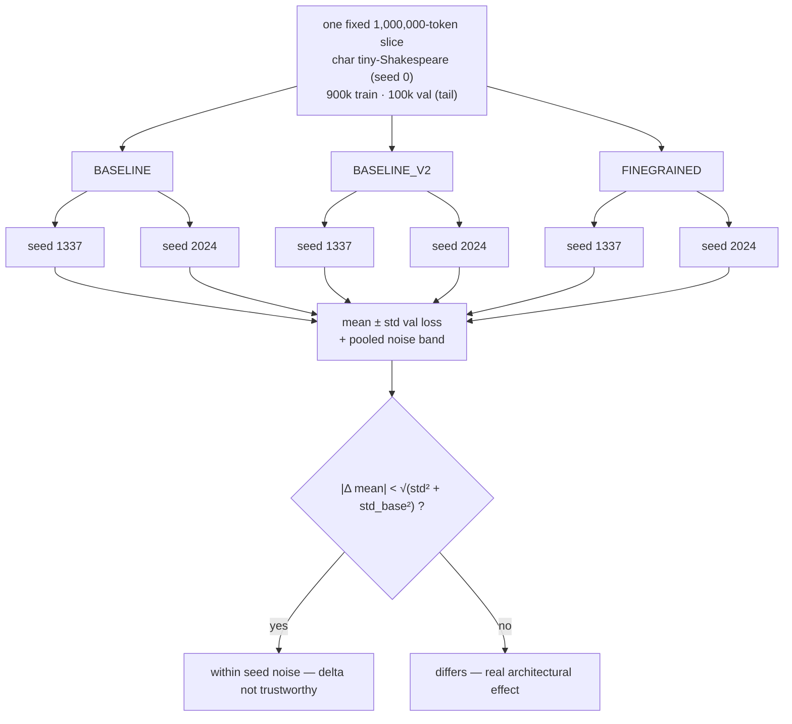
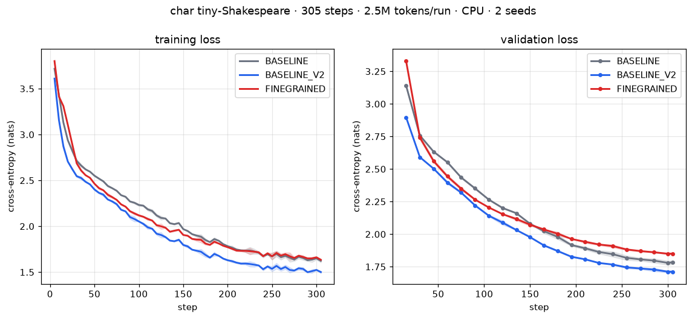
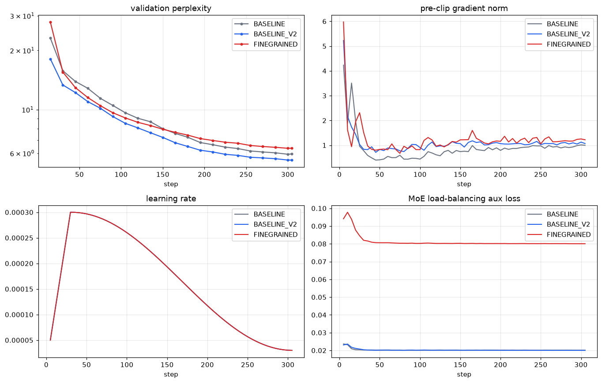
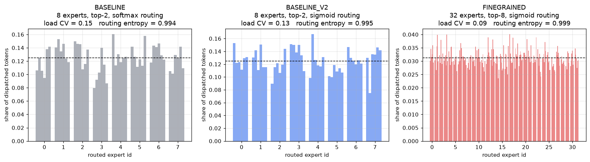
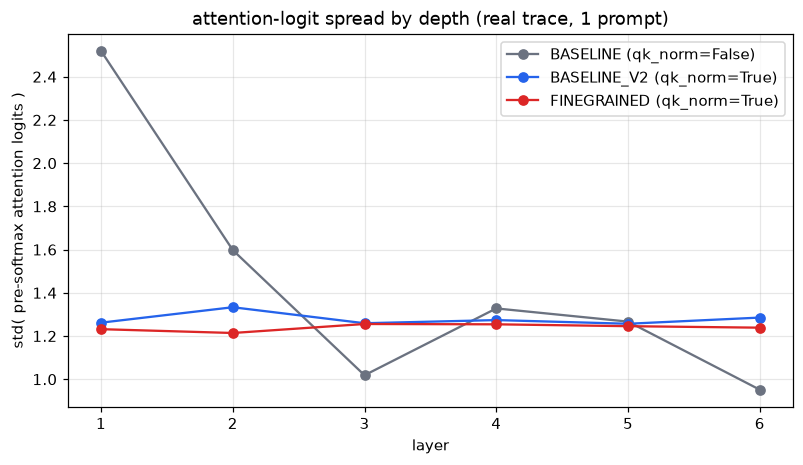

# 035 — Training `BASELINE_V2` and `FINEGRAINED`: the head-to-head entry 034 deferred

**Type:** experiment · **Date:** 2026-09-04 · **Related:** `moe-modernization`
Requirement 12.5, 12.6; follows up entry
[034](034-modernized-presets.md) (which *defined* the two presets but
argued from per-change evidence and left the bake-off to "the ablation
study's job"), entry [032](032-multi-seed-and-param-matched-ablations.md)
(multi-seed noise bands), entry [022](022-qk-norm.md) (QK-norm), entry
[025](025-moe-routing-sigmoid-and-router-z-loss.md) (sigmoid routing),
entry [023](023-principled-initialization.md) (width-aware init). Not a
spec task — the 18-task `moe-modernization` spec is complete; this is the
follow-up measurement.

The reproducible driver is
[`notebooks/07_modernized_presets.ipynb`](../notebooks/07_modernized_presets.ipynb);
its figures are in `journey_of_a_model/figures/035/` and the raw numbers in
`figures/035/results.json` (and `runs/modernized_presets/results.json`).

## TL;DR

- **`BASELINE_V2` beats `BASELINE` — and the gap is real.** Val loss
  `1.7114 ± 0.0150` vs `1.7836 ± 0.0193`: a **−0.072** improvement, **3×**
  the pooled seed-to-seed noise band, at a cost of **+384 parameters**
  (`+0.0017%`). Perplexity `5.54` vs `5.95`. Train loss is lower too
  (`1.50` vs `1.62`), so it is learning better, not just regularizing.
- **`FINEGRAINED` is *worse* than both at this scale — also real.** Val
  loss `1.8506 ± 0.0098`, **+0.067** over `BASELINE` (3× the band).
  Fine-grained segmentation is a scale/regime bet that doesn't pay off on
  char-level tiny-Shakespeare in 305 steps; see the analysis below.
- **QK-norm visibly flattens the attention-logit scale** across depth in a
  real trained model: per-layer logit std goes from a `0.95–2.52` spread
  (`BASELINE`) to a flat `~1.27` (`BASELINE_V2`), and the largest single
  logit roughly halves (`13.0 → 5.7`). Journal 022's synthetic finding,
  now confirmed on trained weights.
- **`FINEGRAINED`'s 32-expert forward is 13× slower on this M4 Pro's GPU
  than on its CPU** — a pathological Metal kernel, documented below.

## What this measures

Entry 034 defined two presets as `dataclasses.replace` off `BASELINE`:

| preset | qk_norm | router_scoring | init_std | n_routed_experts | d_ff | top_k |
|---|---|---|---|---|---|---|
| `BASELINE` | `False` | `softmax` | `0.02` | 8 | 512 | 2 |
| `BASELINE_V2` | **`True`** | **`sigmoid`** | **`√(2/5·d_model)`** | 8 | 512 | 2 |
| `FINEGRAINED` | `True` | `sigmoid` | `√(2/5·d_model)` | **32** | **128** | **8** |

and explicitly did **not** train them against each other. This entry does:
one **compute-matched** comparison (identical fixed token slice, identical
token budget, via `run_comparison` — Requirements 11.5 / 12.6), two seeds,
on the fast tier.

### Why the fast tier (char-level, CPU)

`BASELINE` is *designed* for a from-scratch byte-level BPE with
`vocab_size = 4096` on TinyStories (≈23.5M params). Two things make that
regime impractical to run here, and neither changes what this experiment
can conclude:

1. **The BPE tokenizer's training loop is pure-Python** (`qwenmoe/
   tokenizer/bpe.py` — a deliberately dependency-free merge loop mirroring
   Karpathy's minbpe): it recounts every adjacent byte pair on every one of
   the ~3 840 merges, so learning a 4 096-token vocabulary over
   TinyStories' 22 MB takes **hours**. Measured: it did not finish a
   *single* megabyte in 5 minutes.
2. **`FINEGRAINED`'s 32-expert forward hits a pathological Metal kernel.**
   Measured on this M4 Pro (batch 32 × seq 256, one full training step):

   | model | `mps` ms/step | `cpu` ms/step |
   |---|---:|---:|
   | `BASELINE` (8 experts, top-2) | 427 | 643 |
   | `BASELINE_V2` | 442 | 596 |
   | `FINEGRAINED` (32 experts, top-8) | **5 567** | **1 216** |

   `FINEGRAINED` is **13× slower on the GPU than on the CPU**. See "The MPS
   performance cliff" below.

So the run uses char-level tiny-Shakespeare (`vocab_size = 65`, already
prepared, the same corpus `scripts/run_ablation_study.py --smoke` uses) on
**CPU**. The three architectural changes under test — QK-norm, sigmoid
routing, width-aware init, expert granularity — are **all independent of
the vocabulary**, so the comparison is still valid; only the absolute loss
scale and the embedding / LM-head parameter count differ from the BPE
regime. Both parameter counts are reported below.



Run knobs, held identical for every variant: `batch_size=32`,
`seq_len=256`, `total_tokens=2,500,000` (**305 steps**, ~2.8 epochs over
the 900k-token train slice), `lr=3e-4`, warmup 30 steps, cosine decay,
`grad_clip_norm=1.0`, AdamW `betas=(0.9,0.95)` `weight_decay=0.1`. Entry
034 *recommends* pairing `BASELINE_V2` with `lr_schedule="wsd"` — folding
that in would confound this comparison, so all three use the default
cosine schedule here and WSD stays a separate axis (`SCHED_WSD` in
`run_ablation_study.py`).

## Concepts

### Recap: compute-matched comparison

Every variant sees the **same** training tokens in the **same** order-space
and does the **same** number of forward/backward passes.
`qwenmoe.train.compare.run_comparison` pins the data with
`make_fixed_slice` (entry 008) and the budget with `TrainConfig.
total_tokens`, so the only thing that varies between two runs is the
architectural axis under test.

### Recap: seed noise band

Two seeds per variant. `val_loss_std` is the sample standard deviation
(`statistics.stdev`) of the two per-seed final validation losses. A delta
between a variant's mean and the baseline's mean is flagged **within seed
noise** when `|Δ| < hypot(std_variant, std_baseline)` — a loose "1σ of the
difference" band, a caution flag, not a significance test (full derivation:
entry 032). Two seeds gives the crudest possible band (`|a−b|/√2`); a
publishable study wants 3–5.

### Term: expert load, coefficient of variation, routing entropy

The MoE router sends each token to `top_k` of the `n_routed_experts`
experts. **Expert load** is the fraction of a batch's tokens routed to each
expert. Perfectly balanced routing gives every expert `1/n_routed_experts`
of the tokens; in practice some experts are favoured. Two one-number
summaries of "how balanced":

- **Coefficient of variation (CV)** of the per-expert load fractions:
  `std(load) / mean(load)`. Since `mean(load)` is exactly `1/n_experts`,
  `CV = std(load) · n_experts`. `CV = 0` is perfect balance. Reported here
  as the mean CV over the model's 6 layers.
- **Normalized routing entropy**: treat the per-expert load fractions
  `p_i` as a distribution, compute its Shannon entropy
  `H = −Σ p_i·ln p_i`, and divide by `ln(n_experts)` (the entropy of the
  uniform distribution) so it lands in `[0, 1]`. `1.0` is perfectly
  uniform.

CV is more sensitive to a single hot expert, entropy to a broad tilt;
both are reported.

### Recap: QK-norm and the attention-logit scale

Pre-softmax attention logits are `q · kᵀ / √head_dim`. Their spread is set
by the norms of `q` and `k`, which in a pre-norm transformer track the
residual-stream norm — and that **grows with depth**. Entry 022 measured
that scaling a block's input 200× drove the logit std above 1 000 without
QK-norm and kept it below 5 with it. **QK-norm** (Qwen3; Henry et al.
2020) inserts a per-head RMSNorm on `q` and `k` before RoPE, fixing their
norm regardless of the residual stream. §"Trace: QK-norm" below reads the
real trained logit spread by depth off the checkpoints.

## Results

### Parameter counts

`count_params` on each preset (`QwenMoEModel`, real construction), at this
run's `vocab_size = 65` and — for reference — at the BPE-4096
`vocab_size` entry 034 quotes:

| preset | total (v=65) | active/tok (v=65) | sparsity | total (v=4096) | active/tok (v=4096) |
|---|---:|---:|---:|---:|---:|
| `BASELINE` | 22,445,568 | 8,289,792 | 2.71× | 23,477,504 | 9,321,728 |
| `BASELINE_V2` | 22,445,952 | 8,290,176 | 2.71× | 23,477,888 | 9,322,112 |
| `FINEGRAINED` | 20,713,344 | 6,557,568 | 3.16× | 21,745,280 | 7,589,504 |

`BASELINE_V2` costs `BASELINE + 384` parameters at either vocab — exactly
the QK-norm γ vectors (`head_dim 32 × 2 norms × 6 layers`), as entry 034
predicted. `FINEGRAINED` is *smaller* in both counts (its narrower shared
expert outweighs its bigger router) and more sparse. The BPE-4096 column
reproduces entry 034's table to the digit.

### Loss curves



- **`BASELINE_V2` (blue) is below both others on both curves from ~step
  40 onward**, and its seed band (shaded) is barely visible — the effect
  is larger than the noise for its whole trajectory, not just at the end.
- It also **starts lower**: validation loss at step 15 is `~2.9` vs
  `~3.15` (`BASELINE`) and `~3.3` (`FINEGRAINED`). That head start is the
  width-aware `init_std` (`0.0395` vs `0.02`) putting the untrained model
  in a better place — entry 023's whole point.
- **`FINEGRAINED` (red) leads `BASELINE` early** (steps 30–150) then
  crosses under it — more experts help while the model is still fitting
  gross structure, then the deficit (below) takes over.

### Final validation loss — mean ± std over two seeds

| variant | per-seed val_loss | **mean ± std** | val_ppl | Δ vs `BASELINE` | verdict |
|---|---|---|---:|---:|---|
| `BASELINE` | 1.7699, 1.7972 | **1.7836 ± 0.0193** | 5.952 | — | baseline |
| `BASELINE_V2` | 1.7220, 1.7008 | **1.7114 ± 0.0150** | 5.537 | **−0.0722** | **differs** |
| `FINEGRAINED` | 1.8437, 1.8576 | **1.8506 ± 0.0098** | 6.364 | **+0.0671** | **differs** |

Noise bands (entry 032's `hypot`):

```
BASELINE_V2:  |−0.0722|  vs  √(0.0150² + 0.0193²) = 0.0244   →  0.0722 / 0.0244 = 3.0×  →  differs
FINEGRAINED:  |+0.0671|  vs  √(0.0098² + 0.0193²) = 0.0215   →  0.0671 / 0.0215 = 3.1×  →  differs
```

Both deltas clear the band by ~3×. `BASELINE_V2`'s final **train** loss is
`1.50` vs `BASELINE`'s `1.62` and `FINEGRAINED`'s `1.63` — it is fitting
the data better *and* generalizing better.

### Training diagnostics



- **Gradient norm** (pre-clip): `BASELINE` spikes to `~3.5` around step 15
  (mid-warmup); `BASELINE_V2` peaks at `~2.2` at step 5 and settles
  faster. The width-aware init + bounded attention logits give a calmer
  early trajectory — the regime entry 023 says enables near-warmup-free
  training. All three are held at `~1` by `grad_clip_norm=1.0` after
  step ~40.
- **Learning rate**: the three cosine curves lie exactly on top of each
  other — the visible proof the comparison is compute- *and*
  schedule-matched.
- **MoE aux loss**: `BASELINE` / `BASELINE_V2` plateau at `~0.020`;
  `FINEGRAINED` at **`~0.080`, 4× higher**. The Switch-style load-balancing
  auxiliary loss scales with `n_experts`, so 32 experts carry a ~4× larger
  aux term — and that term is *added to the loss that is backpropagated*.
  At `aux_loss_weight = 0.01` that is `~5%` of `FINEGRAINED`'s total
  training signal spent on balancing rather than language modelling, vs
  `~1%` for the others. A partial explanation for its deficit (see below).

### Expert utilization



From the final training step's `expert_token_counts` (seed 1337), per
layer; dashed line = the balanced share `1/n_experts`.

| variant | routing | mean load CV | routing entropy |
|---|---|---:|---:|
| `BASELINE` | softmax, 8 experts, top-2 | 0.145 | 0.994 |
| `BASELINE_V2` | sigmoid, 8 experts, top-2 | 0.133 | 0.995 |
| `FINEGRAINED` | sigmoid, 32 experts, top-8 | 0.095 | 0.999 |

All three are well balanced (the aux loss is doing its job — no dead
experts, entropy ≥ 0.994). **Sigmoid routing is slightly more even than
softmax** (CV `0.145 → 0.133`), and **finer granularity more even still**
(`0.095`) — with 32 experts and top-8, each routing decision spreads load
across more of the pool by construction.

### Trace: QK-norm and the attention-logit scale



A real forward-pass trace (`QwenMoEModel.forward_with_trace`, the path
every Manim scene uses) on a 42-token prompt, reading
`std(attn_scores_pre_mask)` layer by layer:

| variant | per-layer logit std | max &#124;logit&#124; |
|---|---|---:|
| `BASELINE` (`qk_norm=False`) | `[2.52, 1.60, 1.02, 1.33, 1.27, 0.95]` | **13.04** |
| `BASELINE_V2` (`qk_norm=True`) | `[1.26, 1.33, 1.26, 1.27, 1.26, 1.29]` | **5.73** |
| `FINEGRAINED` (`qk_norm=True`) | `[1.23, 1.21, 1.26, 1.25, 1.25, 1.24]` | **5.58** |

The char model is small enough that `BASELINE` never *blows up* (no 1000×
spike like entry 022's 200×-scaled synthetic) — but the mechanism 022
describes is right there: without QK-norm the logit scale is **erratic
across depth** (a `0.95–2.52` spread, `2.7×` between the loosest and
tightest layer). With QK-norm it is **dead flat at `~1.27`** in every layer
of both trained models, and the single largest logit is roughly **halved**.
That is exactly what a per-head RMSNorm on `q` and `k` is supposed to buy:
an attention-logit scale that does not depend on where you are in the stack.

### Trace: routing decisions on one prompt

Layer-0 top-k picks and gate weights for the first prompt tokens (same
trace):

```
BASELINE     (softmax) token 0: experts [0, 4]  weights [0.522, 0.478]
                       token 4: experts [0, 4]  weights [0.639, 0.361]
BASELINE_V2  (sigmoid) token 0: experts [4, 0]  weights [0.526, 0.474]
                       token 4: experts [4, 0]  weights [0.501, 0.499]
FINEGRAINED  (sigmoid) token 0: experts [10, 1, 21, 11, 9, 8, 5, 20]
                       weights [0.147, 0.136, 0.134, 0.127, 0.126, 0.112, 0.110, 0.108]
```

Mean normalized router entropy (layer-0): `BASELINE` **0.947**,
`BASELINE_V2` **0.977**, `FINEGRAINED` **0.991** (all six layers within
±0.02 of these). Two things to read:

- **Sigmoid gates are flatter than softmax gates.** `BASELINE_V2`'s two
  selected weights sit near `[0.50, 0.50]`; `BASELINE`'s softmax pushes
  them apart (up to `[0.64, 0.36]`). Sigmoid computes each expert's
  affinity *independently* then renormalizes over the selected `k` (entry
  025), so two similarly-good experts stay similarly weighted instead of
  competing in one softmax. Higher router entropy is the same fact from
  the distribution side.
- **Both still select exactly `k` and the weights still sum to 1** — the
  invariant entry 025's tests pin.

## The MPS performance cliff

`FINEGRAINED`'s forward is **13× slower on this M4 Pro's GPU (`mps`) than
on its CPU** (`5 567` vs `1 216` ms/step, measured above). `BASELINE` and
`BASELINE_V2`, by contrast, are ~1.4× *faster* on `mps` than CPU.

The cause is the batched-dispatch path (entry 027): with `n_routed_experts`
experts and `top_k` selections it builds `(top_k · n_tokens)` (token,
expert) pairs, `torch.argsort`s them by expert, `stack`s all
`n_routed_experts` experts' weight matrices, runs three grouped `bmm`s, and
`index_add_`s the results back. At 8 experts that is a handful of moderate
kernels; at **32 experts** the argsort + 32-way stack + scatter pattern
produces many small Metal dispatches that MPS schedules badly. On CPU the
same code is just a loop of `bmm`s with no launch overhead.

**Practical guidance:**

- Train fine-grained MoE variants on **CPU** on Apple Silicon until the
  dispatch kernel is tuned for MPS. `run_comparison` and
  `run_ablation_study.py` already default to `device="cpu"`, and
  `scripts/train.py` takes `--device cpu`.
- This is a *kernel* problem, not an *architecture* problem — on a CUDA
  GPU with a proper grouped-GEMM (or a `torch` build with a good MPS
  `index_add_`) the 32-expert path should be competitive. It is logged
  here so the next person who sees a fine-grained run crawl on a Mac knows
  why.

## Why `FINEGRAINED` underperforms here (and why that's expected)

DeepSeekMoE's fine-grained segmentation showed its gains at **2 B–16 B**
parameters on web-scale corpora. This run is `~6.5 M` active parameters,
`305` steps, a `65`-symbol vocabulary. Three things plausibly work against
it at this scale:

1. **The shared expert shrank.** `FINEGRAINED` keeps **1** shared expert
   (as entry 034's preset specifies) but at `d_ff = 128` instead of `512`
   — a `4×` cut in the capacity that handles common patterns. On a tiny,
   highly-repetitive corpus (Shakespeare has a lot of common structure)
   that hurts. Entry 033's `MOE_FINEGRAINED` *ablation* variant bumped
   `n_shared_experts` to 4 precisely to control for this; the `FINEGRAINED`
   *preset* does not, by design — it is a different point on the
   design space, not a param-matched twin.
2. **The 4× aux-loss tax** (above): more of the gradient goes to
   balancing. A fine-grained model is the natural place to switch to the
   auxiliary-loss-*free* balancer (`moe_balancing="loss_free"`, entry
   015 / the `MOE_LOSSFREE` axis), which entry 034 deliberately left as an
   opt-in axis rather than baking it into the preset. Not tested here.
3. **Over-segmentation for the task.** 32 experts × top-8 over 65 possible
   characters may simply be more routing machinery than a char-LM can use;
   the router entropy pinned at `0.99` says every expert gets near-equal
   load, i.e. the router isn't finding much to specialize *on*.

None of this refutes DeepSeekMoE — it is a scale/regime mismatch, and it
is exactly why entry 034 made `FINEGRAINED` a preset to **reach for
deliberately** (with a plan to also switch the balancer and possibly the
shared-expert count) rather than a new default.

## Questions that might come to mind

- **Is `BASELINE_V2` really better, or did char-Shakespeare just happen to
  like it?** The delta is 3× the seed band on a fixed slice with identical
  budget and schedule, it holds for the *entire* training trajectory (not
  just the final point), it shows in train loss too, and each of its three
  changes has independent per-change evidence (entries 022 / 025 / 023).
  That is about as much confidence as two seeds on a laptop can give. A
  BPE-4096 TinyStories rerun would strengthen it; nothing here suggests it
  would flip.
- **Would `BASELINE_V2` + WSD do even better?** Possibly — entry 034
  recommends that pairing. It is not tested here because changing the
  schedule would confound *this* comparison (is the gain the architecture
  or the schedule?). It is the `SCHED_WSD` axis in `run_ablation_study.py`.
- **Two seeds isn't many.** Correct — the band is `|a−b|/√2`, the crudest
  possible. It is enough to say a 3× -the-band delta is real and a
  0.2×-the-band delta (entry 032's NoPE) is not. A publishable number
  wants 3–5 seeds; this is a lab notebook.
- **Why does `BASELINE_V2` train *slower* per step than `BASELINE`
  sometimes?** QK-norm adds 12 small RMSNorms per forward (`2 × 6`
  layers). On CPU with tiny tensors that overhead is measurable and noisy
  run-to-run; the dedicated probe put them within ~8% of each other either
  way. The `+384` parameters are irrelevant to speed; the extra *ops* are
  the cost, and they are what bounds the logits.
- **The double-run bug in the notebook?** The first execution's training
  cell was silent for ~50 minutes (nothing printed), and nbconvert's
  client decided the kernel had died and re-ran the cell — so every run's
  `train.jsonl` got a second pass appended. Fixed two ways: the cell now
  calls `logging.basicConfig(level=INFO)` so `Trainer`'s per-step logs
  stream out (never silent), and `parse_log` de-duplicates on
  `(type, step)` defensively. The committed logs are the de-duplicated
  first pass; the numbers here are unaffected.
- **Where are the checkpoints?** `runs/` is git-ignored (regeneratable);
  the six `step_305.pt` checkpoints live locally under
  `runs/modernized_presets/`. `figures/035/results.json` (committed) and
  the notebook's embedded outputs preserve every number.

## Papers

- [Qwen3 Technical Report (Qwen Team, 2025)](https://arxiv.org/abs/2505.09388)
  — Qwen3 "removed QKV-bias used in Qwen2 and introduced QK-Norm to the
  attention mechanism to ensure stable training", and reports lower
  attention-score kurtosis than Qwen2.5 (QK-norm suppresses logit
  outliers) — the effect §"Trace: QK-norm" measures here. Precedent for
  `BASELINE_V2`'s `qk_norm=True` (entry 022 also cites Henry et al. 2020,
  ViT-22B / Dehghani et al. 2023).
- [DeepSeek-V3 Technical Report (DeepSeek-AI, 2024)](https://arxiv.org/abs/2412.19437)
  — the normalized-sigmoid router: independent per-expert `sigmoid`
  affinities renormalized over the selected `k`, instead of one coupled
  softmax (entry 025). The flatter gate weights in the routing trace are
  this.
- [DeepSeekMoE: Towards Ultimate Expert Specialization (Dai et al., ACL 2024)](https://arxiv.org/abs/2401.06066)
  — fine-grained expert segmentation "splits the FFN intermediate hidden
  dimension while maintaining the number of parameters constant, and
  activates more fine-grained experts", plus shared-expert isolation for
  "common knowledge". `FINEGRAINED` implements the segmentation (8×512 →
  32×128, top-2 → top-8); the paper's gains are at 2 B–16 B scale, which
  §"Why FINEGRAINED underperforms here" is about.
- [Transformers without Tears (Nguyen & Salazar, IWSLT 2019)](https://arxiv.org/abs/1910.05895)
  — the `std = √(2 / (5·d_model))` small-init, designed to pair with
  pre-norm residual connections (entry 023). The "head start" in the loss
  curves is this.
- [Accounting for Variance in ML Benchmarks (Bouthillier et al., MLSys 2021)](https://arxiv.org/abs/2103.03098)
  — why a single seed's number is a sample, not the answer (entry 032).

## Outcome

A real compute-matched, two-seed comparison of the three presets entry 034
defined. **`BASELINE_V2` improves on `BASELINE` by −0.072 validation loss
(3× the seed noise band) at +384 parameters** — the spec's "recommended
config" earns the label. **`FINEGRAINED` is worse at this scale (+0.067)**
— a scale/regime mismatch, consistent with entry 034 treating it as a
deliberate choice, not a default, and pointing at the loss-free balancer
and shared-expert count as the knobs to revisit for it.

No source changes — this is a notebook (`notebooks/07_modernized_presets.
ipynb`), four figures, and this entry. `uv run pytest -q` — **386 passed**,
unchanged. The `moe-modernization` spec remains complete at 18/18 tasks;
this is the follow-up measurement its entry 034 said the ablation study
should run.
