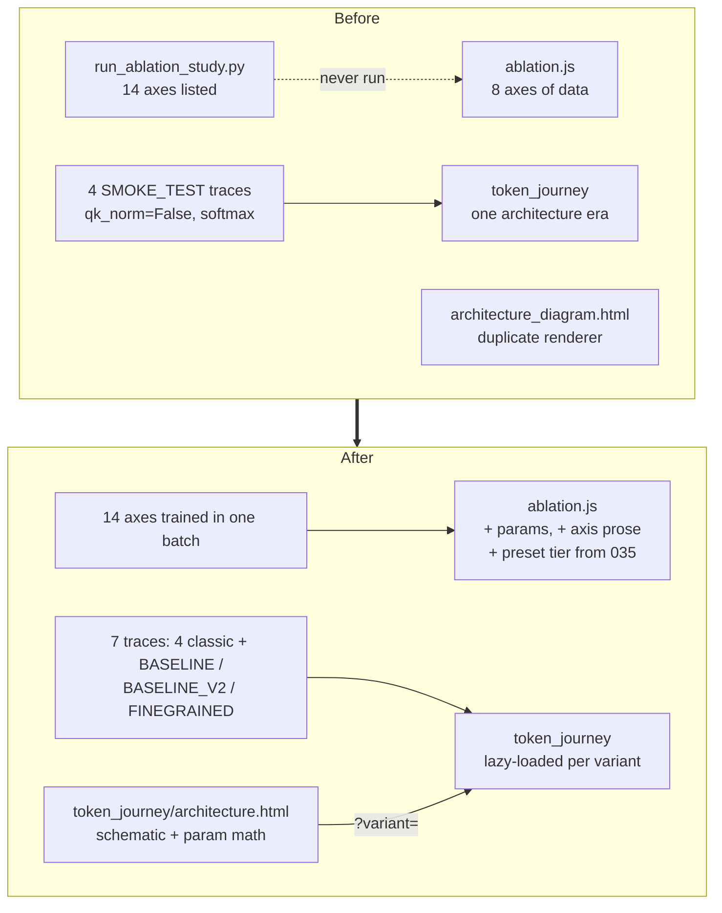

# 036 — Teaching the visualizations the modernized model

**Type:** tooling + experiment (follow-up to [034](034-modernized-presets.md) / [035](035-modernized-presets-training-run.md), not a spec task)
**Date:** 2026-09-05

> **Full by-hand derivation (of `attn_logit_std`/`spread`, i.e. the
> "range across depth" metric only — QK-norm itself is doc 022's job):**
> [`docs/math/036-attention-logit-spread.md`](../docs/math/036-attention-logit-spread.md)
> derives `Tensor.std()`'s flatten-then-Bessel-corrected formula from
> scratch on the real 18-entry population, proves the exact `std(cZ) =
> c·std(Z)` homogeneity that makes an un-normed layer's spread grow by
> precisely `c²` while a QK-normed layer's stays pinned to a `4.5e-7`
> residue, and reproduces this entry's own **23× smaller range** headline
> by re-tracing the real `BASELINE`/`BASELINE_V2` checkpoints, checked
> against the real module by
> [`docs/math/verify_036_attention_logit_spread.py`](../docs/math/verify_036_attention_logit_spread.py).

## TL;DR

- The project's two interactive HTML visualizations were both **stale**: they only knew the pre-`moe-modernization` architecture. `ablation_study/` shipped data for 8 axes while `scripts/run_ablation_study.py` had listed **14** since entry [033](033-ablation-menu-and-moe-budget-note.md) — the six modernization axes had *never been trained*. `token_journey/` walked four `SMOKE_TEST`-derived checkpoints and had no idea QK-norm or sigmoid routing existed.
- **Trained the six missing axes** (`ROUTE_SIGMOID`, `ATT_QKNORM`, `MTP_D1`, `MOE_FINEGRAINED`, `OPT_MUON`, `SCHED_WSD`) plus re-ran the other eight, so all 14 come from one batch under identical conditions. Headline: **`SCHED_WSD` is the single biggest win of any axis (−0.2109 val loss)**, `ATT_QKNORM` −0.1093, and **`OPT_MUON` is by far the biggest loss (+0.6152)** — for a reason worth stating plainly (below).
- **Added a QK-norm capture point to the model itself.** `LayerTrace` gained `q_pre_norm`/`k_pre_norm`, so a trace now carries both sides of the operation instead of only its result. This is what lets a visualization *show* QK-norm rather than assert it.
- Both pages were rebuilt around the modernized presets, and `architecture_diagram.html` was **merged into `token_journey/` as a second page** (`token_journey/architecture.html`) that hands a configuration off to the real-trace walkthrough.
- 386 tests unchanged; no behavior change to any existing model path.

## What was actually wrong

Two separate kinds of staleness, worth distinguishing because they have different causes:

**1. Data staleness (`ablation_study/`).** Entry 033 added six modernization axes to `scripts/run_ablation_study.py::VARIANTS`. That is the *menu*. Nobody had since run the script, so `ablation_study/data/ablation.js` still held the eight-variant export from before. The page was not wrong, it was simply describing an older model — the most dangerous failure mode for a page whose entire selling point is "every number here is real".

**2. Capability staleness (`token_journey/`).** Its four variants are `SMOKE_TEST`-derived, and `SMOKE_TEST` has `qk_norm=False`, `router_scoring="softmax"`. So even after re-exporting, the page *could not* have shown a modernized architecture — no such checkpoint was in its variant list.



## Concepts, defined before use

**Ablation axis.** One configuration field changed relative to a fixed control, everything else held identical — same data slice, same token budget, same seed. A difference in the result is then attributable to that field and nothing else. This is what makes the 14 runs a *study* rather than 14 unrelated numbers.

**Coefficient of variation (CV)** of expert load: `std(load) / mean(load)`. Zero means every routed expert received an identical number of tokens; larger means the router is concentrating. Dividing by the mean is what makes it comparable between an 8-expert and a 32-expert layer, where the raw standard deviations are not.

**Normalized routing entropy:** `H(p) / ln(n_experts)` where `H(p) = −Σ pᵢ ln pᵢ` over the mean routing distribution. Landing in `[0, 1]` regardless of expert count, again so 8-expert and 32-expert models can be put on one axis. `1.0` is a perfectly uniform router.

**Attention-logit spread.** The standard deviation of the pre-mask attention scores `qkᵀ/√d_h` in a layer. QK-norm's claim is about *this quantity's behavior across depth*, not its value in any one layer — so the number that matters is the range across the six layers, not any single reading.

## What the 14 axes measured

Real, from one batch: char tiny-Shakespeare, identical fixed 200,000-token slice, 600 steps at batch 64 × seq 128, `lr=3e-4`, CPU, seed 1337. Control is `SMOKE_TEST` at val loss **2.3504**.

| Variant | Axis | Val loss | Δ vs control | Tok/s |
|---|---|---|---|---|
| `SCHED_WSD` | LR schedule | **2.1395** | **−0.2109** | 189,103 |
| `TIE_FALSE` | tied embeddings | 2.1839 | −0.1665 | 205,256 |
| `ATT_QKNORM` | QK-norm | **2.2411** | **−0.1093** | 206,931 |
| `POS_ALIBI` | positional | 2.2602 | −0.0902 | 208,255 |
| `MTP_D1` | multi-token prediction | 2.3326 | −0.0178 | 170,811 |
| `ACT_GELU` | activation | 2.3344 | −0.0160 | 234,190 |
| `MOE_FINEGRAINED` | expert granularity | 2.3436 | −0.0068 | 121,917 |
| `ACT_GEGLU` | activation | 2.3440 | −0.0064 | 199,110 |
| `ROUTE_SIGMOID` | router scoring | 2.3479 | −0.0025 | 211,134 |
| `SMOKE_TEST` | — (control) | 2.3504 | — | 202,595 |
| `MOE_LOSSFREE` | MoE balancing | 2.3548 | +0.0044 | 209,079 |
| `ATTN_MLA` | attention | 2.4799 | +0.1295 | 174,005 |
| `POS_NOPE` | positional | 2.4879 | +0.1375 | 226,612 |
| `OPT_MUON` | optimizer | **2.9656** | **+0.6152** | 111,236 |

Three of these need a caveat stated *in the page itself*, not just here, because a bare ranking invites the wrong conclusion:

- **`OPT_MUON` is not evidence that Muon is bad.** Muon's published results use a learning rate tuned for Muon, typically much larger than AdamW's. This study deliberately holds `lr` fixed across every variant so the comparison stays single-variable — which means Muon here is running at someone else's hyperparameter. The honest claim is "swapping the optimizer alone, changing nothing else, is not free."
- **`TIE_FALSE` is not a free comparison.** Untying costs `vocab_size × d_model` extra parameters, so unlike every other row it is not parameter-matched.
- **`POS_NOPE` / `ATTN_MLA` are measured at a 128-token context.** Positional schemes mostly differ in how they *extrapolate past the trained length*, and MLA's whole point is KV-cache size during long generation. A short-context, 2-layer run cannot show either benefit — only their costs.

Also worth noting against entry 035: at `SMOKE_TEST` scale `MOE_FINEGRAINED` is very slightly *better* (−0.0068), whereas at `BASELINE` scale entry 035 found `FINEGRAINED` clearly *worse* (+0.067). The two runs differ in more than scale (16 vs 32 experts, 4 vs 1 shared experts), so this is not a clean contradiction — but it is a reminder that neither number generalizes on its own.

## Making QK-norm visible: a change to the model

The trace could not show what QK-norm does, because `Attention.forward_with_trace` captured `q`/`k` *after* the norm — correctly, since those are the vectors that actually reach the dot product. But "after" alone shows a result with nothing to compare it against.

`LayerTrace` now also carries `q_pre_norm` / `k_pre_norm`, populated only when QK-norm is active (`None` otherwise, and `None` for MLA, which has no QK-norm path). Measured on the real trained `BASELINE_V2` checkpoint, prompt `"ROMEO:"`, the followed token, layer 0, per head:

```
q RMS before: [0.729, 0.567, 0.608, 0.595, 0.624, 0.643, 0.582, 0.619]   spread 0.161
q RMS after : [1.015, 1.012, 1.009, 1.017, 1.008, 1.012, 1.011, 1.015]   spread 0.009
```

Across all six layers the pre-norm per-head spread runs `[0.161, 0.255, 0.171, 0.153, 0.313, 0.195]`; post-norm it is `[0.009, 0.005, 0.013, 0.011, 0.013, 0.006]`. Every head arrives at a different scale and leaves at the learned gamma. Since the attention score is `q·k`, that pre-norm drift would otherwise be *squared* into the logits.

And the downstream consequence, measured on the longer prompt `"ROMEO:\nWhat is the cause of this?\n"`:

| Model | attention-logit std per layer | range across depth |
|---|---|---|
| `BASELINE` (no QK-norm) | 2.65, 1.59, 1.03, 1.53, 1.42, 1.04 | **1.615** |
| `BASELINE_V2` (QK-norm) | 1.31, 1.34, 1.28, 1.27, 1.28, 1.29 | **0.070** |
| `FINEGRAINED` (QK-norm) | 1.26, 1.24, 1.26, 1.25, 1.24, 1.25 | **0.019** |

A **23× smaller range** across depth. That is the entire claim, and it is now a chart on the page rather than a sentence.

## Making sigmoid routing visible

The instructive comparison is not "this model's routing distribution" but **both scoring rules evaluated on the same real router logits**, so the only thing that differs on screen is the function. From `BASELINE_V2`'s real layer-0 logits for the followed token:

- softmax: peak share **0.2325**
- sigmoid (renormalized): peak share **0.1667**

Same logits, same model, same forward pass. Softmax shares one denominator, so raising one expert's score necessarily suppresses every other; sigmoid scores each expert on its own and only renormalizes across the selected top-k. The flatter result is why more than one or two experts keep meaningful gradient. Mean normalized routing entropy across layers: `BASELINE` 0.9758, `BASELINE_V2` 0.9849, `FINEGRAINED` 0.9951.

This also fixed a genuine **correctness bug**: `token_journey`'s router deep-dive hard-coded the softmax derivation (`exp(z − max)`, divide by the sum) and then displayed `router_probs`. For a sigmoid checkpoint that is arithmetic the model never performed, shown next to numbers produced a different way. It now branches on `config.router_scoring`.

## What fine-grained segmentation actually buys

Both parameter budgets are held constant by construction — total routed FFN width `32 × 128 = 8 × 512 = 4096`, and per-token active width `8 × 128 = 2 × 512 = 1024`. What changes is how finely that same capacity can be addressed:

- `BASELINE`: choose 2 of 8 experts → `C(8,2)` = **28** possible combinations
- `FINEGRAINED`: choose 8 of 32 → `C(32,8)` = **10,518,300** combinations

**375,653× more distinct ways to specialize, for the same compute.** Whether the model at this scale can *use* that is a separate question, and entry 035 measured that it does not yet.

## The pages

**`ablation_study/`** — rebuilt in two tiers that are deliberately never mixed, because their runs use different base configs, slices and budgets:
- *Single-axis ablations*: all 14 axes, with a sortable leaderboard showing every delta at once (diverging bar centred on zero), an explainer card per axis stating the question it asks and the paper it comes from, and a deep-dive per axis driven by that run's own measurements.
- *The modernized presets*: the entry-035 three-way comparison, with the real min–max envelope across seeds drawn as a band, so "is this difference bigger than seed noise" is answerable by looking rather than by arithmetic.

**`token_journey/`** — now seven real trained architectures instead of four. The walkthrough itself changes shape: a QK-norm model gets an **extra step** that a non-QK-norm model does not have, and the diagram grows a QK-norm box. Verified mechanically — the step is present in exactly the two variants whose `config.qk_norm` is true.

Traces are now **lazy-loaded per variant** (`data/manifest.js` + one `data/trace_<key>.js` each) instead of one 8.6 MB file. The seven traces total ~13.5 MB and the largest is 3.6 MB; loading all of them to look at one was already wasteful at four variants and untenable at seven. Loading uses an injected `<script>` rather than `fetch()` deliberately: these pages are meant to open straight off the filesystem, and browsers block `fetch` across `file://` origins while still permitting a script load.

**`architecture_diagram.html` merged into `token_journey/architecture.html`.** The standalone file was a near-duplicate — its renderer and `token_journey/js/diagram.js` share the same 28 structural functions, because the latter was derived from the former. It now lives beside the walkthrough as its schematic view, and the two hand off to each other: a configuration with a real trained checkpoint offers "walk a real token through this architecture →", which deep-links via `?variant=`. Configurations *without* a checkpoint say so plainly instead of implying their figures are measured. The old path is kept as a redirect stub so existing links keep working.

A useful cross-check fell out of this: the schematic computes parameter counts analytically from the config, and it agrees exactly with the measured PyTorch counts — `BASELINE` 23,477,504 total / 9,321,728 active, `FINEGRAINED` 21,745,280 / 7,589,504, and QK-norm's `2 × head_dim × n_layers = 2 × 32 × 6 = 384`, matching entry 034's measured +384 exactly.

## Questions that might come to mind

**Why re-train the eight axes that already had data?** Throughput is one of the reported metrics, and `tokens_per_sec` is only comparable if every run was measured on the same machine under the same conditions. Mixing a Sep-1 run with a Sep-5 run would have made the speed column quietly meaningless. Retraining all 14 costs about eight minutes.

**Is `SCHED_WSD` really the best axis, or is it an artifact?** It is one seed, one 600-step budget, one corpus. Entry 032 established that a delta is only trustworthy against a seed-noise band, and this tier is single-seed — its band is unmeasured. What can be said is that −0.2109 is an order of magnitude larger than the ±0.011 band entry 032 measured for a comparable setup, which makes it very unlikely to be noise. The preset tier, which *is* multi-seed, is where noise-checked claims live.

**Why not put the modernized presets into the single-axis study?** Because they are not single-axis: `BASELINE_V2` changes three fields at once and `FINEGRAINED` changes four more. Ranking them in a table whose entire premise is "exactly one thing differs" would break the guarantee that makes that table readable. They get their own tier with its own provenance line.

**Why do the large variants ship activations but not expert weight matrices?** The `token_journey` deep-dive re-runs the real matrix multiplication in JavaScript rather than trusting a precomputed answer, which needs the actual matrices. At `d_model=256, d_ff=512` one expert's three matrices are ~393K floats; shipping them for the modern variants would add tens of MB per variant to explain a step the smaller variants already cover completely. The dive is hidden for those variants and the page says why. Every *measured activation* is exported for every variant — this drops weights, never real values.

**Doesn't `q_pre_norm` change the model's behavior?** No. It is a capture-only addition: two extra references stored in a dict on the trace path, which only `forward_with_trace` executes. `forward` — the path every training step and every generation call takes — is untouched, and `LayerTrace`'s new fields default to `None`. 386 tests pass unchanged.

**Why is `BASELINE`'s layer-0 attention-logit std so much higher than its other layers?** Layer 0 reads directly off the embedding table, whose scale is set by `init_std` and is not yet shaped by any residual accumulation, so it is the least representative layer of the six. That is precisely why the metric reported is the *range across depth* rather than any single layer's value — a single reading would be easy to cherry-pick.

## Papers behind the axes

Every link below was resolved and title-checked against arXiv while writing this entry, not recalled:

- Su et al., [RoFormer: Enhanced Transformer with Rotary Position Embedding](https://arxiv.org/abs/2104.09864) — RoPE.
- Shazeer, [GLU Variants Improve Transformer](https://arxiv.org/abs/2002.05202) — SwiGLU / GEGLU.
- Press & Wolf, [Using the Output Embedding to Improve Language Models](https://arxiv.org/abs/1608.05859) — tied embeddings.
- Wang et al., [Auxiliary-Loss-Free Load Balancing Strategy for Mixture-of-Experts](https://arxiv.org/abs/2408.15664) — loss-free balancing.
- DeepSeek-AI, [DeepSeek-V2: A Strong, Economical, and Efficient Mixture-of-Experts Language Model](https://arxiv.org/abs/2405.04434) — MLA.
- DeepSeek-AI, [DeepSeek-V3 Technical Report](https://arxiv.org/abs/2412.19437) — sigmoid routing.
- Dai et al., [DeepSeekMoE: Towards Ultimate Expert Specialization in Mixture-of-Experts Language Models](https://arxiv.org/abs/2401.06066) — fine-grained experts.
- Qwen Team, [Qwen3 Technical Report](https://arxiv.org/abs/2505.09388) — QK-norm.
- Gloeckle et al., [Better & Faster Large Language Models via Multi-token Prediction](https://arxiv.org/abs/2404.19737) — MTP.
- Hu et al., [MiniCPM: Unveiling the Potential of Small Language Models with Scalable Training Strategies](https://arxiv.org/abs/2404.06395) — the WSD schedule.

## Outcome

- `qwenmoe/model/trace.py`, `qwenmoe/model/attention.py`: QK-norm capture points (trace path only).
- `scripts/run_ablation_study.py`: per-variant parameter counts, axis prose, LR/MTP curves, the entry-035 preset tier, and a `_modern_probe` that measures QK-norm and routing behavior from the real trained checkpoints.
- `scripts/export_trace.py`: seven variants across two families, per-variant files plus a manifest, float rounding, and three real analysis blocks (`qk_norm_effect`, `routing_compare`, `layer_stats`).
- `ablation_study/`, `token_journey/`: rebuilt; `token_journey/architecture.html` added; `architecture_diagram.html` reduced to a redirect stub.
- `runs/ablation_study/`: 14 variants, all retrained in one batch.
- **386 tests pass, unchanged.** No default behavior changed anywhere.
