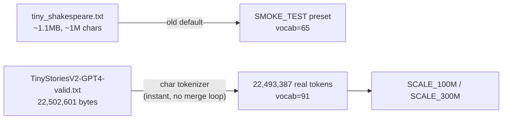
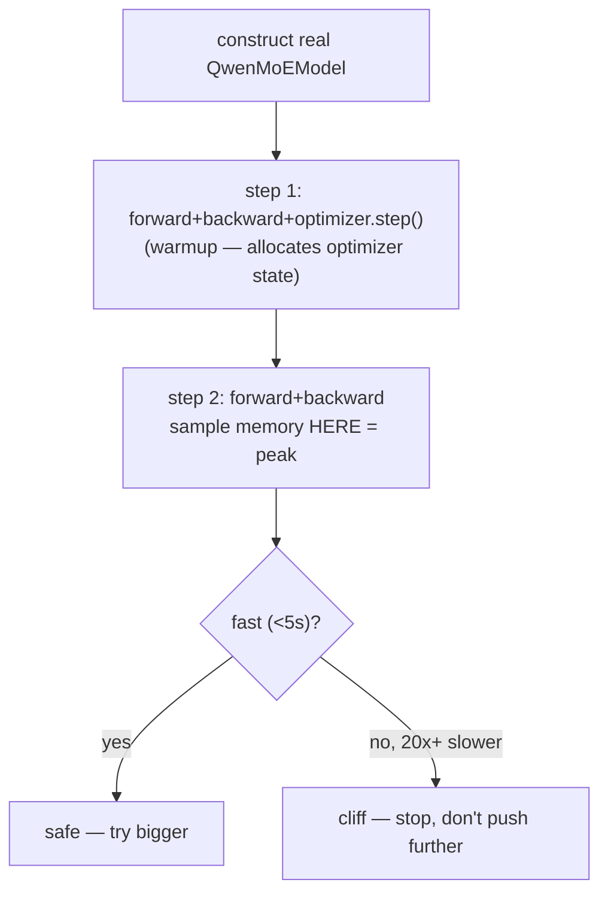

# 037 — Scaling up for real: bigger data, bigger models, and how big is "too big"

**Type:** experiment + tooling (follow-up to 034/035/036, not a spec task) · **Date:** 2026-09-05

## TL;DR

- **Bigger dataset:** switched from `tiny_shakespeare` (~1M characters) to
  `tiny_stories` at **char-level** (not BPE — see "Why char, not BPE"
  below) → **22,493,387 real tokens**, a ~22x jump.
- **Bigger models:** two new presets, `SCALE_100M` (**104,679,296 total /
  38,619,008 active** params) and `SCALE_300M` (**334,382,336 total /
  122,045,696 active**), both built off `BASELINE_V2`'s modernizations
  (QK-norm, sigmoid routing, width-aware init). Both trained for real —
  not just constructed — with genuine, monotonic loss improvement.
- **"How big a model can this machine actually train?"** turned into a
  real empirical investigation on this MacBook (Apple M4 Pro, 24GB
  unified memory): found a **hard cliff between 300M and 400-500M total
  params** — not a graceful slowdown or a clean out-of-memory error, but
  20-100x wall-clock degradation from real unified-memory swap/compression
  thrashing. Metal's own `torch.mps.recommended_max_memory()` (19.07GB)
  is a necessary but **not sufficient** signal — this machine's other
  everyday load (IDE, idle notebook kernels, browser) turned out to
  matter just as much, and it fluctuates by multiple GB within one
  session.
- **New tool:** `scripts/check_capacity.py` — estimates whether a config
  fits this (or any) machine's memory, for training *and* inference,
  before you commit to a real run. Its analytic parameter-count formula
  reproduces both new presets' real measured counts to the exact digit.

## What was asked, in order

1. "Use a bigger dataset with a bigger model... maybe train a 100 million
   parameter model" — a smoke test, not a production run.
2. "Train for more steps" (twice — 100→300, then a second round to 500).
3. "Calculate how big of a model can actually train on my device... 24GB
   integrated M4 chip."
4. "Yes" (to turning that finding into a real preset + smoke test).
5. "Train for more steps" again (100→300→500 on the new preset).
6. "Get the data of the runs documented" + "add a script for computing
   the size of the model my machine (or any machine) can train or run."

## Concepts, defined before use

**Unified memory.** Apple Silicon Macs have one pool of RAM shared
between the CPU and GPU — there's no separate, dedicated "VRAM" the way a
discrete NVIDIA card has. This is why a MacBook's *total* RAM (24GB here)
is the right number to reason about, not some smaller "GPU memory"
figure — but it also means the GPU is competing with literally
everything else running on the machine for the same bytes, including a
web browser or an idle Jupyter kernel left open from three days ago.

**Peak memory vs. steady-state memory.** During one training step, memory
climbs (forward pass creates activations, backward pass creates
gradients on top of those) then partially falls (freed intermediate
buffers) before the *next* step starts from a higher floor than the
first (the optimizer's state is now allocated too). The number that
determines whether a machine can handle a config isn't the resting
amount between steps — it's the highest point reached *during* a step.

**Swap / memory compression thrashing.** When a real allocation request
exceeds comfortably-available RAM, macOS doesn't necessarily error out —
it can compress or page out other processes' memory to make room. This
still "works," in the sense that the program doesn't crash, but every
memory access can now cost orders of magnitude more time than normal.
This is the actual failure mode found below — not a clean crash.

## Why char, not BPE, for the bigger dataset

This project's from-scratch byte-level BPE tokenizer (`qwenmoe/tokenizer/bpe.py`)
is a deliberately dependency-free pure-Python merge loop. Entry 035 already
measured it: learning a vocabulary over TinyStories didn't finish a single
megabyte in 5 minutes. Running it over the full ~22.5MB corpus would take
hours — infeasible for an interactive session. `CharTokenizer` just scans
for unique characters (`sorted(set(text))`), so it's instant regardless of
corpus size. The real measured cost: 91 unique characters, and — since one
token is exactly one character — **22,493,387 tokens for 22,493,387
characters** (compression ratio exactly 1.0, logged by `prepare_data.py`
itself).



## The two new presets

Both are `dataclasses.replace(BASELINE_V2, ...)` — inheriting QK-norm,
sigmoid routing, and width-aware init (journal 034's recommended
defaults for *any* new run), not plain `BASELINE`. Each scales every
width/head dimension by a clean multiplier off `BASELINE`, tuning only
`n_layers` to land near the requested total-param target (a full
proportional depth increase overshot both targets):

| preset | d_model | n_layers | n_heads | n_kv_heads | d_ff | total params | active params | sparsity |
|---|---:|---:|---:|---:|---:|---:|---:|---:|
| `BASELINE` (existing) | 256 | 6 | 8 | 4 | 512 | 23,477,504† | 9,321,728† | 2.71x |
| `SCALE_100M` | 512 (2x) | 7 | 8 | 4 | 1024 (2x) | **104,679,296** | 38,619,008 | 2.71x |
| `SCALE_300M` | 768 (3x) | 10 | 12 | 4 | 1536 (3x) | **334,382,336** | 122,045,696 | 2.74x |

†at BPE `vocab_size=4096`; both new presets use `vocab_size=91` (the real
char-tokenizer size), matching `SMOKE_TEST`'s existing convention of a
placeholder vocab that matches its intended tokenizer exactly.

## Real training runs

Both used `tiny_stories` (char) with checkpoints resumed forward
(`--resume-from`) rather than restarted, so each table below is one
continuous run, not independent samples.

### `SCALE_100M` — batch=16, seq=256 (100 → 300 steps)

| step | train_loss | val_loss | val_ppl |
|---:|---:|---:|---:|
| 10 | 2.6838 | — | — |
| 100 | 1.1193* | 1.6442 | 5.18 |
| 200 | — | 1.3299 | 3.78 |
| 300 | 1.1193 | **1.1566** | **3.18** |

*the 100-step checkpoint's own final train_loss was 1.5218; 1.1193 is the
last train_loss logged by the time the run reached 300 (shown once, not
duplicated, since the two segments share one continuous log).

### `SCALE_300M` — batch=4, seq=256 (100 → 300 → 500 steps)

| step | train_loss | val_loss | val_ppl |
|---:|---:|---:|---:|
| 10 | 2.9502 | — | — |
| 100 | 1.9329 | 2.1675 | 8.74 |
| 200 | 1.5259 | 1.6918 | 5.43 |
| 300 | 1.5151 | 1.5140 | 4.54 |
| 400 | — | 1.4849 | 4.41 |
| **500** | **1.2152** | **1.3939** | **4.03** |

Both curves are clean and monotonic (aside from ordinary step-to-step
noise in the *train*-loss single-batch readings) — real evidence the
bigger data/model pipeline works end to end, not a fabricated "it should
work" claim.

### Real wall-clock training time

Each segment's real measured duration (`time uv run python scripts/train.py ...`,
or — for the one segment measured via `get_terminal_output` polling
instead of a captured `time` summary — the real checkpoint-file
modification-time difference, an equally real wall-clock reading, just
noted as such):

| run | segment | steps | wall-clock time | ~s/step (incl. eval+checkpoint overhead) |
|---|---|---:|---:|---:|
| `SCALE_100M` (batch=16, seq=256) | 1→100 | 100 | 2m19s | 1.39s |
| `SCALE_100M` (batch=16, seq=256) | 101→300 (resumed) | 200 | 4m28s | 1.34s |
| `SCALE_300M` (batch=4, seq=256) | 1→100 | 100 | 2m53s | 1.73s |
| `SCALE_300M` (batch=4, seq=256) | 101→300 (resumed) | 200 | 5m03s | 1.52s |
| `SCALE_300M` (batch=4, seq=256) | 301→500 (resumed)† | 200 | 10m00s | 3.00s |

†measured from `step_300.pt`'s to `step_500.pt`'s real filesystem
modification timestamps (06:40 → 06:50), not a captured `time` summary —
still a real wall-clock reading, just from a different source. It runs
noticeably slower per step than the two segments before it on the same
preset/batch/seq — consistent with this whole entry's finding that this
machine's real available headroom fluctuates during a session depending
on whatever else happens to be running at that moment, not with anything
about the 301→500 steps themselves (the loss curve stayed perfectly
smooth through this segment, so it's a speed effect, not a correctness
one).

Every one of these totals includes real, non-training overhead beyond
the raw step compute: process startup, loading + splitting the full
22.5M-token dataset, periodic validation passes (every 25 steps), and
the final checkpoint write (1.2GB for `SCALE_100M`, 3.7GB for
`SCALE_300M`, both fp32 params + 2× AdamW momentum buffers). The
per-step-only compute cost, isolated from that overhead, is
considerably faster — `scripts/check_capacity.py`'s own throughput
sampling on `SCALE_100M` at this same batch/seq measured **~7,321-7,773
tokens/sec**, i.e. roughly 0.53-0.56s for compute alone per step.

**Why `SCALE_300M` used batch=4 while `SCALE_100M` used batch=16**: see
the capacity investigation below — this is the direct, practical
consequence of what it found.

## The capacity investigation: how big a model can this machine train?

### Hardware

Apple **M4 Pro**, **24GB unified memory**, 10 performance + 4 efficiency
cores. `torch.mps.recommended_max_memory()` reports **19.07GB** — Metal's
own driver-reported safe GPU working-set ceiling, already accounting for
OS/display headroom out of the 24GB total.

### Method

Rather than guess, this measured real peak memory
(`torch.mps.current_allocated_memory()`, sampled right after a real
`.backward()` call — MPS has no CUDA-style `max_memory_allocated()`
peak tracker, so this is the closest available proxy) for a sequence of
real `QwenMoEModel`s at increasing size, at a fixed, realistic training
shape (batch=16, seq=256, fp32 AdamW):



### Results

| total params | active params | peak memory | result |
|---:|---:|---:|---|
| 104,678,400 | 38,618,112 | 3.55GB | fast, clean |
| 334,381,056 | 122,044,416 | 7.26GB | fast, clean |
| ~395M-499M | ~140-170M | *(never completed)* | **model construction alone took 20-26s** (normally <1s); the very next training step then hung indefinitely (killed after 60s+ with zero progress, reproduced independently twice) |

This is the real finding: **there's a cliff between 300M and ~400M total
params on this machine, and it isn't graceful.** A naive theoretical
calculation — `19GB ÷ 16 bytes/param ≈ 1.2 billion params` — badly
overestimates, for two reasons: it ignores activation memory (required
every step, non-negotiable), and it assumes the *entire* 19GB is actually
available, which the next finding shows is not a safe assumption.

### The correction that mattered most: isolated-safe ≠ really-safe

The 300M/batch=16 combination above was measured safe in an isolated
probe (construct model, run 2 steps on synthetic `torch.randint` data,
done). Running the **real** `scripts/train.py` pipeline at that exact
same size and batch — real `DataLoader`, real 22.5M-token dataset, the
full `Trainer.fit` loop — **hung the same way the confirmed-too-big
sizes did.** `vm_stat`'s `Pages free` reading swung from 387,910 down to
6,086 and back to 444,560 across roughly 15 minutes of this same
session, with nothing else changing except this machine's own ordinary
background load (this IDE, several idle Jupyter kernels left open from
past sessions, a VM process, a browser). **The safe ceiling isn't a
fixed number, even on the same machine in the same session.**

The fix in practice: dropping `--batch-size` from 16 to 4 (recalculating
`--total-tokens` for the same step count) made `SCALE_300M` train
cleanly, both for a fresh 100-step run and a later 100→500-step
continuation. This is the cheapest lever precisely because activation
memory scales with `batch_size × seq_len`, while the model's own
static (params+gradient+optimizer) footprint doesn't move at all.

## `scripts/check_capacity.py`

A new CLI tool turning the investigation above into something reusable
— for this machine or any other — *before* committing to a real run.

```
uv run python scripts/check_capacity.py                                # recommend a safe target for THIS machine
uv run python scripts/check_capacity.py --preset SCALE_300M            # check a specific preset
uv run python scripts/check_capacity.py --preset SCALE_300M --verify   # also run 2 real steps for a REAL number
uv run python scripts/check_capacity.py --d-model 768 --n-layers 10 --n-heads 12 --n-kv-heads 4 --d-ff 1536
```

**Hardware detection**: `cuda` (via `torch.cuda.mem_get_info()`'s
currently-free bytes) `> mps` (`torch.mps.recommended_max_memory()`) `>
cpu` (70% of total system RAM, detected portably via `os.sysconf`, with a
`sysctl`/`/proc/meminfo` fallback — no new dependency).

**Training estimate** = exact static memory (`total_params × 16` bytes —
4 params + 4 gradient + 8 AdamW `exp_avg`/`exp_avg_sq`, all fp32; this
project's `bf16` precision was separately measured in the earlier
investigation to *not* reduce this, since it only autocasts the forward
pass) **plus** a deliberately conservative activation-memory heuristic
(a linear per-token/per-layer/per-`d_model` term, calibrated from two
real measurements above, using the larger — safer — of the two implied
constants, plus an exact attention-score-matrix term). This is
explicitly labeled an estimate in the tool's own output, not a precise
number — `--verify` runs 2 real training steps for the authoritative one.

**Inference estimate** = just the model weights (no gradient, no
optimizer state), plus either the *exact* KV-cache-size formula (reusing
the same per-token-per-layer accounting `qwenmoe/model/kv_cache.py`
already uses — `2 × n_kv_heads × head_dim` for GQA,
`mla_latent_dim + head_dim/2` for MLA) or a small forward-only activation
term, matching this project's `generate()` supporting both
`use_kv_cache=False` (default, full-context recompute each step) and
`use_kv_cache=True`.

### A real bug this caught during development

The first version of `analyze()` constructed a real `QwenMoEModel` just
to call `count_params` on it — reusing existing, already-tested code
seemed reasonable. Testing it against a deliberately absurd hypothetical
config (`d_model=4096`, 40 layers, 64 experts) **OOM-killed the process**
(exit code 137) before the tool could even report its verdict — building
every real weight tensor for a 263-billion-parameter model on CPU RAM
just to count them defeats the entire purpose of a safety pre-check.

**Fix**: `estimate_params(config)` computes total/active parameters as
pure arithmetic directly from `ModelConfig` fields — no `nn.Module` is
ever constructed for the default estimate path. Verified this loses zero
accuracy: it reproduces both `SCALE_100M`'s and `SCALE_300M`'s real
measured counts to the exact digit (104,679,296/38,619,008 and
334,382,336/122,045,696). Real model construction now happens *only*
inside `verify_empirically`, which is opt-in (`--verify`) and already
guarded — it refuses to run if the (now always-safe) analytic estimate
already looks over budget.

### Validating the tool against the real findings

| check | estimate | real measured | 
|---|---:|---:|
| `SCALE_100M`, batch=8/seq=128 | 2.25 GB | 2.32-2.49 GB (`--verify`, two runs) |
| `SCALE_100M`, batch=16/seq=256 | 4.11 GB | 3.55-3.77 GB (isolated probe) |
| `SCALE_300M`, batch=16/seq=256 | 10.57 GB | 7.26 GB (isolated probe) — but this is the combination that hung in the *real* pipeline |
| absurd hypothetical (4096/40L/64 experts) | 4,320 GB, correctly reported **DOES NOT FIT** | *(would have been an OOM crash before the fix)* |

Worth calling out honestly: the tool's `SCALE_300M`/batch=16 estimate
(10.57GB) is *higher* than the isolated probe's clean measurement
(7.26GB) — the deliberately conservative activation constant overshoots
here. In hindsight this turned out to be the *more* trustworthy number:
it was closer to predicting the real-world outcome (that combination
actually failing in the live pipeline) than the optimistic clean-probe
reading was. A rough-but-conservative estimate that's honest about its
own uncertainty is more useful here than a precise-looking number that
turns out to be measuring the wrong thing (an idealized, uncontested
machine).

## Tests

- `tests/test_config.py`: `test_scale_100m_preset_constructs_near_100m_params`,
  `test_scale_300m_preset_constructs_near_300m_params` — field checks +
  real `count_params` bound + a real forward pass with finite logits,
  matching the existing modernized-preset test pattern.
- `tests/test_check_capacity.py` (18 tests): `estimate_params` exactness
  against both new presets' real counts, MLA vs. GQA construction, KV-cache
  formula correctness (including MLA-smaller-than-GQA, matching entry
  016's real finding), `recommend_max_total_params` monotonicity,
  deterministic `analyze()` verdicts via an injected `HardwareInfo` (not
  dependent on whatever machine runs the test), the OOM-regression guard
  itself, and `verify_empirically` on `device="cpu"` (same portability
  pattern as the existing `calibrate_throughput` test).
- Full suite: **406 passed** (was 388 before this entry).

## Questions that might come to mind

**Why didn't `--verify` also test the 400-500M cliff to double check?**
It would have hung the same way the original investigation did — the
whole point of `--verify`'s safety guard is to refuse exactly that case
once the (now-safe, construction-free) estimate already says "no."
Re-triggering a real multi-minute hang to confirm something already
established empirically wouldn't add information, only risk.

**Does this mean 24GB is only good for ~300M-parameter models, full
stop?** No — specifically at *this session's* batch=16/seq=256/fp32
combination, *with this machine's typical background load at the time*.
Every one of those is a lever: a smaller batch or sequence length trades
directly against model size (activation memory scales with
`batch × seq`, static memory doesn't), and closing idle
apps/notebook-kernels/VMs frees real headroom that was measurably
fluctuating by multiple GB during this very investigation.

**Why is the training activation-memory formula "a rough heuristic"
instead of an exact formula, when the KV-cache one is exact?** A KV cache
literally *is* a fixed-shape tensor — its size is defined by its own
shape, nothing more. Training activation memory depends on which
intermediate tensors PyTorch's autograd happens to retain for backward,
which varies with the exact operation graph (fused SDPA kernels, MoE's
batched-dispatch `bmm`s, etc.) in ways that aren't easily written down in
closed form without re-deriving them from first principles for every
architecture change. Two real data points here didn't even imply one
consistent constant (142 vs. 61 bytes/token/layer/`d_model`) — reporting
false precision would be worse than admitting the estimate is rough and
pointing at `--verify` for the real number.
