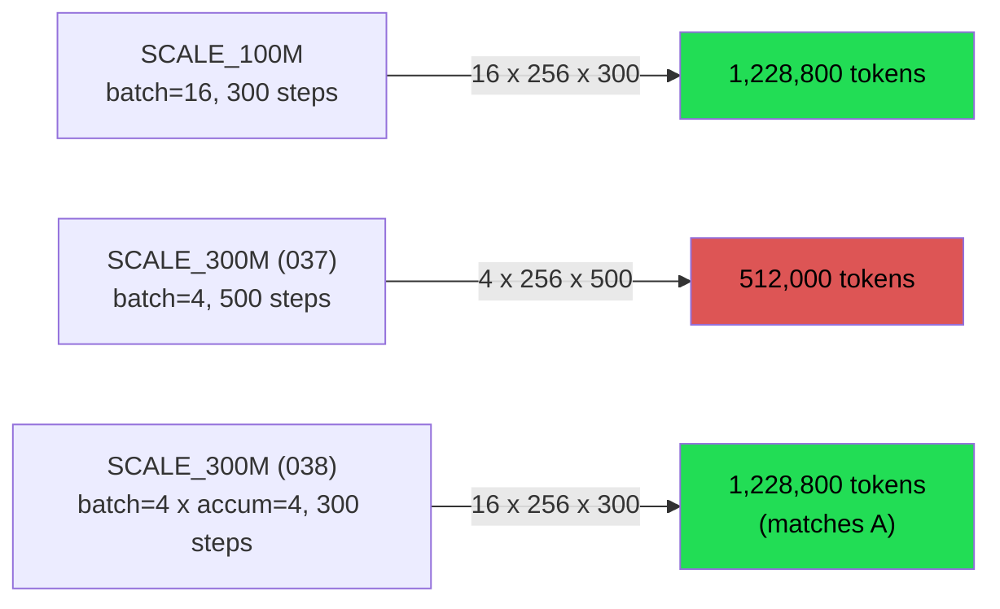

# 038 — Gradient accumulation: a fair rematch for SCALE_300M vs SCALE_100M

**Type:** tooling + experiment (direct follow-up to 037, not a spec task) · **Date:** 2026-09-05

## TL;DR

- **The question:** entry 037's tables show `SCALE_300M` at step 500 (val_loss
  1.3939) still *worse* than `SCALE_100M` at step 300 (val_loss 1.1566) — a
  3x-bigger model, trained *longer*, losing to a smaller one trained
  *shorter*. Was this a real capacity/data mismatch, or an artifact of how
  the two runs were configured?
- **The diagnosis:** a batch-size confound, not a scaling problem.
  `SCALE_100M` ran at `--batch-size 16`; `SCALE_300M` was forced down to
  `--batch-size 4` by the memory cliff 037 itself found. At equal *step*
  counts that means very unequal *token* counts — `SCALE_300M`'s 500-step
  checkpoint had actually seen fewer real tokens (512K) than `SCALE_100M`'s
  300-step checkpoint (1.23M). Comparing them by step number was never a
  fair comparison once the batch size changed between runs.
- **The fix:** `TrainConfig.grad_accum_steps` (new `--grad-accum-steps` CLI
  flag) — accumulates gradients over several small micro-batches before one
  optimizer step, giving an *effective* batch of `batch_size *
  grad_accum_steps` at the peak memory cost of `batch_size` alone.
- **The rematch:** reran `SCALE_300M` at `--batch-size 4 --grad-accum-steps
  4` (effective batch 16 — matching `SCALE_100M`, and the same peak memory
  as the already-proven-safe plain `batch=4` run), same seed/lr/warmup, out
  to 500 steps. At the *same token exposure* as `SCALE_100M`'s step-300
  checkpoint (1,228,800 tokens, reached at step 300 here too), `SCALE_300M`
  now scores val_loss **1.1398** — a hair better than `SCALE_100M`'s
  **1.1566**. By step 500 (2,048,000 tokens) it's pulled further ahead:
  val_loss **0.9473**, ppl **2.58**.
- **Verdict:** the earlier "regression" was a step-vs-tokens measurement
  artifact, not evidence the bigger model needs disproportionately more
  data to be worth it. Once the two models see the same amount of data,
  the bigger one wins, as expected.

## The confound, made concrete

Both original 037 runs used `--seq-len 256`, so tokens-per-optimizer-step is
just `batch_size × 256`:

| run | batch_size | tokens/step | steps | **tokens actually seen** |
|---|---:|---:|---:|---:|
| `SCALE_100M` | 16 | 4,096 | 300 | **1,228,800** |
| `SCALE_300M` (037, original) | 4 | 1,024 | 500 | **512,000** |

`SCALE_300M`'s "500 steps" is not a bigger training budget than
`SCALE_100M`'s "300 steps" — it's **less than half** the real data,
dressed up in a bigger step number. Any comparison keyed on step count
alone was comparing apples to oranges the moment the batch size diverged
between runs (037 dropped it specifically because `SCALE_300M`+batch=16
hung the real training pipeline, not by choice).



## `TrainConfig.grad_accum_steps`

The fix: run `grad_accum_steps` micro-batches of `batch_size` through
forward + backward — scaling each micro-batch's loss by
`1/grad_accum_steps` so their gradients *average* rather than sum — before
a single `clip_grad_norm_` + `optimizer.step()`. This gets the exact
gradient a real `batch_size * grad_accum_steps` batch would have produced
(cross-entropy's mean reduction is linear across equal-sized splits, so
averaging per-micro-batch mean losses reproduces the full-batch mean
loss and gradient exactly), at the peak memory of the *smallest* piece,
since only one micro-batch's activations are ever live at once.

```
uv run python scripts/train.py --preset SCALE_300M --batch-size 4 --grad-accum-steps 4 ...
# effective batch 16, same peak memory as --batch-size 4 alone
```

**Implementation** ([qwenmoe/train/trainer.py](../qwenmoe/train/trainer.py)):
- `_forward_backward_step` (the old, single-micro-batch, `grad_accum_steps
  == 1` path) split into a shared `_forward_backward_core` — forward +
  `(loss_scale * total_loss).backward()`, no `zero_grad`/clip/step — plus
  the original wrapper, now just `_forward_backward_core(loss_scale=1.0)`
  bracketed by `zero_grad`/clip/step exactly as before. Every existing
  direct unit test of `_forward_backward_step` needed zero changes.
- `_run_step` now takes a list of `(x, y, segment_ids)` micro-batches
  instead of a single one, looping `_forward_backward_core` over all of
  them under one `zero_grad`/clip/`optimizer.step()`. `grad_accum_steps ==
  1` (the default) reduces to exactly one micro-batch per step — the old
  behavior, unchanged.
- `total_steps = total_tokens // (batch_size * grad_accum_steps * seq_len)`
  — the step count now reflects the *effective* batch, so `--total-tokens`
  means the same real training budget regardless of how it's split between
  `batch_size` and `grad_accum_steps`.
- Per-expert token counts (Requirement 8.2) are summed across the whole
  accumulation window (`_sum_expert_counts`), not just the last
  micro-batch — `MoELayer.last_expert_counts` is overwritten by every
  forward call, so without this the logged counts would silently
  under-report by a factor of `grad_accum_steps`.
- The existing mps→cpu fallback (a real `RuntimeError` mid-step) now
  restarts the *whole* accumulation window on cpu rather than resuming
  mid-window — simpler, and just as correct given how rare that path is
  (an already-warned fallback, not a silent one).

**The trickiest test to get right**: proving accumulation is numerically
*interchangeable* with a real bigger batch, not just "runs without
crashing." `test_run_step_grad_accum_matches_a_single_bigger_batch` runs
one real batch of 8 through a plain step, and the same 8 rows split into
two micro-batches of 4 through `_run_step`, from identical initial
weights — and checks the post-step parameters match to `1e-5`.  Getting
this exact required `aux_loss_weight=0.0`: `LossFreeBalancer`'s bias
buffer mutates after *every* training-mode forward call, so two
micro-batch forwards would see a bias update between them that a single
big-batch forward never does — a real state-mutation difference that has
nothing to do with gradient accumulation itself, and would have made the
two paths genuinely (if very slightly) diverge. `AuxLossBalancer` has no
such state (`update` is a documented no-op), and a zero weight removes its
loss term from both the value and the gradient without changing anything
else about the forward pass.

## The rematch, step by step

`SCALE_300M` rerun at `--batch-size 4 --grad-accum-steps 4` (effective
batch 16), same `lr=3e-4`, `warmup_steps=10`, `seed=1337` as the original
037 run, fresh from initialization (not resumed from 037's checkpoints —
comparing against a smaller model that also started from scratch):

| step | tokens seen | train_loss | val_loss | val_ppl |
|---:|---:|---:|---:|---:|
| 10 | 40,960 | 2.9827 | — | — |
| 100 | 409,600 | 1.5222 | 1.7113 | 5.54 |
| 200 | 819,200 | 1.2452 | 1.3088 | 3.70 |
| **300** | **1,228,800** | 1.1028 | **1.1398** | **3.13** |
| 400 | 1,638,400 | 0.9705 | 1.0608 | 2.89 |
| 500 | 2,048,000 | 0.9758 | **0.9473** | **2.58** |

The bolded row is the fair comparison point: at step 300 here, `SCALE_300M`
has seen **exactly** the 1,228,800 tokens `SCALE_100M`'s step-300 (037)
checkpoint saw.

| model | tokens seen | val_loss | val_ppl |
|---|---:|---:|---:|
| `SCALE_100M` (037) | 1,228,800 | 1.1566 | 3.18 |
| `SCALE_300M` (038, grad-accum) | 1,228,800 | **1.1398** | **3.13** |
| `SCALE_300M` (037, original batch=4) | 1,228,800\* | 1.5140† | 4.54† |

\*037's original run never actually reached 1,228,800 tokens at any
logged checkpoint — its step-300 checkpoint (†) had only seen 307,200
tokens, less than a quarter of `SCALE_100M`'s. That comparison (the one
that looked like a regression) was even more lopsided in token terms than
"step 300 vs step 300" suggested.

With the batch-size confound removed, the 3x-bigger model is (marginally)
ahead, exactly as expected — and it keeps pulling away as it sees more
data (val_loss 0.9473 by step 500, vs. `SCALE_100M`'s 300-step 1.1566 — not
a same-token comparison, but a preview of the trend).

## Questions that might come to mind

**Does this prove `SCALE_300M` is "worth" its 3x extra parameters?** Not
strongly, yet — at equal tokens the gap is real but small (1.1398 vs.
1.1566, about 1.5%), and both models are still deep in the underfitting
regime relative to their size: Chinchilla-style scaling wants roughly 20
tokens/active-param, which for `SCALE_300M`'s 122M active params implies
~2.4B tokens against the ~2M actually used here (and the entire char-level
corpus is only 22.5M tokens). What this experiment *does* establish is
narrower and firmer: the earlier apparent regression was fully explained
by the batch-size confound, not by some deeper problem with training
bigger models on this setup.

**Why not just rerun `SCALE_300M` at a real `--batch-size 16` instead of
using gradient accumulation?** 037's own capacity investigation already
found that combination hangs the real training pipeline on this machine
(the "isolated-safe ≠ really-safe" finding). Gradient accumulation gets
the identical effective batch at the identical, already-proven-safe peak
memory of `--batch-size 4` — it's the only way to run this rematch at all
on this hardware.

**Was the rematch also faster/slower?** Not directly comparable —
037 already documented this machine's background load fluctuating by
multiple GB within a single session, and these two runs weren't executed
under controlled, isolated conditions. For the record: the original
`batch=4` run averaged 1.015s per step (one micro-batch); this run
averaged 1.998s per *optimizer* step, i.e. ~0.499s per equivalent
micro-batch — nominally faster, but this is a side observation from two
uncontrolled sessions, not a benchmark claim.

**Does `--grad-accum-steps` change anything for existing runs?** No —
it defaults to `1`, which every code path (loop bounds, `total_steps`
math, metric averaging, expert-count summing) reduces to exactly the
pre-existing single-micro-batch-per-step behavior. Every pre-existing
test needed zero changes.

## Tests

- `qwenmoe/config.py`: `TrainConfig.grad_accum_steps: int = 1`, validated
  `>= 1`.
- `tests/test_config.py`: default value + invalid-value (`0`) rejection.
- `tests/test_trainer_integration.py` (4 new):
  `test_run_step_grad_accum_matches_a_single_bigger_batch` (the core
  numerical-equivalence property, see above),
  `test_trainer_grad_accum_reduces_optimizer_steps_for_the_same_token_budget`,
  `test_trainer_grad_accum_expert_counts_sum_across_the_whole_window`,
  `test_trainer_grad_accum_runs_and_loss_decreases` (end-to-end smoke test
  through the real `Trainer.fit` loop).
- Full suite: **411 passed** (was 406 before this entry).
