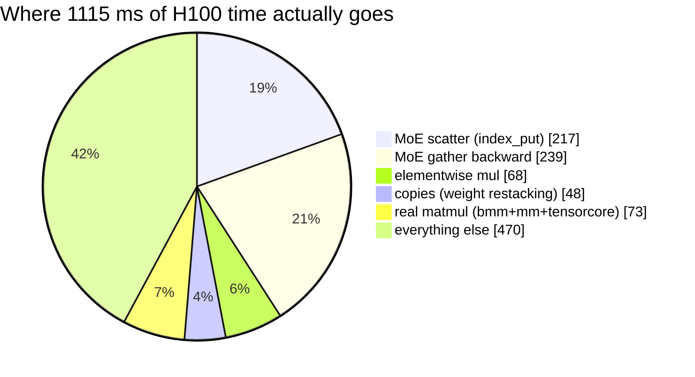

# 044 — Forty-five minutes on a real H100: everything worked, and the plan was wrong anyway

**Type:** experiment (first real GPU session) · **Date:** 2026-09-19

> **Full derivation:** [`docs/math/044-mfu-and-the-roofline.md`](../docs/math/044-mfu-and-the-roofline.md) — every
> derived number here (FLOPs/token, MFU, hours, profile shares) recomputed from the real model. Recomputing found one
> table row and two rounded figures that differ slightly from this entry; see that doc's Part 7.

> Everything below was measured on a rented NVIDIA H100 80GB HBM3
> (sm_90, driver 580.126.09, CUDA 13.0, torch 2.13.0+cu130) in RunPod's
> `AP-IN-1` datacenter, SECURE tier, for about 45 minutes at $3.49/hr —
> roughly **$2.60**. Entries 042 and 043 carried a banner saying every
> performance figure in them was a projection. This entry is where those
> projections meet hardware. Most of them did not survive.

## TL;DR

- **The port works.** `select_device` returns `cuda`, FlashAttention is
  enabled, bf16 autocast runs, **529/529 tests pass on GPU hardware**,
  checkpoints save, `latest.pt` resolves, resume continues, the WSD cooldown
  fires, generation produces text. Every artifact entry 041 built behaves
  on CUDA exactly as it does on MPS.
- **`check_capacity.py` under-reports memory by ~2x and says "FITS" for
  configurations that then OOM.** The plan's batch 64 × seq 1024 doesn't fit
  on an 80GB card — it isn't close. **Fixed in this entry**, and the six
  measurements are now regression tests.
- **MFU is 6.6%, not the 30% every estimate in entries 042-043 assumed.**
  The real run as planned would take ~9 hours and ~$32, not 2.15 hours and
  $7.
- **Profiling says why, unambiguously: ~43% of GPU time is MoE
  scatter/gather, and only ~7% is matmul.** The bottleneck is exactly where
  the plan guessed, but four times larger than it guessed.
- **`torch.compile` alone is worth 2.48x** (77,770 → 192,832 tok/s), which
  reframes Phases 4-6 from "optional if throughput is good enough" to the
  entire difference between a $32 run and a $14 one.
- **bf16 is 1.43x fp32** — the first time this project has measured that at
  all.

## Getting there: five things that bit

None of these are interesting engineering. All of them cost real minutes on
a billing clock, which is exactly why they belong in the journal.

**1. "HIGH availability" does not mean you can rent one.** The catalog
reported H100 SXM at HIGH overall, and `AP-IN-1` at MEDIUM. Two community
creates failed with *"There are no longer any instances available with the
requested specifications"* — including one targeting `AP-IN-1` explicitly.
SECURE tier succeeded immediately in the same datacenter, at $3.49/hr
instead of $2.69. Availability is a snapshot of a market, not a promise;
budget for the secure price and treat community as a discount you might get.

**2. The account had no SSH key registered.** `get-ssh-keys` returned `[]`.
RunPod injects registered keys into the container **at start**, so
discovering this after a pod is running means destroying it and paying for
another. Register first, verify with a read, then create.

Worth recording precisely because the API makes it easy to get wrong:
`update-ssh-keys` **replaces the entire set** rather than merging. It was
safe here only because the set was empty.

**3. `manim` blocks `uv sync` on a clean GPU box.** It's a hard dependency
in `pyproject.toml`, it needs `cairo.h`, and the build fails without
`libcairo2-dev` / `libpango1.0-dev` / `pkg-config`. Manim rendered the
visualization scenes. **Training never imports it.** A dependency that
exists to draw diagrams should not be on the critical path to a GPU that
bills by the second — it belongs in the `notebooks` group.

> *Later: rather than moving `manim` to a group, the project removed Manim
> and all its scene code entirely.*

**4. The image's torch is not the project's torch.** RunPod's PyTorch image
ships 2.8.0+cu128; `pyproject.toml` pins `torch>=2.13.0`. `uv sync` built
2.13.0+cu130 in its own venv and everything was fine — but it means the
base image choice is nearly irrelevant, and the sync is not instant.

**5. `get-pod` takes `id`, not `podId`.** A one-word mistake that cost a
round trip. The MCP server's error message named the expected key, which is
the only reason it cost one round trip and not five.

## What worked, verified rather than assumed

```
select_device("auto") = cuda
cuda: NVIDIA H100 80GB HBM3 (sm_90, 85.0GB) | flash sdp on | tf32 matmul 'high'
529 passed, 5 warnings in 198.88s
```

The test-suite result is the one I care about most. Entry 042 changed three
`select_device` tests *specifically because they patched only
`torch.backends.mps.is_available` and would therefore fail on a CUDA box* —
a prediction that could only be checked on a CUDA box. It checked out.

Training, checkpointing and resume, end to end:

```
step 10/30 | loss 3.9175 | 99,712 tok/s     <- bf16 autocast on CUDA
step 30/30 | loss 3.6430 | val_ppl 38.7476

checkpoints/
  latest.pt -> step_30.pt          (relative symlink)
  milestone_20.pt   1,123,129 B    (weights-only)
  step_20.pt        3,365,385 B    (full: weights + AdamW moments)
  step_30.pt        3,365,385 B
```

3,365,385 / 1,123,129 = 2.996 — the 12-bytes-vs-4-bytes-per-parameter rule
from entry 041, holding to three significant figures on a different
architecture.

Then resuming from that checkpoint:

```
total_steps changed across resume (30 -> 45): the learning-rate schedule has been
re-sized, so step 30 now sits at 66.7% of the schedule instead of 100.0%.
step 45/45 | loss 3.4573 | lr 6.00e-05 | val_ppl 32.7245
```

Loss continued falling across the boundary and the WSD cooldown engaged
(3.00e-04 → 6.00e-05). The guard fired, said what changed, and allowed it —
which is the behaviour entry 041 designed and this is the first time it has
run on hardware it wasn't written on.

Telemetry confirmed the 042 decision to add keys rather than rename them:

```
device                  cuda
device_allocated_bytes  71546880
device_reserved_bytes   138412032
mps_allocated_bytes     None        <- correctly absent, not zero
```

## Finding 1: the capacity estimator is ~2x optimistic, and it says FITS

`scripts/check_capacity.py --verify` estimates, then measures. Both numbers,
side by side:

| config | estimate | **measured peak** | ratio | verdict given |
| --- | ---: | ---: | ---: | --- |
| B=8 × 1024 | 18.81 GB | **33.26 GB** | 1.77x | FITS ✓ |
| B=16 × 1024 | 32.28 GB | **64.88 GB** | 2.01x | FITS ✓ |
| B=24 × 1024 | 45.74 GB | **OOM** | — | **FITS ✗** |
| B=32 × 512 | 28.25 GB | **58.27 GB** | 2.06x | FITS ✓ |
| B=48 × 512 | 39.70 GB | **OOM** | — | **FITS ✗** |
| B=64 × 256 | 26.24 GB | **51.09 GB** | 1.95x | FITS ✓ |

The ratio is strikingly consistent at 1.77-2.06x, which says this is a
missing factor rather than noise — the estimator models one copy of
something that exists twice, most likely the saved activations that both
forward and backward hold.

Two consequences:

**The plan's configuration was impossible.** Entry 042's target was batch 64
× seq 1024, justified by a hand-derived 44.5GB. The estimator puts that at
113.06 GB and the real ceiling is lower still. The largest working
configuration is **~16,384 tokens per micro-batch**, reachable three ways —
16×1024, 32×512, 64×256 — all landing between 51 and 65GB. Memory tracks
tokens, not the shape you arrange them in.

**A "FITS" verdict cannot currently be trusted.** That is worse than no
estimator, because entry 037 already established this machine class fails by
*hanging* rather than erroring cleanly, and a confident wrong answer is what
sends you into that. Until it carries the vocabulary term and a correction
factor, only `--verify` counted — which is what the fix below addresses.

## Finding 2: MFU is 6.6%, not 30%

Measured with `calibrate_throughput` — trustworthy only because entry 042
fixed `_synchronize` to call `torch.cuda.synchronize()`. Without that fix
every number in this table would have been the rate Python can enqueue work.

At vocab 4097, seq 1024, the per-token cost is

```
6 x 121,975,808 (active non-embedding)
+ 6 x   3,146,496 (tied lm_head)
+ 6 x 10 x 1024 x 768 (attention scores)
= 797,919,744 FLOPs/token
```

| config | tok/s | TFLOP/s | **MFU** | hrs for 2.69B | cost @ $3.49 |
| --- | ---: | ---: | ---: | ---: | ---: |
| B=8 × 1024 bf16 | 73,313 | 58.5 | 5.9% | 10.20h | $35.60 |
| B=16 × 1024 bf16 | 82,323 | 65.7 | **6.6%** | 9.08h | $31.69 |
| B=32 × 512 bf16 | 91,625 | 70.9 | 7.2% | 8.16h | $28.48 |
| B=64 × 256 bf16 | 100,504 | 80.2 | 8.1% | 7.44h | $25.96 |
| B=16 × 1024 **fp32** | 57,721 | 46.1 | 4.7% | 12.95h | $45.20 |

**bf16 is 1.43x fp32** (82,323 / 57,721). Entry 024 implemented bf16
autocast; `scripts/train.py` described it as "unmeasured on MPS"; it has now
been measured, on CUDA, and it is worth having.

Every hours-and-dollars figure in entries 042 and 043 was built on 30% MFU.
At the real number the run is **four to five times longer and costlier** than
those entries said.

## Finding 3: the profile, which makes the 6.6% obvious

Three steps at B=16 × seq 1024, 1115.2 ms of GPU time total:

| operation | self GPU | share | calls |
| --- | ---: | ---: | ---: |
| `aten::_index_put_impl_` | 241.46 ms | **21.7%** | 150 |
| `indexing_backward_kernel` | 212.62 ms | **19.1%** | 30 |
| `aten::mul` | 76.19 ms | 6.8% | 2040 |
| `aten::copy_` | 53.69 ms | 4.8% | 2721 |
| `indexing_backward_kernel` (2) | 26.31 ms | 2.4% | 60 |
| **`aten::bmm`** (the expert GEMMs) | 36.30 ms | **3.3%** | 360 |
| `aten::mm` | 33.77 ms | 3.0% | 729 |
| `nvjet_sm90…` (tensor-core GEMM) | 11.62 ms | 1.0% | 90 |



`_index_put_impl_` is `out.index_add_` at the end of `dispatch_batched`.
`indexing_backward_kernel` is the backward of the gather `x_flat[token_grid]`
that feeds the experts. Together: **~43% of all GPU time moving tokens to
and from experts.** The matmuls those tokens are being moved *for* come to
about **7%**.

An H100's tensor cores are idle roughly nine tenths of the time, waiting on
scatter/gather. That is the 6.6%, and it is not a mystery.

`aten::copy_` at 2,721 calls per three steps is the other predicted cost
showing up: `_stack_expert_weights` rebuilding the expert weight tensors on
every layer of every forward, which entry 042's plan costed at ~113MB per
layer per pass.

> **Term: scatter/gather.** MoE routing sends each token to a couple of
> experts out of many. Since tokens for one expert are scattered through the
> batch, the implementation *gathers* them into a contiguous block, does one
> matrix multiply, then *scatters* the results back. Real-world analogy:
> sorting a mailroom's post into per-street sacks, driving each sack to its
> street, then delivering. If the streets are short, you spend the day
> sorting and driving rather than delivering. Technically it is
> memory-bandwidth-bound indexing work, which tensor cores cannot help with
> — they only accelerate the multiply.

## Finding 4: `torch.compile` is worth 2.48x, today, unmodified

| | ms/step | tok/s | MFU | warmup |
| --- | ---: | ---: | ---: | ---: |
| eager | 210.7 | 77,770 | 6.5% | 1.3s |
| **`torch.compile(block.forward)`** | **85.0** | **192,832** | **15.6%** | 33.7s |

2.48x, for one line per block, *while Dynamo is still logging recompilations*
caused by the data-dependent `group_size` that Phase 5 exists to remove. The
compiler is fighting the dispatch and winning anyway.

At 192,832 tok/s the 2.69B-token budget is **3.88 hours, ~$13.53** — against
9.08 hours and $31.69 eager. One flag pays for the GPU session that
discovered it, ten times over.

Note this is compiling the **bound method** (`block.forward = torch.compile(...)`),
not the module. Entry 042's plan called that out: `torch.compile(model)`
returns an `OptimizedModule` whose `state_dict()` keys gain a `_orig_mod.`
prefix, which would silently break `save_checkpoint` and every existing
checkpoint. That detail held up in practice — checkpoints written under the
compiled model load fine.

## What this changes

The plan said Phases 4-6 were *optional if throughput turns out good enough*.
Throughput is not good enough, and the profile says the remaining work
targets exactly the right thing:

| phase | targets | measured share |
| --- | --- | ---: |
| 4 — fused expert weights | `aten::copy_` restacking | ~4.8% + backward |
| 5 — fixed-capacity dispatch | `index_put` + `indexing_backward` | **~43%** |
| 6 — `torch.compile` | everything, and 5 removes its recompiles | **2.48x proven** |

Revised plan for the real run:

1. **Land Phases 4-6.** No longer optional.
2. **Re-measure in one short session** before committing. The lesson of this
   entry is that a 45-minute, $2.60 measurement invalidated a plan built on
   careful-looking arithmetic.
3. **Configuration: batch 16 × seq 1024**, not 64 × 1024. That keeps the
   planned context length, sits at a measured 64.88GB, and reaches the
   planned 65,536-token effective batch through `--grad-accum-steps 4`.
   B=8 × 1024 at 33.26GB is the safer fallback if fused experts change the
   memory profile.
4. **Fix `check_capacity.py`** — vocabulary term plus the ~2x factor — or
   stop quoting its verdicts.
5. **Move `manim` to the `notebooks` dependency group.** *(Superseded: Manim was removed from the project entirely.)*

## The one fix that landed with this entry

`check_capacity.py` is recalibrated, because an estimator whose FITS verdict
OOMs is worse than none at all:

- `_ACTIVATION_BACKWARD_FACTOR = 2.2`, the measured gap above.
- A logits term (`tokens x vocab x 4 x 3`), previously absent entirely.
- `_CUDA_USABLE_FRACTION = 0.90` — CUDA's `mem_get_info` free figure is every
  byte on the card, and B=48/S=512 OOMed at an estimated 97% of it.

Against the six measured configurations:

| config | new estimate | measured | error | verdict |
| --- | ---: | ---: | ---: | --- |
| B=8 × 1024 | 35.42 GB | 33.26 GB | +6.5% | FITS ✓ |
| B=16 × 1024 | 65.45 GB | 64.88 GB | **+0.9%** | FITS ✓ |
| B=24 × 1024 | 95.47 GB | OOM | — | DOES NOT FIT ✓ |
| B=32 × 512 | 56.59 GB | 58.27 GB | −2.9% | FITS ✓ |
| B=48 × 512 | 82.18 GB | OOM | — | DOES NOT FIT ✓ |
| B=64 × 256 | 52.16 GB | 51.09 GB | +2.1% | FITS ✓ |

**All six classify correctly**, and the estimate errs high on four of six,
which is the right direction for a capacity check.

The constants are fitted to one GPU and one architecture. That is a real
limitation and it is stated rather than hidden — but a factor consistent
across a 2x range of batch and a 4x range of sequence length is a better
basis than the MPS-derived constant it replaces.

## Tests

**12 added, 1 changed (541 passing, was 529).** The entry's measurements are
themselves now a test — every number came from
running the existing suite and existing scripts (`check_capacity.py`,
`calibrate_throughput`, `scripts/train.py`, `scripts/generate.py`) on
hardware they had never touched. The suite stands at **529 passing on both
MPS and CUDA**, which is itself the entry's most reassuring result.

## Questions that might come to mind

**Is 6.6% MFU unusually bad?** For a dense model that size, yes,
embarrassingly. For a 337M-parameter MoE with 8 experts at top-2 on an H100,
less so — the model is small enough that per-expert GEMMs are modest and the
routing overhead is fixed regardless. Published MoE training runs report
30-50% MFU at far larger scale, where the expert matmuls are big enough to
dominate the routing. The gap is a statement about this model's size
relative to this GPU, not only about the implementation.

**Then is the H100 simply the wrong GPU?** Partly, and that is worth
stating: a 125M-active-parameter model underfills it badly. But the fix is
not a smaller GPU — at 15.6% MFU post-compile the H100 is still the cheapest
route to the finished model, because it finishes in a third of the time for
roughly twice the hourly rate.

**Why does batch 64 × seq 256 beat batch 16 × seq 1024 on throughput?**
Shorter sequences mean cheaper attention (the score matrix is quadratic in
sequence length), so more of the budget goes to the MLP. It is 21% faster —
and it is *not* the recommendation, because entry 042 chose seq 1024
deliberately: at seq 256 the model sees ~880 characters of context, which is
a worse model for a marginal throughput gain.

**Could the estimator's 2x be the caching allocator rather than real usage?**
`--verify` reads `torch.cuda.max_memory_allocated()`, which is allocated
tensor bytes, not reserved pool. So no — the 64.88 GB is real tensors. The
reserved figure would be higher still.

**Was the pod actually destroyed?** Yes — `delete-pod` returned OK and a
follow-up `list-pods` returned zero pods. Worth verifying with a read rather
than trusting the write, on anything that bills per second.
