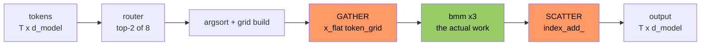
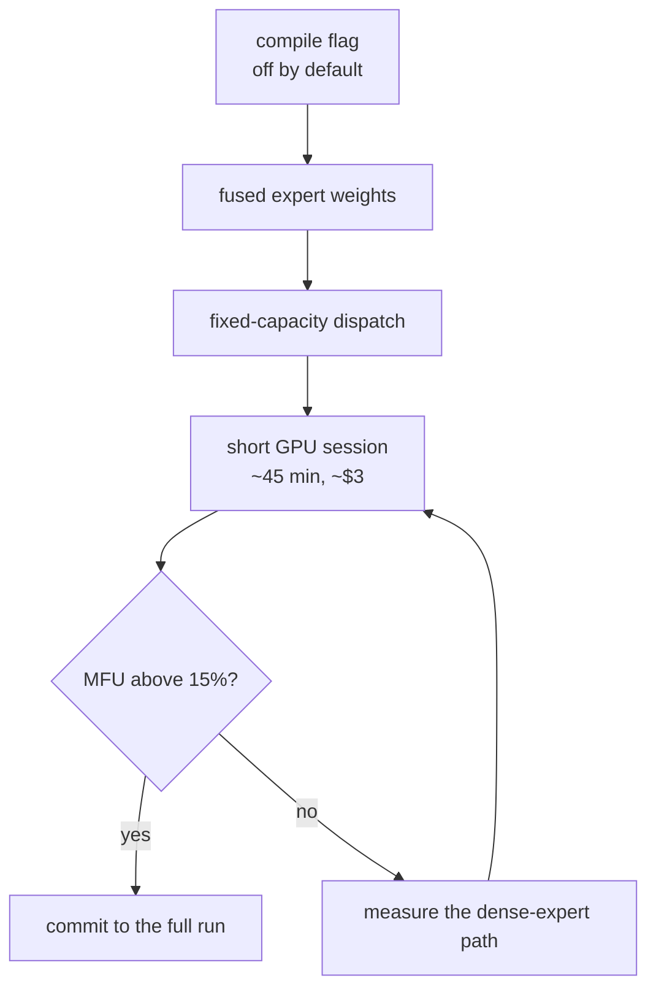

# 045 — What to optimize next, and why it isn't the model size

**Type:** plan / decision (direct follow-up to 044) · **Date:** 2026-09-19

> **Full derivation:** [`docs/math/044-mfu-and-the-roofline.md`](../docs/math/044-mfu-and-the-roofline.md) (Parts 4–6) —
> the roofline, the capacity-factor tail and the dense-expert trade, recomputed and verified.

> **This entry ships no code.** It is the decision record for what entry 044's
> profile implies, written before the work rather than after it. Every figure
> is labelled **measured** (from 044's H100 session) or **estimated**
> (arithmetic performed here and not yet run on hardware). Entry 044's own
> lesson is that this project's estimates have been wrong by 8.6x, 4.5x and
> 2x in consecutive entries, so the estimates below are worth exactly what
> those were.

## TL;DR

- The obvious reading of "6.6% MFU" is *the model is too small for the GPU,
  so make it bigger*. **That reading is wrong**, and the profile says so:
  the matmuls are already running at a large fraction of peak. They are just
  **~7% of the wall clock**.
- Deriving the roofline gives the sharp version: the MoE permutation moves
  **5.28 GB/step**, which at the H100's 3.35 TB/s should take **1.58 ms**.
  It takes **91 ms** — **~58x off bandwidth peak**. The dispatch is not
  expensive because of how much data it moves. It is expensive because
  `index_put` uses atomics and advanced-indexing backward sorts.
- Worse: at **2,304 FLOP/byte** the expert FFN sits **7.8x past this GPU's
  ridge point**. It is a theoretically compute-bound workload running
  memory-bound at 1/58th of memory peak. That gap is the entire opportunity.
- Ranked work: `torch.compile` (**2.48x, measured**), fused expert weights,
  fixed-capacity dispatch, and a cheaper permutation kernel. Target
  **6.6% → 20-25% MFU**, *estimated*.
- One option could make most of that unnecessary: with only 8 experts at
  top-2, **running every expert densely** costs +20.9 TFLOP/step to delete
  91 ms of indexing. Worth one measurement before building anything.
- **MFU is the wrong objective.** The dense path would improve wall clock
  ~1.45x while *useful*-FLOP MFU rises only 6.3% → 9.1%.
- **541 tests, unchanged** — no code in this entry.

## The question this entry answers

After 044 the natural next move is to scale up. A 125M-active model
underfills an H100; bigger models report 30-50% MFU; therefore make the
model bigger. Entry 044's own "Questions that might come to mind" section
half-endorses this, saying the gap is "a statement about this model's size
relative to this GPU, not only about the implementation."

That is true and it is not actionable, for two reasons — one of which is
already in this repo's own notes.

**First, the data does not exist.** Entry 042 worked this out: inverting
Chinchilla on a 6-hour budget suggests ~231M active parameters, but a
274M-active model's floor is 5.5B tokens = **6.2 epochs** over one FineWeb-Edu
shard, past the 4-epoch repetition threshold `epochs_for_budget` warns at
(Muennighoff et al. 2023). Scaling up needs a second shard before it needs
anything else.

**Second, and more fundamental: MFU is a ratio, and scaling the model buys
the numerator with money.** You can reach 40% MFU today by training a dense
7B model. It would cost vastly more to reach the same loss. The quantity
that matters is **loss per dollar**, and MFU is a diagnostic pointing at
where the dollars leak — not a thing to maximize.

So the question becomes: *where exactly are they leaking?*

## Deriving the roofline

> **Term: arithmetic intensity.** How much arithmetic a piece of code does
> per byte it moves from memory, in FLOP/byte. It exists because on modern
> hardware, moving data is far more expensive than computing on it — an H100
> can do ~295 floating-point operations in the time it takes to fetch one
> byte from HBM. **Real-world analogy:** a chef's ratio of cooking time to
> shopping time. A stew simmered for three hours from one bag of groceries
> has high intensity; making one sandwich per shopping trip has terrible
> intensity, and you will spend your day in traffic no matter how fast you
> can chop. **Technically:** total FLOPs performed divided by total bytes
> read plus written. **In this project:** it is the number that decides
> whether the MoE dispatch *should* be slow, which turns out to be the whole
> argument of this entry.

> **Term: the roofline model.** A one-picture performance model
> ([Williams, Waterman & Patterson, 2009](https://dl.acm.org/doi/abs/10.1145/1498765.1498785)):
> plot attainable FLOP/s against arithmetic intensity, and every kernel is
> capped by a slanted line (memory bandwidth) rising to a flat line (compute
> peak). Where the two meet is the **ridge point** — the intensity at which
> a machine stops being memory-limited. It exists to answer "is this code
> slow because of the maths or because of the memory?" without guessing.
> **Real-world analogy:** a delivery van's capacity versus the road speed
> limit. Below a certain load per trip you are limited by driving; above it,
> by how much fits in the van. **In this project:** it converts 044's
> profile percentages into a verdict about *why* they are what they are.

### The derivation

Let `T` = tokens per micro-batch, `k` = top_k, `E` = experts, `d` = `d_model`,
`L` = layers, `b` = bytes per element. Each token is routed to `k` experts, so

$$
P = T \cdot k
$$

dispatch pairs exist. The permutation does two things per layer, forward:

1. **Gather** `xg = x_flat[token_grid]` — reads `P·d` elements and writes
   `P·d` elements: `2·P·d·b` bytes.
2. **Scatter** `out.index_add_(0, ...)` — reads `P·d` elements and accumulates
   into `T·d`: `(P + T)·d·b` bytes.

Per layer, forward:

$$
B_{\text{fwd}} = (2P + P + T) \cdot d \cdot b = (3P + T) \cdot d \cdot b
$$

The backward pass has a counterpart for each (the gather's backward is a
scatter, the scatter's backward is a gather), so across forward and backward
the traffic is approximately `3×` the forward figure. Over `L` layers:

$$
B_{\text{step}} = 3 \cdot L \cdot (3P + T) \cdot d \cdot b
$$

Time at the memory roof is `B_step / BW`, where `BW` is HBM bandwidth.

### Worked numeric example

Using the measured configuration — `T` = 16,384 (batch 16 × seq 1024),
`k` = 2, `d` = 768, `L` = 10, `b` = 2 (bf16), `BW` = 3.35e12 B/s:

```
P            = 16,384 × 2                        =      32,768 pairs
3P + T       = 98,304 + 16,384                   =     114,688
× d          = 114,688 × 768                     =  88,080,384 elements
× b          = 88,080,384 × 2                    = 176,160,768 B  (176.2 MB/layer/fwd)
× L          = 176,160,768 × 10                  =   1.7616 GB
× 3          = 1.7616 × 3                        =   5.285 GB/step

at HBM peak  = 5.285e9 / 3.35e12                 =   1.578 ms
measured     = 0.432 × 210.7 ms                  =  91.0 ms      <- 044's profile
ratio        = 91.0 / 1.578                      =  57.7x
```

**The permutation runs at roughly 1.7% of this GPU's memory bandwidth.**

Note the `3×` backward multiplier is an **empirically-motivated constant**,
not exact arithmetic — it is the same class of estimate as entry 044's
recalibrated `_ACTIVATION_BACKWARD_FACTOR = 2.2`, and the honest statement is
that the true figure is somewhere between 2 and 4. At the low end the ratio
is 87x; at the high end, 43x. The conclusion survives the whole range, which
is the only reason it is safe to act on.

### The part that makes it damning

Now the intensity of the work the permutation exists to enable. One
token-expert pair moves `2·d·b` bytes (in and out) and earns three
`d × d_ff` matrix multiplies (SwiGLU's `w_gate`, `w_up`, `w_down`):

$$
I = \frac{3 \cdot 2 \cdot d \cdot d_{\text{ff}}}{2 \cdot d \cdot b}
  = \frac{3 \cdot d_{\text{ff}}}{b}
$$

```
I            = 3 × 1536 / 2                      = 2,304 FLOP/byte
ridge point  = 989e12 / 3.35e12                  =   295 FLOP/byte
              2304 / 295                         =   7.8x past the ridge
```

The expert FFN is **7.8x past the point where an H100 stops being
memory-limited**. In theory it is solidly compute-bound. In practice it is
spending 43% of its time memory-bound, at 1/58th of memory peak.

That is not a hardware limit and it is not a model-size problem. It is a
kernel problem, and kernel problems have fixes.

## Where the time goes



Orange is ~43% of GPU time. Green is ~7%. Everything the model is *for*
happens in the green box.

> **Term: scatter/gather.** Repeated from 044 because this entry turns on it.
> MoE routing sends each token to a couple of experts out of many. Since one
> expert's tokens are scattered through the batch, the implementation
> *gathers* them into a contiguous block, does one matrix multiply, then
> *scatters* the results back. **Real-world analogy:** sorting a mailroom's
> post into per-street sacks, driving each sack to its street, then
> delivering. If the streets are short, the day goes on sorting and driving
> rather than delivering.

## The ranked work

| Change | Targets | Measured share | Status |
| --- | --- | ---: | --- |
| `torch.compile(block.forward)` | everything | **2.48x proven** | measured |
| Fused expert weights | `aten::copy_` restacking | ~4.8% + backward | estimated |
| Fixed-capacity dispatch | `index_put` + `indexing_backward` | **~43%** | estimated |
| Cheaper permutation kernels | the same ~43%, differently | **~43%** | estimated |

### 1. `torch.compile` — measured, 2.48x

| | ms/step | tok/s | MFU | warmup |
| --- | ---: | ---: | ---: | ---: |
| eager | 210.7 | 77,770 | 6.5% | 1.3s |
| `torch.compile(block.forward)` | **85.0** | **192,832** | **15.6%** | 33.7s |

3.88 hours and ~$13.53 for the 2.69B-token budget, against 9.08 hours and
$31.69. Measured **while Dynamo was still logging recompilations** caused by
the data-dependent `group_size`, so this is a floor.

Compile the **bound method**, never the module — `torch.compile(model)`
returns an `OptimizedModule` whose `state_dict()` keys gain a `_orig_mod.`
prefix, silently breaking `save_checkpoint` and every checkpoint on disk.
Entry 042's plan predicted this and 044 confirmed it in practice.

### 2. Fused expert weights

`_stack_expert_weights` re-materializes ~113MB of expert weights per layer
per forward via `torch.stack`, plus a matching backward — ~1.1GB of pure copy
each way per micro-batch, and the 2,721 `aten::copy_` calls in 044's profile.
Replace with `FusedExperts` holding `nn.Parameter(E, d_ff, d_model)`.

Keep the **legacy per-expert format canonical** via a `state_dict` hook, so
every existing checkpoint keeps working with no migration script and new
checkpoints stay readable at old commits. For a repo whose premise is that
old journal entries stay reproducible, that property is worth ten lines.

### 3. Fixed-capacity dispatch

The grid becomes a static `(E, C)` with
`C = ceil(capacity_factor · top_k · n_tokens / E)` — a Python int from
**shapes only**, never from data. Rank within expert via
`one_hot(pair_expert).cumsum(0)`; mask `rank >= C` to drop.

This is the trade the project has been avoiding since entry 027 chose the
dropless path. The quantified version:

> **Term: capacity factor.** In a fixed-capacity MoE, each expert gets a
> fixed number of slots per batch, and tokens arriving after the slots fill
> are *dropped* — they skip the expert entirely and pass through on the
> residual. The capacity factor is how many slots each expert gets relative
> to its fair share. It exists because GPUs want static shapes, and "however
> many tokens happen to route here" is not one. **Real-world analogy:** a
> restaurant that seats exactly 40 covers per sitting regardless of how many
> turn up. Introduced in
> [GShard (Lepikhin et al., 2020)](https://arxiv.org/abs/2006.16668) and
> [Switch Transformers (Fedus, Zoph & Shazeer, 2021)](https://arxiv.org/abs/2101.03961);
> [MegaBlocks (Gale et al., 2022)](https://arxiv.org/abs/2211.15841) is the
> dropless alternative this project currently implements.

Under balanced routing, per-expert pair counts are `~Binomial(P, 1/E)`:

```
mean  mu    = P / E        = 32,768 / 8              = 4,096
sd    sigma = sqrt(P · (1/E) · (1 - 1/E))
            = sqrt(32,768 × 0.125 × 0.875)            = 59.9
cf 1.25 => capacity 5,120  => (5120 - 4096) / 59.9    = 17.1 sigma
cf 1.05 => capacity 4,301  => (4301 - 4096) / 59.9    =  3.4 sigma
```

At a capacity factor of 1.25 a drop requires a **17-sigma** fluctuation. The
published "dropping hurts quality" results come from per-device batches of a
few thousand tokens, where `sigma/mu` is an order of magnitude worse. Drops
here are effectively zero unless routing genuinely collapses — which is
something you want surfaced anyway.

Bonus: capacity **bounds** activation memory. Today `group_size = max(counts)`
grows toward `E × P` under a collapsed router, a latent OOM with no defence.

### 4. Cheaper permutation kernels

Even with static shapes, *how* the permutation is written decides whether the
58x gap closes. `x_flat[token_grid]` is advanced indexing, whose backward is
the sort-based `indexing_backward_kernel`; `out.index_add_` uses atomics for
duplicate indices. With a static layout these become `index_select` (a
coalesced copy) and `scatter_add` into a pre-sized buffer.

Given the roofline above, **this is where most of the 43% should actually
fall** — the other three changes remove work, this one makes the remaining
work run at a sane fraction of bandwidth. **Estimated.**

## The option that might make most of this unnecessary

With `E` = 8 and `k` = 2 the sparsity factor is only 4x. So you can run
**every** expert on **every** token and mask the result — paying 4x the routed
FFN FLOPs and deleting the permutation entirely.

```
routed FFN FLOPs/token/layer (fwd+bwd) = 6 × k × 3 × d × d_ff
                                       = 6 × 2 × 3 × 768 × 1536 = 42,467,328
× T × L        = 42,467,328 × 16,384 × 10        =  6.96 TFLOP/step
dense (E/k=4x) = 6.96 × 4                        = 27.83 TFLOP/step
extra          = 27.83 - 6.96                    = 20.87 TFLOP/step

added time @ the observed GEMM rate (~850 TF/s)  =  24.6 ms
added time @ half that rate       (~425 TF/s)    =  49.1 ms
permutation time deleted                         = -91.0 ms
```

Even on the pessimistic row this trades **50 ms of tensor-core work for 91 ms
of indexing**, and it removes the data-dependent shape, so `torch.compile`
gets a clean graph without the fixed-capacity rewrite at all.

**Costs.** The `(T, E, d_ff)` intermediate is 4x today's, and memory is
already the binding constraint at 16,384 tokens per micro-batch. And it only
works at small `E` — at 64 experts it is absurd, so it is a decision that
does not survive scaling the architecture.

**This is a hypothesis, not a result**, and it is the first thing to measure.

It is also the cleanest demonstration that MFU is the wrong objective: this
change would improve wall clock ~1.45x while *useful*-FLOP MFU rises only
**6.3% → 9.1%**, because it deliberately performs wasted FLOPs at high
efficiency instead of no FLOPs at terrible efficiency. Optimize for tokens
per dollar.

## Smaller items, nearly free

- **Vocabulary 4,097 → 16,384.** Already planned for tokenizer reasons, but
  it is a throughput item too: **4,097 is not a multiple of 8**, so the
  `lm_head` GEMM misses tensor-core alignment entirely. 16,384 = 128×128.
- **bf16.** **Measured at 1.43x fp32** (82,323 vs 57,721 tok/s). Already
  wired; no `GradScaler`, since bf16 shares fp32's exponent range.
- **Drop `mmap=True`** on CUDA in `scripts/train.py`. Random offsets across a
  4GB mmap with a cold page cache means a page fault per window on the
  training thread. It was a 24GB-Mac accommodation (entry 040); a GPU box has
  RAM to spare.
- **Move `manim` to the `notebooks` group.** *(Superseded: Manim was removed from the
  project entirely.)* Entry 044's finding: a hard
  dependency needing `cairo.h` that training never imports, blocking
  `uv sync` on a machine billing by the second.

## Deliberately not doing

| Option | Why not |
| --- | --- |
| **fp8** | H100 doubles to ~1,979 TFLOP/s in fp8. Worth nothing at 6.6% MFU — you are not matmul-bound. Revisit above ~30%. |
| **Scaling the model up** | Buys MFU with dollars, and needs a second FineWeb-Edu shard to stay under 4 epochs. |
| **`mode="max-autotune"`** | Standard-shaped large GEMMs where cuBLAS is near-optimal. A/B it; don't assume 5-10% beats 10-20 min of compile. |
| **`mode="reduce-overhead"` (CUDA graphs)** | Needs static input addresses. DataLoader tensors break it, and `self.last_expert_counts = ...` is a buffer mutation. |
| **Multi-GPU** | Doesn't raise MFU. It adds GPUs to a problem that is one GPU running at 7%. |
| **DataLoader workers / `pin_memory`** | Worth <1%: ~1.0MB per micro-batch over PCIe against a ~170ms step. Four lines, so do it — but not as an optimization. |

## Risks that fail silently

Ranked by how quietly they go wrong. Every one produces a worse model with no
traceback.

1. **Residual downscaling misses the fused experts.**
   `_RESIDUAL_PROJ_SUFFIXES` matches `name.endswith("w_down.weight")`; a fused
   parameter is named `...routed_experts.w_down` — no `.weight` suffix — so
   every routed expert silently loses its `1/sqrt(2·n_layers)` init scaling.
   This looks like "the run is just a bit worse".
2. **Muon silently downgrades to AdamW.** `split_muon_adamw_params` selects on
   `ndim == 2`; fused expert params are 3-D. Not blocking for this run, which
   uses AdamW — but it breaks the ablation study.
3. **Weight init skips `FusedExperts`.** `self.apply(self._init_weights)` only
   matches `nn.Linear`/`nn.Embedding`. Needs an explicit `reset_parameters()`.
4. **Indexing helpers break on the new type.** `count_params`,
   `forward_with_trace`, `export_trace.py` and the viz scenes all index
   `routed_experts`, so `FusedExperts` must keep `__len__`/`__iter__`/`__getitem__`.
5. **Idle experts become weight-decayed.** Today a zero-token expert gets no
   gradient and AdamW skips it; under fixed capacity it gets a zeros grad and
   *is* decayed. At 16,384 tokens and E=8 a zero-token expert is effectively
   impossible, so this is a change in principle rather than practice — but it
   belongs here rather than in a later bug hunt.

Bit-exactness with the MPS baseline is **not** preservable and is not the
goal (`index_add_` reduction order, bf16 vs fp32, flash reassociation). What
*is* testable: on CPU in fp32 with a non-binding capacity factor, the new
dispatch must match the old within the existing `atol=1e-5`.

## Sequencing



Everything before the GPU session is testable on CPU and MPS, where the suite
stands at 541 passing.

**On the GPU, in order:** (1) suite green — it was 529/529 last time, the
cheapest signal that nothing regressed; (2) `check_capacity.py --verify`
across the batch/seq grid, which fixes `batch_size` and `seq_len` since both
are fingerprint-locked; (3) `calibrate_throughput` → measured MFU;
(4) 200-step loss-curve agreement against the MPS baseline at the same seed
and shape, the only check that catches a silent flash-SDPA, bf16 or
router-dtype bug before hours are spent; (5) A/B the dense-expert path.

**The gate before the full run:** capacity verified at the chosen shape,
measured MFU implying an acceptable wall clock, and the 200-step curves
tracking the baseline within noise.

| Stage | MFU | Hours for 2.69B | Cost @ $3.49/hr | Confidence |
| --- | ---: | ---: | ---: | --- |
| today | 6.6% | 9.08 | $31.69 | **measured** |
| + `torch.compile` | 15.6% | 3.88 | $13.53 | **measured** |
| + the dispatch work | 20-25% | 2.4-3.0 | $8-10 | *estimated* |

## Tests

**None added; 541 passing, unchanged.** This entry ships no code. It is
recorded because the repo's convention is that decisions get entries, and
because the reasoning above is the thing most likely to be wrong — better to
have it written down before the measurement than reconstructed after it.

## Questions that might come to mind

**If the GEMMs are at 86% of peak, why is whole-step MFU only 6.6%?** Because
MFU divides useful FLOPs by *wall-clock* time, and 93% of the wall clock is
not GEMM. The two numbers are consistent: `0.073 × 86% ≈ 6.3%`. That is the
entire finding in one line.

**Is the 86% figure trustworthy?** Not as a precise number. It comes from
attributing all 13.07 TFLOP of step work to three named kernels, and some
matmul time certainly lands in kernels counted elsewhere, which would push the
real figure down. The claim that survives is the weak one, and it is enough:
the GEMMs are not the bottleneck.

**Why does 3x appear as the forward-to-total traffic multiplier?** Because the
gather's backward is a scatter and the scatter's backward is a gather, so each
forward op has one backward counterpart of comparable traffic, plus the
forward itself. It is a modelling choice, not a derivation, which is why the
entry states the 2-4 range and checks the conclusion across all of it.

**If drops are a 17-sigma event, why log the drop rate at all?** Because the
binomial argument assumes *balanced* routing, and the thing most likely to
break that assumption is router collapse — exactly the failure the drop rate
would announce. The statistic is cheap insurance against the one case where
the statistic's own premise is false.

**Isn't running all 8 experts just abandoning the point of MoE?** For
*training throughput* on one GPU at E=8, possibly yes, and that is worth
saying plainly. MoE's win is that inference and larger-scale training only
touch `k` of `E` experts; at E=8 the ratio is small enough that the dense path
may be faster to train while the trained model still routes sparsely at
inference. It stops being viable the moment `E` grows, which is the reason to
treat it as a measurement rather than a design.

**Why write a plan entry at all, rather than just doing the work?** Entry 044
invalidated a carefully-argued plan for $2.60. The value of writing the
reasoning down first is that when the next session contradicts it, the
contradiction is legible — which is how 042's projections became 043's counts
and 044's measurements.

## References

- [Roofline: An Insightful Visual Performance Model for Multicore
  Architectures (Williams, Waterman & Patterson, 2009)](https://dl.acm.org/doi/abs/10.1145/1498765.1498785)
  — the FLOP/byte-vs-attainable-FLOP/s model this entry derives.
- [MegaBlocks: Efficient Sparse Training with Mixture-of-Experts (Gale,
  Narayanan, Zaharia & Blalock, 2022)](https://arxiv.org/abs/2211.15841) —
  block-sparse dropless MoE; the approach entry 027 followed.
- [GShard (Lepikhin et al., 2020)](https://arxiv.org/abs/2006.16668) —
  introduced expert capacity and token dropping.
- [Switch Transformers (Fedus, Zoph & Shazeer, 2021)](https://arxiv.org/abs/2101.03961)
  — capacity factor as a tunable quality/throughput trade-off.
- [Scaling Data-Constrained Language Models (Muennighoff et al., 2023)](https://arxiv.org/abs/2305.16264)
  — the 4-epoch repetition threshold that rules out scaling this model up.
